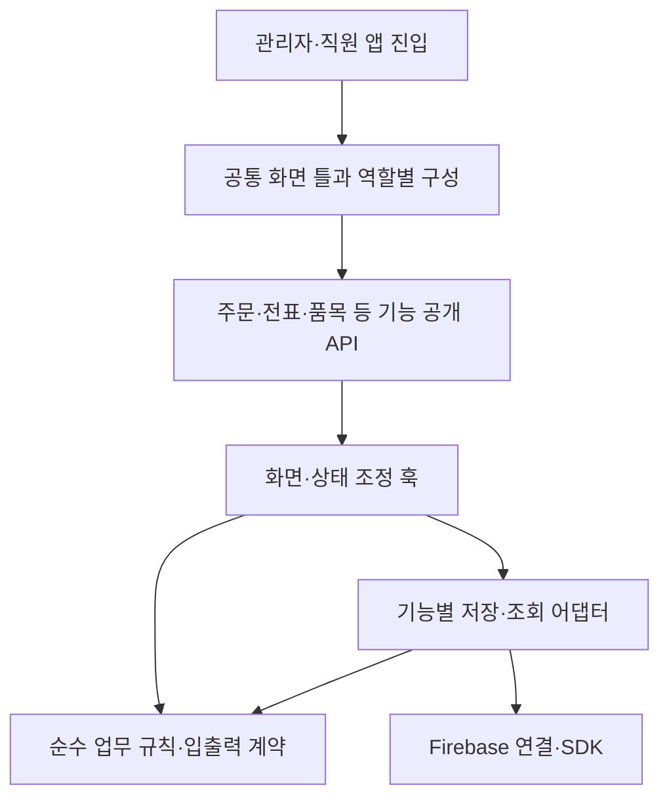

# 앱 전체 코드 모듈화 설계

기준 소스: `9565b05696a52022d3ac4a8f8018f11d7eadfd5c`, 2026-10-17. 사용자 요청에 따라 실제 코드 구조와 import를 조사한 설계다. 최초 산출물은 분리 경계·첫 적용 묶음·검증 계획이다. 이후 사용자 승인으로 첫 구현과 공통 UI 정리를 시작했다. 아래 최초 계획과 후속 적용 결과를 구분하며 앱 전체 모듈화 완료를 뜻하지 않는다. 운영자료는 변경하지 않는다.

## 현재 문제와 유지할 구조

Git 추적 중 `components/src/apps/functions/src`와 루트 타입 facade의 제품 TS/TSX를 집계했다. 시험·`src/test`·스크립트·설정 JS·생성물·의존 패키지를 제외한 기준은 509파일·99,110줄이다. 줄 수는 위험 우선순위의 단서이며 파일 크기만으로 결함을 판정하지 않는다.

| 현재 파일 | 줄 수 | 우선 분리할 책임 |
| --- | ---: | --- |
| `src/features/admin/AdminApp.tsx` | 5,441 | 메뉴/화면 틀과 기능별 업무 조정 |
| `components/HaccpChecklist.tsx` | 4,685 | 점검표 종류별 입력·출력과 저장 조정 |
| `components/OrdersList.tsx` | 4,538 | 목록/카드 표시·검색과 주문 처리 |
| `components/ItemList.tsx` | 4,122 | 재고/로트 표시·입고/실사 조정 |
| `components/TradeStatement.tsx` | 3,124 | 날짜/목록/상세/실패 작업과 작성 조정 |
| `components/ItemManager.tsx` | 2,075 | 품목 편집·거래처 연결·단위 표시 |
| `src/shared/types.ts` | 1,700 | 공통 계약과 기능 소유 타입 |
| `src/shared/services/firebaseService.ts` | 1,103 | 공통 조회와 기능별 저장 명령 |

동일 집합의 상대 import·타입 참조·재수출·문자열 dynamic import를 정적으로 연결한 파일 간 의존은 2,028개다(외부 패키지 제외). AdminApp의 직접 상대 의존151개, TradeStatement86개, firebaseService의 소비 파일40개, 공통 types 소비 파일235개가 확인됐다. 앱에서 서버 원본으로의 참조52개와 역방향0개는 현재 해석된 정적 경로의 수치이며 전체 순환 부재의 증명이 아니다. 계산된 동적 경로와 전체 SCC 순환 분석은 이번에 수행하지 않았다.

- 직원 `StaffApp`도 `AdminApp`을 `isAdmin=false`로 사용한다. 관리자·직원 코드를 복사하면 공통 동작과 수정이 다시 갈라진다. 공용 화면 틀에 역할별 구성을 주입하는 방향으로 분리한다.
- `AdminApp`에는 메뉴·권한별 화면 선택·알림·모달과 주문/전표 처리 조정이 함께 있다. 상태 전체를 큰 Context로 옮겨 파일 길이만 줄이지 않는다. 구독 수명과 회사·사용자 경계를 먼저 드러낸다.
- `firebaseService`에는 조회, 일반 CRUD, 기초잔액, OEM, 입고, 주문 원료 작업의 원자 처리까지 섞여 있다. 읽기와 도메인별 명령을 분리하되 원자 트랜잭션을 여러 호출로 쪼개지 않는다.
- `src/features/statements`에는 이미 `domain/hooks/infrastructure/ui`가 있다. 품목·생산서류·세금서류도 기존 기능 경계를 우선 재사용한다. 새 폴더 체계를 병렬로 하나 더 만들지 않는다.
- `types.ts`와 `src/services/firebaseService.ts`는 기존 경로 호환 재수출이다. 현재 호출자를 한 번에 바꾸지 않고 새 공개 경로를 점진 적용한다.
- 최근 챗봇의 화면·서버 지식 분리 누락처럼 같은 업무 규칙을 서로 다른 원본으로 관리하지 않는다. 단위·원료·금액 산식은 기존 공용 원함수를 그대로 사용한다.

대표 재사용 원본은 `statementLines`의 전표 행/합계, `purchaseUnit`의 단위 스냅샷, `day`의 날짜 정책, `orderProductionRecordPlan`의 생산 근거 계획, `inventoryWriterProtocol`의 원자 writer, `orderInventoryGeneration`의 작업 세대, `tradeStatementPending`와 복구 서비스, `financialOpeningCommands`의 기초 명령이다. 모듈화 중 동일 계산을 새로 구현하지 않는다. 복제 계산을 발견해도 원본 선택과 산식 변경은 별도 검증 작업으로 분리한다. 예를 들어 이름이 같은 stripUndefined도 JSON 왕복 방식과 재귀 제거 방식의 SDK 값 보존 의미가 다를 수 있으므로 이름만으로 통합하지 않는다.

## 목표 의존 방향

| 경계 | 소유 책임 | 금지하는 의존 |
| --- | --- | --- |
| `apps/admin`, `apps/staff` | 시작·인증·회사 선택·provider 조립 | 개별 전표/원료 산식 직접 구현 |
| 공통 화면 틀 | 메뉴·화면 선택·알림·챗봇·역할별 구성 | 기능 내부 저장 로직 직접 구현 |
| 기능 `ui` | 표시·입력·사용자 동작 전달 | 임의 SDK 쓰기, 다른 기능 내부 파일 접근 |
| 기능 `hooks` | 화면 수명·비동기 상태·취소·복구 조정 | 회사/UID 변경 뒤 이전 응답 재사용 |
| 기능 `domain` | 순수 계산·검증·DTO·상태 전이 | React, Firebase, 브라우저 API, 서비스 import |
| 기능 `infrastructure` | SDK/callable·원문 보관·조회·영수증 연결 | 화면 틀·AdminApp·상위 서비스 재수입 |
| `shared` | 실제 공용 기본 부품·순수 규칙·연결 기반 | 특정 기능의 모든 상태나 임의 업무 로직 수용 |

공통 화면 틀은 초기 추출에서는 기존 admin 경로를 유지하고, 역할별 조립과 테스트를 확보한 뒤 `src/features/app-shell`로 이동한다. 신규 기능은 필요한 층만 만든다. 기능 간 호출은 명시한 공개 파일의 컴포넌트·DTO·순수 함수만 사용한다. 모든 내부 파일을 재수출하는 큰 barrel은 만들지 않는다.

## 공개 API와 호환 방식

첫 추출은 함수 인자·반환형·콜백 순서·예외·구독 해지·기존 import 경로를 유지한다. 기존 파일은 새 원본을 명시 재수출하고, 새 원본이 호환 파일을 역수입하지 않도록 한다. 이후 소비자를 기능별 공개 경로로 옮긴 뒤 실제 참조가 없어졌을 때만 호환 파일을 제거한다.

거대한 공통 타입을 한 번에 분할하지 않는다. 새 모듈의 소유 DTO부터 `import type`으로 분리하고, 기존 타입 원본을 유지한 채 타입 순환과 런타임 순환을 구분한다. 함수명 변경·API 개편·오류 의미 변경을 파일 추출과 섞지 않는다.

앱은 ESM, 서버는 CommonJS이며 `functions/tsconfig.json`의 `rootDir=src`, 산출 진입점은 `lib/index.js`다. 서버·브라우저가 공유하는 원본은 현 빌드 경계에 맞게 `functions/src/shared`의 부작용 없는 순수 코드로 유지할 수 있다. 브라우저에서 `firebase-admin`, 서버 entry, Secret·trigger 모듈을 역수입하지 않는다. 공유 패키지나 monorepo 전환은 별도 필요성이 확인되기 전 도입하지 않는다. Node+tsx와 Vite의 모듈 해석 차이도 별도 확인한다.

## 첫 적용 묶음: 작은 추출 3개

세 작업의 고유 변경 파일은 8개(제품6·시험2, 기존3·신규5)다. 기존 시험 파일은 재사용하며 초기 구현 시 담당별 정확 소유를 먼저 등록한다. 업무 값·화면 배치·권한·writer·Functions·Rules는 바꾸지 않는다.

| 작업 | 정확 변경 파일 | 유지할 공개 계약과 검증 |
| --- | --- | --- |
| 사이드바 기본 부품 | `src/features/admin/AdminApp.tsx`, 신규 `src/features/admin/ui/NavigationPrimitives.tsx`, 신규 동일 경로 `.test.tsx` | `NavGroup`, `NavItem`을 원문 추출. props·`nav.*` 저장 키·접힘·hidden·99+ 배지·클릭 순서 유지. 메뉴 목록·역할·외부 동작·헤더/챗봇은 변경하지 않는다. 기존 메뉴 선호 시험과 숨김/접힘/저장 불가/배지 경계 시험으로 확인한다. |
| 전표 날짜 부품 | `components/TradeStatement.tsx`, 신규 `src/features/statements/ui/VoucherDateChip.tsx` | 기존 `VoucherDateChip` named export를 부모에서 호환 재수출한다. `value/onApply`, 명시 적용·취소·저장 중 잠금·실패 초안·최신 value ref를 유지한다. 기존 `components/TradeStatement.test.tsx`의 실제 날짜 회귀를 그대로 실행한다. 전표 발행/번호·저장 복구는 건드리지 않는다. |
| 읽기 서비스 | `src/shared/services/firebaseService.ts`, 신규 `src/shared/services/firestoreReads.ts`, 신규 동일 경로 `.test.ts` | `fetchWhere`, `fetchWhereIn`, `fetchByIds`, `subscribeWhere`를 동일명 재수출한다. 30개 분할·중복 처리·순서·없는 ID·회사 인자 필수/선택·구독 해지·오류 콜백을 유지한다. 기존 fetchByIds/fetchWhereIn 집중·실제 로컬 SDK 회사 경계 시험을 재사용한다. |

읽기 모듈은 SDK·`shared/firebase`·컬렉션/타입만 하향 참조하고 원래 `firebaseService`를 import하지 않는다. 현재 `fetchWhere/subscribeWhere`에는 회사 인자가 없고 `fetchByIds`는 선택, `fetchWhereIn`은 필수다. 이를 추출하면서 일괄 회사 필터를 추가하거나 `subscribeWhere`의 오류 시 `cb([])`를 바꾸지 않는다. 기존 의미를 기록하는 것이 보안 개선 완료를 뜻하지 않으며 정책 개선은 별도 변경으로 다룬다.

## 전체 적용 순서

| 단계 | 분리 대상과 완료 조건 |
| --- | --- |
| 1. 첫 3개 | 위 8파일 추출로 호환 재수출·의존 검사·행동 회귀 패턴을 확립한다. 큰 파일의 전체 분리를 완료했다고 세지 않는다. |
| 2. 화면 틀 | 메뉴의 역할별 구성·화면 registry·알림·모달 host를 각각 추출한다. 관리자/직원·회사·UID·마이페이지 고정·메뉴 선호·단축키·기존 작성창 보존을 통과한 뒤 직원 wrapper의 AdminApp 의존을 공통 화면 틀로 바꾼다. |
| 3. 주문 | `OrdersList`의 표시 모델·날짜/필터 부품→주문 카드→편집/복사주문/원료 복구 조정 훅 순서로 나눈다. 큰 OrderCard를 첫 작업으로 통째 옮기지 않는다. 조회 조건·구독 종료·이력 표시·원문·작업 ID·늦은 응답 차단을 유지한다. |
| 4. 전표·회계 | 기존 statements의 초안/명령/복구/이력 훅을 확장하고 전표 작성·목록·상세·실패 작업을 분리한다. admin 아래 `cashLedger/voucherMerge/financials` 등 공용 회계 책임은 실제 사용처에 따라 statements 또는 finance 경계로 정리한다. 실패·unknown·완료 구분과 영수증/요청 동일성은 그대로 둔다. |
| 5. 재고·입고·OEM | 기존 순수 단위/원가/로트 함수를 재사용하며 조회·화면과 명령 어댑터를 분리한다. 재고·로트·이력·금액을 함께 저장하는 원자 명령, actor/revision/release/receipt 경계를 통째 유지한다. |
| 6. 나머지 기능 | 품목·거래처·생산서류·세금서류·HACCP/위생점검·인사·대화/공지·보고서를 기존 기능 경계에 점진 합류한다. 큰 점검표 파일은 종류별 입력/출력부터 나누고 저장·revision은 하나의 조정 경계로 유지한다. 타입·계산·서비스의 실제 소유를 확정한 뒤 불필요한 호환 경로를 제거한다. |
| 7. 서버 조립 | 순수 규칙·명령·외부 어댑터와 trigger 조립을 분리한다. export명·region·secrets·schedule/timezone·timeout·retry 등 manifest와 Admin SDK 초기화 순서를 기존 배포와 대조한다. import만으로 새 Firestore 호출이 생기면 중단한다. |

단계별 구현은 관련 작업 약 3개를 묶되 의존이 없는 작업만 병렬 배정한다. 한 writer의 복구·원문·영수증 관련 파일을 담당별로 찢지 않는다. 설계 담당은 한 명, 구현과 검수는 별도로 유지한다. 상위 단계를 모두 끝내야만 독립 기능을 시작할 수 있다는 뜻은 아니다.

## 검증과 되돌리기

1. 추출 전 호출자·export·관련 시험·회사/계정/권한·비동기 수명·SDK 부작용을 기록한다. SDK mock만 있는지 실제 로컬 검증이 있는지도 구분한다.
2. 추출 후 기존 경로와 새 경로의 공개 계약을 확인한다. 관련 회귀와 핵심 행동을 깨뜨리는 변이를 실행하고 원문을 복원한다. 새 파일이 facade를 역수입하거나 domain이 SDK/UI를 import하면 실패하도록 경계를 확인한다. 기존 AST 시험은 실제 새 구현 위치를 검사하도록 최소 수정하며 보호 조건을 삭제해 통과시키지 않는다. writer 단계에서는 관련 실제 로컬 SDK의 회사 격리·중복/응답 유실·늦은 actor 검증이 필요하다.
3. 최종 후보에서 앱 타입·양 앱 빌드를 한 번 수행한다. 서버 변경 시 서버 타입/산출물과 실제 manifest를 추가 확인한다. 전체 수천 시험을 작은 추출마다 반복하지 않는다. 공유 기반의 영향이 넓거나 회귀 근거가 부족하면 그때 검증 범위를 넓힌다.
4. UI가 포함된 묶음은 관리자·직원, PC·모바일 폭, 작성/대기/오류/닫기·초점/원문 보존을 에이전트가 직접 확인한다. 실기기는 기존 사용자 지시에 따라 제외 사실을 기록한다.
5. 관련 코드·시험·문서를 한 묶음으로 main에 통합·배포하고 공개 산출물과 서버 상태를 확인한다. 노션은 묶음 마감에 한 번 갱신한다.
6. 회귀가 있으면 해당 추출 묶음만 revert하고 마지막 검증 빌드로 되돌린다. 이번 구조 추출에는 DB 이관이 없으며 실제 전표·재고를 되돌리거나 실패 사본을 임의 삭제하는 복구는 하지 않는다.

완료 기준은 줄 수 감소가 아니라 단일 업무 원본·하향 의존·명확한 공개 API·기존 동작 보존이다. 순환 import 제거 수나 전체 의존 그래프 완전성을 아직 확인하지 않은 상태에서 달성했다고 기록하지 않는다. 최초 설계 문서만 반영할 때에는 앱 빌드나 재배포를 하지 않았다. 후속 제품 변경은 아래 범위에서 따로 검증·배포한다.

## 첫 구현과 날짜 필터·헤더 공통화

사용자가 반복되는 날짜 필터와 헤더도 통일성 있게 모듈화하도록 요청했다. 기존 DateRangeFilter와 PageHeader를 재사용하며 날짜 선택 정책과 페이지 제목 표시 정책은 유지한다. 페이지 헤더와 앱 최상단 헤더를 구분하고, 조회 날짜와 전표 날짜의 명시적 적용도 구분한다. 모든 날짜 선택을 하나의 동작으로 강제하지 않는다.

첫 묶음은 NavGroup/NavItem 원문 추출, VoucherDateChip 원문 추출·기존 named export 호환, 공통 날짜 필터/페이지 헤더와 소비 화면2곳 정리다. 기존 조회 서비스4함수 추출은 다음 묶음으로 옮겼다. 제품·시험 고유 변경12개(제품8·시험4)이며 이 문서와 할일 기록2개를 별도로 관리한다. 현금출납장과 전표 주문 날짜 필터 부모는 줄바꿈·최소 너비·흰 바탕을 정리한다. OrderPicker는 소스를 바꾸지 않고 같은 원본을 사용한다. StatementHistoryFilters의 당년/ALL/이전·다음 기간과 월별 분석 등 다른 정책을 억지로 치환하지 않는다.

공통 조작 높이44px와 간격·날짜 입력 배치를 맞추고 우측 작업 버튼은 좁은 화면에서 줄바꿈한다. PageHeader는 기존처럼 모바일 제목을 숨기고 우측 조작이 없으면 빈 헤더 공간도 만들지 않는다. 메뉴 저장 키·숨김·접힘·배지와 조회 콜백·회사 조건·저장 흐름은 유지한다. 관련8파일136시험과 메뉴 숨김/날짜 저장 경합/수동 quick 해제 보호 변이3개를 통과하고 원문을 복원했다. 고정 날짜 전표 fixture를 현재 당일 필터로 찾던 기존6시험은 원본에서도 실패해 해당 수량 시험에 ALL 조회 선택1줄을 명시했다. 제품 날짜 정책이나 수량 검증을 바꾸지 않았다. 구현자와 별도의 제품12파일 검수도 완료했다.

총괄은 동결 SHA로 고정한 실제 Nav 부품·VoucherDateChip·공통 날짜 필터·PageHeader·StatementOrderDateFilter·CashLedger와 실제 전표 헤더 JSX의 우측 슬롯을 운영 연결 없는 합성 화면에서 검수했다. PC·390·320픽셀의 헤더 숨김/액션 표시·빠른 기간 선택·메뉴 접힘/배지·현금출납장 일반전표 창 열기/닫기를 확인했다. 날짜 수동 입력·전표 적용/취소/저장 경합은 관련 행동 시험으로 확인했으며 합성 화면 확인과 구분한다. 320픽셀에서 기존 전역 date 최소너비140px가 겹침을 만들던 문제를 발견해 이 컴포넌트에만 최소너비 우선순위를 지정하고359이하는 세로로 배치했다. 최종 재검에서320 세로·390 동일행, 입력 높이44px·겹침0·가로 넘침0이었다. 관련2파일5시험 재통과·해당 CSS 독립 검수 후 동결했다. 초기 빌드 도중 이 CSS 보완으로 소스 핀이 달라진 결과는 최종 성공으로 쓰지 않는다. 초기 앱 타입 오류0은 유지하고 최종 CSS 후보에서 양 앱 빌드를 다시 한 번 수행한다. 최종 CSS 보완본 양 빌드는 관리자17.32초·직원15.92초로 성공했다. 기존 FCM 원문 bytes와 소스12파일 SHA가 유지됐으며 관리자76·직원78파일을 생성했다. 제품·시험12개와 문서2개를 d862282, 추출 모듈2개의 끝 빈 줄만 정리한 e83b752를 main·GitHub에 반영했다. 공백 정리 전후의 실행 본문과 정규화된 Git 텍스트 동치를 확인했으며 해당 형식 변경으로 빌드를 반복하지 않았다. 검증한 동일 빌드로 양 Hosting만 배포했다. 관리자472958834ee7ad44·직원4aca8d52b4754c31은 2026-10-17 08:40:04.792/05.070 UTC에 FINALIZED됐고 전체154개 공개 파일과 양 HTML이 GET200·원시 SHA로 최종 빌드와 일치했다. 기존 askHelp의 업데이트 시각·소스와 Rules 원문 SHA도 그대로 확인했다. 개인 원격 검증은 records/modular-ui-release-verification-20261017.json에 보존한다. 실기기 검수는 사용자 지시로 제외했다. 구조 추출로 기존 작성 요청·전표·재고·금액·서버·Rules를 변경하지 않는다.

## 조회·주문 복구 표시·그룹 색상 분리

둘째 묶음은 공용 조회 함수 네 개를 `firestoreReads.ts`로, 실제 주문 화면의 복구 안내를 `OrderRecoveryEntry.tsx`로, 그룹별 표시 정책을 `orderGroupStyle.ts`로 분리한다. 기존 서비스 공개 경로와 주문 화면의 named export는 유지한다. 조회 회사 조건·30개 분할·결과 순서·중복 처리·SDK 값·오류 처리와 복구 콜백의 원 주문 전달·처리 중 실행 금지를 그대로 보존한다. 그룹 다섯 색과 순환 순서도 원문 그대로다. 미사용 날짜 버튼은 조사 후 이번 대상에서 제외했고 기존 선언을 보존했다. 날짜 계산·요청·재고·회계·서버·Rules·운영자료는 바꾸지 않는다.

제품·시험8파일의 독립 검수를 마쳤다. 조회 관련15개와 주문 관련34개 시험, 회귀 변이3개의 검출·복원, 실제 로컬 Auth/Firestore SDK 시험2개가 통과했다. SDK 시험은 회사별 조회 허용·거절과 자체 합성 문서·계정 정리까지 확인했으며 운영 환경은 사용하지 않았다. 총괄은 실제 추출 컴포넌트의 합성 화면에서 복구 콜백·내부 오류 안내·처리 중 버튼 비표시·그룹 색상 순환을 확인했고 PC와390픽셀에서 페이지 넘침이 없었다. 전체 주문 화면 검수로 확대하지 않으며 기존 실제 OrderCard/OrdersList 연결은 행동 시험으로 확인했다. 실기기 검수는 사용자 지시로 제외했다. 최종 앱 타입 오류0·양 앱 빌드 한 번 성공(관리자16.92초·직원15.91초), 동결 소스8개 SHA 불변·FCM 원바이트 복원을 확인했다. main 5c9c189를 GitHub에 푸시하고 같은 검증 빌드로 양 Hosting만 배포했다. 관리자 ef9ecd614e2c28e9·직원 a65ee1517811c31f는 2026-10-17 09:26:11.464/599 UTC에 FINALIZED됐다. 공개154개 파일과 양 HTML의 GET200·원시 SHA가 최종 빌드와 전부 일치했다. 기존 askHelp 업데이트·소스와 Rules 원문 SHA도 그대로다. 개인 검증 결과는 records/orders-modular-release-verification-20261017.json에 보존한다. 원본 TODO26완료·17잔여 집계는 변경하지 않는다.

## 배송 행·HACCP PDF·순서 변경 분리

셋째 묶음은 배송 박스 선택 초안과 송장 콜백을 갖는 DeliveryRow, HACCP PDF 내보내기 어댑터, 템플릿 드래그 정렬 훅과 배열 이동 함수를 분리한다. 배송 행은 현재 숨겨진 이전 배송 탭의 소비1곳을 가진 기존 코드이며 화면에 새로 노출하지 않는다. PDF의 실제 호출16곳, 정렬 훅의 편집기7곳 연결을 유지한다. PDF 동적 import 순서·캡처 옵션·A4 페이지 반복·원래 파일명·오류 전달, 정렬 ref의 즉시 갱신·연속 이동·종료 시 확정, 박스 초안·취소·정수화·확정 콜백을 원문 그대로 옮긴다. 별도 월간 PDF 엔진·저장 세대 가드·회사 구독·업무 값·양식은 바꾸지 않는다.

제품·시험8파일 독립 검수와 관련79개 시험, 보호 변이3개 검출·원복을 마쳤다. 총괄은 운영 연결 없는 실제 추출 부품의 PC/390픽셀 합성 화면에서 박스 편집 취소·재열기·확정1회, 제외 품목 미표시, 배열 이동·페이지 넘침0을 확인했다. 실제 브라우저 드래그와 실제 라이브러리 PDF 파일 생성은 실행하지 않았으며, 관련 동작은 분리 훅·PDF 어댑터의 행동 시험과 기존 부모 연결 회귀로 확인했다. 실기기는 사용자 지시로 제외했다. 최종 타입 오류0·양 앱 빌드 한 번 성공, 동결 소스8개와 FCM 원바이트 불변을 확인했다. main aba5fc6를 GitHub에 푸시하고 동일 빌드로 양 Hosting을 배포했다. 관리자3bc8611fe8e76d52·직원e109f06703181df4는 2026-10-17 09:41:06.582/804 UTC에 FINALIZED됐고 공개154개 파일·양 HTML GET200/원시 SHA가 모두 일치했다. 기존 askHelp·Rules도 그대로다. 비공개 증거는 records/haccp-delivery-modular-release-verification-20261017.json에 보존한다.

## HACCP 인쇄·가열·금속검출 입력폼 분리 — 미배포

넷째 묶음은 위생점검 인쇄·월간 표지, CCP 가열 입력폼, 금속검출 입력폼을 분리한다. 공통 표 스타일·제목·서명란과 제품 목록은 각각 한 원본을 참조하고, 위생점검 타입은 type-only로 옮긴다. 부모는 회사 Context와 탭 조립·저장 경계를 유지하며 새 모듈을 정적으로 import한다. 고정 서식·검사기준·O/X 의미·회사명·월 날짜 정책·PDF와 저장 동작은 그대로다.

제품·시험11파일 독립 검수, 기존4·신규4파일의 집중64개 시험과 변이3개 검출·복원을 마쳤다. 총괄은 실제 추출 양식의 합성 화면에서 행 추가 뒤 입력 독립성, 가열·금속검출 전환, 서로 다른 O 의미, 위생 인쇄의 확인·개정·적합/부적합 열과 월간 표지 집계를 확인했다. PC/390픽셀에서 인쇄표 넘침이 없었으며 실제 PDF 파일 생성·실기기 검수는 미실시다. 타입 오류0·양앱 빌드 한 번 성공(16.88/15.82초), 동결11파일과 FCM 원바이트 불변을 확인했다. 사용자의 최신 배포 보류 지시에 따라 미배포다. 다음 배포는 명시 지시 후 수행한다.

## 온도·입고·방충방서 입력폼 분리 — 미배포

다섯째 묶음은 온도점검·입고검사·방충방서 입력폼을 각 모듈로 옮기고 부모는 탭·회사 Provider 조립을 맡긴다. 회사 Context는 기본 태백값과 같은 객체를 하나만 유지하며 기존 Provider·소비자가 이를 공유한다. 냉장 구역 기본값은 템플릿 편집기와 같은 원본을 쓰고, 로컬 getter를 사용하는 todayStr는 별도 원문으로 보존한다. 다른 날짜 함수와 통합하지 않는다. TempForm 기존 named export는 부모에서 호환 재수출한다. 조회 조건·구독 해지·확인 권한·현재 기록 수신과 초안 교체·저장 인자·개정 번호·PDF·검사 기준을 변경하지 않는다. 제품·시험12파일 독립 검수와 기존4·신규5파일 관련66개 시험, 보호 변이4개 검출·복원을 마쳤다. 같은 Context의 기본값·회사 전환·구독 해지와 기존 named export 동일성을 확인했다. 총괄은 운영 SDK·저장을 차단한 실제 폼 합성 화면에서 온도 초안·입력·회사 전환, 입고 행 추가 후 기존 공급처·수량 보존, 방충 장소·O/X 선택과 PC/390픽셀 표 내부 스크롤·페이지 넘침0을 확인했다. 실제 운영 저장·실제 PDF 생성·실기기는 미실시다. 최종 타입 오류0·양앱 빌드 한 번 성공(관리자16.69/직원16.02초), 동결12파일·FCM 원바이트 불변을 확인했다. 최신 사용자 지시에 따라 미배포로 유지한다.

## 작업장·개인위생·세척소독 폼 분리 — 미배포

여섯째 묶음은 작업장 위생점검·개인위생점검·세척소독의 큰 입력 책임을 각 모듈로 옮긴다. 템플릿 편집기와 공유하는 작업장 항목·개인위생 열은 domain의 단일 원본으로 분리한다. 기존 Context·날짜·서식·PDF·인쇄·타입을 재사용하며 부모는 공개 named export와 탭 연결을 보존한다. 월간 PDF는 일반 PDF와 다른 A4 맞춤·페이지 순서·취소·정리 정책을 원문 그대로 유지한다. 주간·월간·마감 점검과 초안 제어 훅은 이번에 변경하지 않는다. 조회·저장·확인·삭제·입력·기준·날짜 정책을 추출과 섞지 않는다. 기존 소비 파일에 고정된 Context·PDF·인쇄 경로 검사를 이동한 실제 모듈까지 보완하여 제품·시험12파일로 마쳤다. HACCP 전체와 기존 회귀18파일102개 통과, 변이4개 검출·원복, 독립 검수를 완료했다. 월간 PDF의 2회 프레임 대기·표지/날짜슬롯 순서·3페이지 맞춤·파일명·정리와 시작 전/캡처 중 해제에 따른 후속 캡처·저장 취소를 합성 시험으로 확인했다. 총괄은 실제 추출3폼의 운영 차단 합성 화면에서 시간대 초안·부적합/조치·개인행 입력·세척 선택·회사 문맥과 PC/390픽셀 표 내부 스크롤을 확인했다. 실제 운영 저장·실제 PDF 파일 생성·실기기는 미실시다. 최종 타입 오류0·양앱 빌드 한 번 성공, 동결12파일·FCM 원바이트 불변을 확인했다. 사용자 재개 지시 전까지 미배포다.

## 주기·마감 점검·템플릿 편집기 분리 — 미배포

일곱째 묶음은 주기 위생점검·마감 점검과 템플릿 편집기5개를 분리했다. 공유 초안 제어 훅과 두 기본값·타입 모듈을 두고, 기존 공개 편집기3개는 같은 함수로 호환 재수출한다. 원래 세대 토큰·초안 확인·저장 중 잠금·서버/캐시 구분·새로고침·늦은 응답과 언마운트 보호·비ISO 주차·저장 필드를 그대로 옮긴다. Context·드래그·보호 본문 검사는 실제 기능 모듈을 추적하며 기존 계약을 낮추지 않는다.

제품·시험14파일 독립 검수, HACCP 전체와 기존 강한 회귀22파일120개 시험, 변이4개 검출·복원을 마쳤다. 총괄은 운영 연결 없는 실제 부품의 PC/390픽셀 합성 화면에서 주기 변경 취소 후 체크 초안 보존, 마감 입력, 템플릿 기본8열과 위아래 순서 이동·페이지 넘침0을 확인했다. 합성 SDK의 서버 확인은 fromCache/hasPendingWrites를 명시해 운영 조회와 구분했다. 실제 저장·실제 PDF 파일 생성·실기기는 미실시다. 최종 타입 오류0·양앱 빌드 한 번 성공(17.39/16.02초), 동결14파일·FCM 원바이트 불변을 확인했다. 사용자 명시 재개 전 배포하지 않는다.

## HACCP 진입·화면 조립 분리 마감 — 미배포

여덟째 묶음에서 개요 평가·일상 위생점검과 관리자·직원 화면 조립을 분리했다. 최초 약4,685줄의 HaccpChecklist 진입 파일은 회사별 key를 가진 두 wrapper와 기존 named7/default 호환 export를 남기는 14줄이 됐다. 기능을 삭제한 것이 아니라 폼·제어 훅·출력·템플릿·화면 조립의 단일 원본으로 옮긴 결과다. Provider2개는 원래 화면 조립 위치와 같은 Context 객체를 유지하며 회사 변경의 초안·탭·구독 수명, 관리자12/직원5 탭과 기존 권한·순서 저장을 보존한다. 개요 점수·일상 항목·날짜·서식·PDF·기준은 바꾸지 않는다. HACCP 기능의 분리 마감이며 앱 전체 모듈화 완료를 뜻하지 않는다.

제품·시험11파일 독립 검수, HACCP 전체와 기존 강한 회귀25파일132개 시험과 변이3개 검출·복원을 마쳤다. 총괄은 가짜 SDK·저장 차단 환경에서 실제 진입 컴포넌트 전체를 렌더해 관리자12탭·온도 초안과 회사 전환 후 기본 화면 초기화, 직원5탭·템플릿 편집기 비노출·회사 변경 후 점검 초안 초기화를 확인했다. PC/390픽셀에서 탭 내부 스크롤·페이지 넘침0을 확인했으며 실제 운영 조회·저장·PDF 생성·실기기는 미실시다. 최종 타입 오류0·양앱 빌드 한 번 성공(16.80/15.72초), 동결11파일·FCM 원바이트 불변을 확인했다. 사용자 명시 재개 전 배포하지 않는다.

## 버튼 크기·역할색·인사 글꼴 후속

사용자가 공통 헤더 안의 버튼이 너무 크고 인사 탭·퇴직금 글자가 세로로 깨진다고 제보했다. 앞선 PageHeader의 모든 자손 버튼 최소 높이 강제를 제거하고, 헤더는 외곽 배치만 담당한다. 버튼 자체를 ActionButton으로 분리해 기본36px·12px·semibold·상속 글꼴·한 줄 표시를 통일한다. 기본 type은 button이며 명시 submit·disabled·aria·ref·콜백을 그대로 전달한다. 일반은 흰 바탕/회색 선, 주요 등록·발행은 인디고 강조, 실패 확인은 흰 바탕/앰버 선과 글자로 구분한다. 역할색과 기존 전표 종류색을 일괄 지우지 않는다.

전표 진입 버튼의 표시는 실패 N으로 줄이고 PageHeader의 별도 recovery 영역으로 옮긴다. 전표내역 등 일반 조작과 다른 줄에 구분하며, 실제 실패 개수·저장 중 비활성화·복구 열기와 사본 처리 로직은 그대로다. 목록·상세의 설명 문구를 단순 치환하지 않는다. 전표의 실제 엑셀·작성 도구에 공통 버튼을 적용한다. 이전 증거 화면의 내역 내려받기는 합성 검수용 라벨이며, 실제 제품의 엑셀 버튼과 구분한다.

인사4탭은 한 줄을 유지하고 좁으면 탭 영역 안에서 가로로 이동한다. 직원 등록·휴가는 같은 주요 버튼을 쓰며, 직원 행의 퇴직금·수정·삭제는 동일한 버튼 규격과 관리 셀 최소 폭으로 한글 세로 줄바꿈을 막는다. 표 내부 수평 스크롤을 허용하고 페이지 전체 넘침은 방지한다. 직원 ID·퇴직금/급여 계산·삭제 방어·조회와 상태는 바꾸지 않는다. 이 후속은 명시한 공통 원본과 전표·인사 소비자부터 적용하는 범위이며 앱 전체 모든 버튼이 바뀌었다고 주장하지 않는다.

제품·시험10파일과 문서2개를 대상으로 관련7파일127개 집중 시험과 기본 폼 비제출·퇴직금 표시 회귀 변이2개 검출·원문 복원, 독립 제품10파일 검수를 마쳤다. 총괄은 실제 HRManager·StatementHistoryActions·ActionButton·PageHeader와 실제 전표 헤더 전체 JSX를 동결 SHA로 고정한 운영 연결 없는 합성 화면에서 PC/390/320픽셀로 확인했다. 버튼36px·글자12px/굵기600·같은 상속 글꼴·주요색/실패색, 실패와 전표내역의 서로 다른 줄, 인사4탭과 퇴직금 한 줄, 표 내부 가로스크롤/페이지 넘침0을 실측했다. 실제 내보내기·매입전표 선택 콜백과 직원 등록창 열기/닫기를 확인했고 실제 저장·발행은 실행하지 않았다. 퇴직금 대상·삭제 방어는 기존 행동 시험으로 확인했다. 최종 앱 타입 오류0, 양 앱 빌드 한 번 성공(관리자16.86초·직원15.72초), 소스10파일 SHA 불변과 FCM 원문 bytes 복원을 확인했다. 제품·시험10개와 문서2개를 main 8fffb35로 반영하고 동일 검증 빌드로 양 Hosting만 배포했다. 관리자2eaf9e1c2b16b54a·직원f0bbed46a5d1ded2는 2026-10-17 09:03:26.864/27.014 UTC에 FINALIZED됐고 공개154파일·양 HTML GET200/원시 SHA가 최종 빌드와 모두 일치했다. 기존 askHelp 업데이트·소스와 Rules 원문 SHA는 그대로다. 개인 결과는 records/compact-actions-release-verification-20261017.json에 보존한다. 실기기 검수는 사용자 지시로 제외했다. 글로벌 font와 iOS 입력 확대 방지 정책·서버·Rules·운영자료는 변경하지 않는다.

## 주문 카드·채널 묶음·날짜 의존 분리 — 미배포

아홉째 묶음은 주문 카드와 실제 보드의 채널 묶음을 별도 UI 모듈로 옮겼다. 날짜 표시 네 함수와 달력 열기 이벤트는 순수 계산과 DOM 동작으로 나누며 원래 로컬 getter·365일·서울 시간·상태 판정을 유지한다. 부모의 기존 OrderCard·OrderRecoveryEntry 공개 경로와 미사용 선언은 보존한다. 수정·복구에 원래 주문을 전달하고 읽기 전용·처리 중·삭제·단위·BOM·메모·재고 오류와 콜백 계약을 바꾸지 않는다.

제품·시험9파일 독립 검수, 주문 전체와 관련15파일88개 시험, 보호 변이3개 검출·복원을 마쳤다. 총괄은 실제 Card·Group을 운영 연결 없는 합성 화면으로 확인하여 묶음 접기/펼치기, 원래 주문 ID로 복구 전달, 읽기 전용의 복구 숨김과 입력 비활성화, 처리 중 실패 안내 숨김을 확인했다. PC/390픽셀 페이지 넘침0이며 실제 저장·운영 SDK·실기기는 미실시다. 최종 타입37.716초·양앱 빌드41.08초 성공, 동결9파일·FCM 원바이트 불변을 확인했다. 사용자 명시 재개 전 배포하지 않는다.

## 품목 연결 정리·용역 조건·표시 분리 — 미배포

열째 묶음은 품목 연결 확인·정리창과 거래처별 용역 조건, 재고 목록의 이름·규격 표시 책임을 나눈다. 정리창은 동적 서비스 로딩·인증 구독 해제·회사/사용자 key·요청 토큰/세대·원문 복구를 한 모듈에 보존한다. 용역 조건은 기존 named export와 거래처·매입/매출별 key, 필수값·저장 오류·재시도를 유지한다. 품목 표시 함수 네 개와 내부 보조값만 이동하고 공용 규격 파서는 재사용한다. 재고·수량·원가·필터·등급 계산과 운영 자료는 바꾸지 않는다. 기능 추가나 화면 개편과 섞지 않고 기존 실소비에 연결한다. 제품·시험11파일 독립 검수, 최종 관련27파일209개 시험과 추출 보호 변이2개 검출·복원을 마쳤다. 넓은 회귀에서 기존 시험6건 실패가 드러났고 원HEAD에서도 동일 실패를 확인한 뒤 시험3파일의 합성 로그인·Web Locks와 현재 복구 동선을 보완했다. 과거 OEM 사본의 차단·원문 보존과 정상 계정 원문의 재개를 별도로 검증하며 원료의 확정 실패/응답 미확인/같은 원문 재개 후 원장 갱신 보호를 유지한다. 총괄은 운영 SDK·저장·삭제를 차단한 실제 부품 합성 PC/390픽셀에서 용역 방향별 계정·합성 저장 인자·방향 전환 초기화, 정리창의 정상/손상 사본·복구 조회 안내·열기/닫기와 페이지 넘침0을 확인했다. 실제 운영 저장·삭제·실SDK·실기기는 미실시다. 최종 타입39.949초·양앱 빌드41.02초 성공, 동결11파일과 FCM 원바이트 불변을 확인했다. 사용자 명시 재개 전 배포하지 않는다.

용역의 계정 선택은 기존 admin/financials의 filterCodesForContext 정본을 그대로 참조한다. 현재 기능 간 내부 의존은 남아 있으며 향후 공용 회계 경계를 정리할 대상이다. 이번 추출에서 같은 계산을 복사하거나 별도 정책을 만들지 않는다.

## 수금·지불 입력·자금 수정·복사주문 판독 분리 — 미배포

열한째 묶음은 자금 전표 창의 수금·지불 입력폼과 기존 자금 수정폼을 독립 UI로 옮기고 부모는 기존 mode 분기를 유지한다. 공용 타입은 domain, 금액 표시는 원래 fmt 하나로 분리하며 초과금액 설명·계정 정렬 보조 함수는 각 실소비 폼에 둔다. 잔액·최신 전표 재조회·초기 일자·초과 확인·분할 줄·급여·이체·통장 배정과 늦은 응답/중복 저장 보호를 통째로 유지한다. 외부 마운트 key와 공개 타입·콜백, 정적 인증 의존의 수명은 바꾸지 않는다.

복사주문은 로컬 품목 유사도와 줄 판독 함수군만 원문 이동한다. 기존 공용 타입을 사용하고 점수 임계0.25·동점 목록 순서·마지막 수량과 단위·기본 수량/박스 판정을 보존한다. 거래처 검색·제품 목록·단위 정규화·원문 식별·AI 병합·주문 저장은 부모에 남긴다. 새 계산·업무 규칙과 섞지 않으며 운영 쓰기·AI 호출·서버 변경 없이 검증한다. 제품·시험10파일 독립 검수, Cash/Trade8파일153개와 복사주문7파일80개인 고유15파일233개 시험, 보호 변이2개 검출·복원을 마쳤다. 본문2·타입3과 판독 함수군의 원문 동치를 확인했다. 총괄은 운영 SDK·실저장·AI를 차단한 실제 CashEntryModal wrapper와 로컬 판독 합성 PC/390픽셀에서 남은 수금액·기존 전표일, 거래처 범위 전환 후 날짜 보존과 합성 전달, 원래 자금 ID·수정 비고 전달, 박스/소수 낱개 판독과 페이지 넘침0을 확인했다. 실제 금융 처리·통장 지정·급여/이체 저장·실AI·실기기는 미실시다. 이 경로의 비동기·급여·이체 보호는 관련 행동시험 근거와 구분한다. 최종 타입39.934초·양앱 빌드41.2초 성공, 동결10파일과 FCM 원바이트 불변을 확인했다. 사용자 명시 재개 전까지 배포하지 않는다.

## 전표 양식 선택·판정·분개 투영 분리 — 미배포

열둘째 묶음은 기존 cashTemplates의 양식 선택 Modal·Picker, 저장 양식과 기본 양식의 선택 판정, 차대 입력·분개 미리보기 투영을 나눈다. 타입·기본 양식·방향/색·분할 모드 상수는 전표 domain의 한 카탈로그로 옮기며 기존 shared 경로는 같은 binding을 재수출하는 호환 진입점으로 남긴다. 외부 소비 경로는 바꾸지 않고 새 모듈에서 호환 진입점을 역수입하지 않는다. 카탈로그 배열·객체를 재생성하거나 새로 동결하지 않으며 기존 공용 lineAmount·autoJournal·accountChart·templateStatementType 정본을 재사용한다.

양식 누락 계정 안내·선택 가능 여부, 저장 양식 우선/기본 fallback·정렬, 차변·대변/세금/이체 양식 줄과 화면의 검색·그룹·즐겨찾기·직접입력·방향 탭/라벨·선택 원객체·상태·key를 유지한다. 회계 정책·계정·양식 이름·색과 입력 규칙은 바꾸지 않는다. 제품·시험8파일 독립 검수, 기존14·신규3인 관련17파일146개 시험과 보호 변이3개 검출·복원을 마쳤다. 원상수·함수16개 원문 동치와 기존 공개 binding 동일성을 확인했다. 총괄은 실제 선택 부품을 운영 통신 없는 합성 PC/390픽셀에서 렌더해 이름/계정 검색·그룹/즐겨찾기 조합·원래 양식 객체 전달·직접입력 해제·숨긴 방향 탭/라벨 override·계정 누락 사유/비활성·열기/닫기와 페이지 넘침0을 확인했다. 분개 미리보기 계산은 행동시험 근거이며 실제 발행·운영 쓰기·실기기는 미실시다. 최종 타입39.712초·양앱 빌드40.709초 성공, 동결8파일과 FCM 원바이트 불변을 확인했다. 사용자 명시 재개 전까지 배포하지 않는다.

## 자금원장 입력·수동 상계·계좌 관리 분리 — 미배포

열셋째 묶음은 CashLedger의 입출금 입력과 미확인 요청 복구, 수동 전표 상계, 계좌 관리의 큰 모달 세 책임을 각각 옮긴다. 입력 모듈은 사본 타입·읽기 검증을 private로 동반하고, 계좌 모듈은 회사 key wrapper와 본문을 함께 옮긴다. 공통 Props는 domain type, 계좌 아이콘 표는 한 표시 모듈로 두며 동일했던 금액 표시는 기존 cashEntryDisplay 정본을 재사용한다. 부모는 원래 목록·필터·조건부 mount와 기존 공개 MatchModal·AccountModal의 같은 함수 재수출을 맡는다. 새 props를 추가해 상태를 쪼개지 않는다.

회사·UID·인증 준비·익명 거절, 손상/미확인 사본과 같은 원문 재시도·부분 실패·다른 창 사본 비교 후 정리, 상계의 반품·선수·삭제된 자금 제외, 계좌 기초/현재 잔액과 저장 잠금·실패 초안·늦은 응답 보호를 그대로 유지한다. 기존 자금원장·분개·잔액 정본을 사용하며 새 writer·권한·가드·계좌 정책은 만들지 않는다. 제품·시험9파일 독립 검수, 기존 CashLedger/양식 관련과 신규3인 고유17파일143개 시험, 보호 변이3개 검출·복원을 마쳤다. 모달·사본 읽기·타입·부모·아이콘 원문 동치와 기존 공개 binding을 확인했다. 부모는 236줄의 목록·조립 책임으로 줄었다. 총괄은 운영 SDK·금융 처리를 차단한 실제3모달 합성 PC/390픽셀에서 입력과 동일한 분개 미리보기·계좌/계정/금액 전달, 미매칭 범위 상계와 원래 ID 전달·해제 후 후보 복귀, 계좌 현재15만/기초10만 구분·모드 전환·열기/닫기와 페이지 넘침0을 확인했다. 초기 비공개 검수 번들의 tree-shaking 문법 오류는 기존 QA와 같은 원인으로 검수 설정만 보완했고 제품은 변경하지 않았다. 실제 금융 처리·계좌 저장/보정·실SDK·실기기는 미실시다. 최종 타입37.206초·양앱 빌드40.789초 성공, 동결9파일과 FCM 원바이트 불변을 확인했다. 사용자 명시 재개 전 배포하지 않는다.

## 계정 분류·손익·직접법 현금흐름 정본 분리 — 미배포

열넷째 묶음은 admin/financials의 계정 분류·손익·직접법 현금흐름을 financials 기능의 순수 domain 모듈 세 개로 옮긴다. 계정 선택은 품목·전표·재무 화면이 공용으로 소비하므로 특정 화면의 소유로 두지 않는다. 기존 admin 경로는 동일 binding의 호환 재수출과 범용 addMonthStr 원문을 남긴다. 외부 소비 경로와 공개 타입·상수·함수는 유지하며 새 세 모듈은 서로와 호환 진입점을 역수입하지 않는다. 기존 shared 타입·autoJournal·accountChart 정본을 참조한다.

계정 그룹 원객체·옛 ID/없는 그룹 처리·숫자 정렬·현금 이름 정규식, 손익 normalBalance/계정 분류·nullish0·월 prefix/기본 plLine·음수·소수, 현금흐름 isCash 필드·0.005 경계·운영 계정 우선·분류 fallback·Map 동점 순서를 그대로 유지한다. 계정 이름을 보는 분류 함수와 현금흐름의 isCash 필드 판정을 임의 통일하지 않는다. 기존 중복 문장도 원문 이동에서 정리하지 않는다. 이번에는 UI·계정·회계 정책을 바꾸지 않으며 제품·시험7파일 독립 검수, 신규3·금융기존6·실소비11인 고유20파일223개 시험과 보호 변이3개 검출·복원을 마쳤다. 모든 공개 runtime binding 동일성·그룹 원객체·입력 불변, 분류/날짜6개와 손익/현금흐름9개 원문 동치를 확인했다. 화면·레이아웃 변경이 없어 새 시각 검수는 하지 않았으며 실제 소비자인 용역·전표 작성·재무 화면의 합성 행동 회귀를 포함했다. 운영 조회·금융 처리·실SDK·실기기는 미실시다. 최종 타입38.296초·양앱 빌드40.569초 성공, 동결7파일과 FCM 원바이트 불변을 확인했다. 공용 chunk 추가로 산출물은 관리자77/직원79인156개이며 이전154개를 고정 기대하지 않는다. 앞서 지적한 admin/financials의 업무 정본은 별도 financials domain으로 분리했고 기존 경로는 호환 계층을 유지한다. 사용자 명시 재개 전까지 배포하지 않는다.
