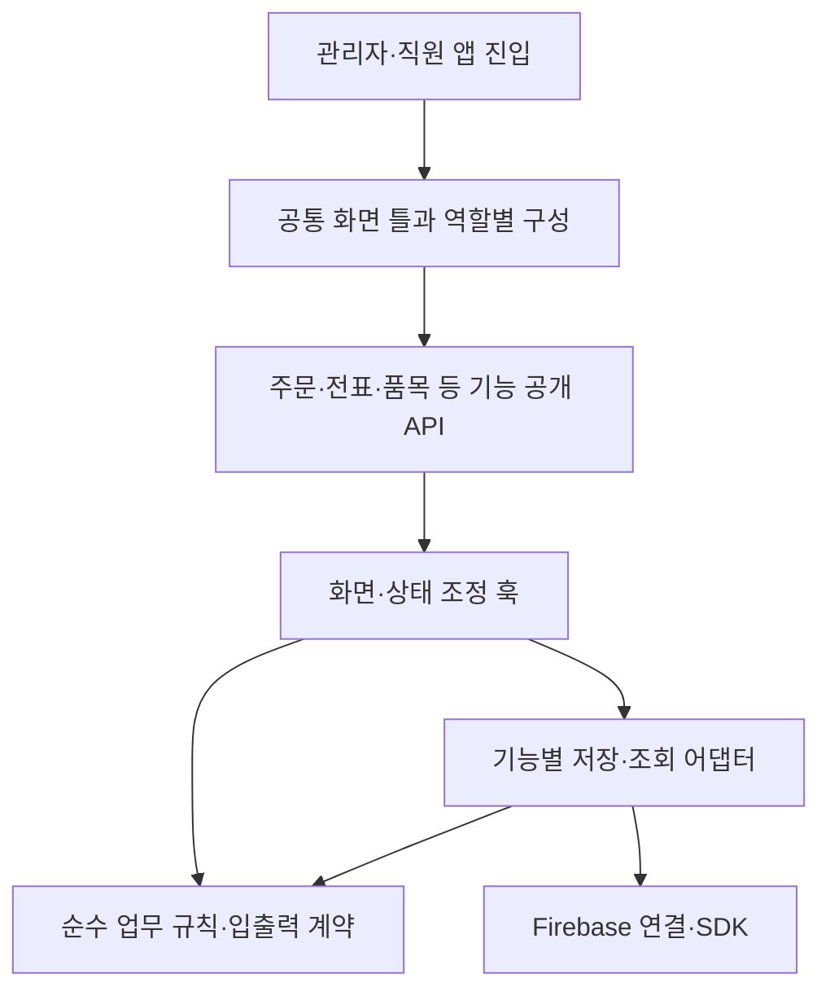

# 앱 전체 코드 모듈화 설계

기준 소스: `9565b05696a52022d3ac4a8f8018f11d7eadfd5c`, 2026-10-17. 사용자 요청에 따라 실제 코드 구조와 import를 조사한 설계다. 최초 산출물은 분리 경계·첫 적용 묶음·검증 계획이다. 이후 사용자 승인으로 첫 구현과 공통 UI 정리를 시작했다. 아래 최초 계획과 후속 적용 결과를 구분하며 앱 전체 모듈화 완료를 뜻하지 않는다. 운영자료는 변경하지 않는다.

## 현재 문제와 유지할 구조

Git 추적 중 `components/src/apps/functions/src`와 루트 타입 facade의 제품 TS/TSX를 집계했다. 시험·`src/test`·스크립트·설정 JS·생성물·의존 패키지를 제외한 기준은 509파일·99,110줄이다. 줄 수는 위험 우선순위의 단서이며 파일 크기만으로 결함을 판정하지 않는다.

| 현재 파일 | 줄 수 | 우선 분리할 책임 |
| --- | ---: | --- |
| `src/features/admin/AdminApp.tsx` | 5,441 | 메뉴/화면 틀과 기능별 업무 조정 |
| `components/HaccpChecklist.tsx` | 4,685 | 점검표 종류별 입력·출력과 저장 조정 |
| `components/OrdersList.tsx` | 4,538 | 목록/카드 표시·검색과 주문 처리 |
| `components/ItemList.tsx` | 4,122 | 재고/로트 표시·입고/실사 조정 |
| `components/TradeStatement.tsx` | 3,124 | 날짜/목록/상세/실패 작업과 작성 조정 |
| `components/ItemManager.tsx` | 2,075 | 품목 편집·거래처 연결·단위 표시 |
| `src/shared/types.ts` | 1,700 | 공통 계약과 기능 소유 타입 |
| `src/shared/services/firebaseService.ts` | 1,103 | 공통 조회와 기능별 저장 명령 |

동일 집합의 상대 import·타입 참조·재수출·문자열 dynamic import를 정적으로 연결한 파일 간 의존은 2,028개다(외부 패키지 제외). AdminApp의 직접 상대 의존151개, TradeStatement86개, firebaseService의 소비 파일40개, 공통 types 소비 파일235개가 확인됐다. 앱에서 서버 원본으로의 참조52개와 역방향0개는 현재 해석된 정적 경로의 수치이며 전체 순환 부재의 증명이 아니다. 계산된 동적 경로와 전체 SCC 순환 분석은 이번에 수행하지 않았다.

- 직원 `StaffApp`도 `AdminApp`을 `isAdmin=false`로 사용한다. 관리자·직원 코드를 복사하면 공통 동작과 수정이 다시 갈라진다. 공용 화면 틀에 역할별 구성을 주입하는 방향으로 분리한다.
- `AdminApp`에는 메뉴·권한별 화면 선택·알림·모달과 주문/전표 처리 조정이 함께 있다. 상태 전체를 큰 Context로 옮겨 파일 길이만 줄이지 않는다. 구독 수명과 회사·사용자 경계를 먼저 드러낸다.
- `firebaseService`에는 조회, 일반 CRUD, 기초잔액, OEM, 입고, 주문 원료 작업의 원자 처리까지 섞여 있다. 읽기와 도메인별 명령을 분리하되 원자 트랜잭션을 여러 호출로 쪼개지 않는다.
- `src/features/statements`에는 이미 `domain/hooks/infrastructure/ui`가 있다. 품목·생산서류·세금서류도 기존 기능 경계를 우선 재사용한다. 새 폴더 체계를 병렬로 하나 더 만들지 않는다.
- `types.ts`와 `src/services/firebaseService.ts`는 기존 경로 호환 재수출이다. 현재 호출자를 한 번에 바꾸지 않고 새 공개 경로를 점진 적용한다.
- 최근 챗봇의 화면·서버 지식 분리 누락처럼 같은 업무 규칙을 서로 다른 원본으로 관리하지 않는다. 단위·원료·금액 산식은 기존 공용 원함수를 그대로 사용한다.

대표 재사용 원본은 `statementLines`의 전표 행/합계, `purchaseUnit`의 단위 스냅샷, `day`의 날짜 정책, `orderProductionRecordPlan`의 생산 근거 계획, `inventoryWriterProtocol`의 원자 writer, `orderInventoryGeneration`의 작업 세대, `tradeStatementPending`와 복구 서비스, `financialOpeningCommands`의 기초 명령이다. 모듈화 중 동일 계산을 새로 구현하지 않는다. 복제 계산을 발견해도 원본 선택과 산식 변경은 별도 검증 작업으로 분리한다. 예를 들어 이름이 같은 stripUndefined도 JSON 왕복 방식과 재귀 제거 방식의 SDK 값 보존 의미가 다를 수 있으므로 이름만으로 통합하지 않는다.

## 목표 의존 방향

| 경계 | 소유 책임 | 금지하는 의존 |
| --- | --- | --- |
| `apps/admin`, `apps/staff` | 시작·인증·회사 선택·provider 조립 | 개별 전표/원료 산식 직접 구현 |
| 공통 화면 틀 | 메뉴·화면 선택·알림·챗봇·역할별 구성 | 기능 내부 저장 로직 직접 구현 |
| 기능 `ui` | 표시·입력·사용자 동작 전달 | 임의 SDK 쓰기, 다른 기능 내부 파일 접근 |
| 기능 `hooks` | 화면 수명·비동기 상태·취소·복구 조정 | 회사/UID 변경 뒤 이전 응답 재사용 |
| 기능 `domain` | 순수 계산·검증·DTO·상태 전이 | React, Firebase, 브라우저 API, 서비스 import |
| 기능 `infrastructure` | SDK/callable·원문 보관·조회·영수증 연결 | 화면 틀·AdminApp·상위 서비스 재수입 |
| `shared` | 실제 공용 기본 부품·순수 규칙·연결 기반 | 특정 기능의 모든 상태나 임의 업무 로직 수용 |

공통 화면 틀은 초기 추출에서는 기존 admin 경로를 유지하고, 역할별 조립과 테스트를 확보한 뒤 `src/features/app-shell`로 이동한다. 신규 기능은 필요한 층만 만든다. 기능 간 호출은 명시한 공개 파일의 컴포넌트·DTO·순수 함수만 사용한다. 모든 내부 파일을 재수출하는 큰 barrel은 만들지 않는다.

## 공개 API와 호환 방식

첫 추출은 함수 인자·반환형·콜백 순서·예외·구독 해지·기존 import 경로를 유지한다. 기존 파일은 새 원본을 명시 재수출하고, 새 원본이 호환 파일을 역수입하지 않도록 한다. 이후 소비자를 기능별 공개 경로로 옮긴 뒤 실제 참조가 없어졌을 때만 호환 파일을 제거한다.

거대한 공통 타입을 한 번에 분할하지 않는다. 새 모듈의 소유 DTO부터 `import type`으로 분리하고, 기존 타입 원본을 유지한 채 타입 순환과 런타임 순환을 구분한다. 함수명 변경·API 개편·오류 의미 변경을 파일 추출과 섞지 않는다.

앱은 ESM, 서버는 CommonJS이며 `functions/tsconfig.json`의 `rootDir=src`, 산출 진입점은 `lib/index.js`다. 서버·브라우저가 공유하는 원본은 현 빌드 경계에 맞게 `functions/src/shared`의 부작용 없는 순수 코드로 유지할 수 있다. 브라우저에서 `firebase-admin`, 서버 entry, Secret·trigger 모듈을 역수입하지 않는다. 공유 패키지나 monorepo 전환은 별도 필요성이 확인되기 전 도입하지 않는다. Node+tsx와 Vite의 모듈 해석 차이도 별도 확인한다.

## 첫 적용 묶음: 작은 추출 3개

세 작업의 고유 변경 파일은 8개(제품6·시험2, 기존3·신규5)다. 기존 시험 파일은 재사용하며 초기 구현 시 담당별 정확 소유를 먼저 등록한다. 업무 값·화면 배치·권한·writer·Functions·Rules는 바꾸지 않는다.

| 작업 | 정확 변경 파일 | 유지할 공개 계약과 검증 |
| --- | --- | --- |
| 사이드바 기본 부품 | `src/features/admin/AdminApp.tsx`, 신규 `src/features/admin/ui/NavigationPrimitives.tsx`, 신규 동일 경로 `.test.tsx` | `NavGroup`, `NavItem`을 원문 추출. props·`nav.*` 저장 키·접힘·hidden·99+ 배지·클릭 순서 유지. 메뉴 목록·역할·외부 동작·헤더/챗봇은 변경하지 않는다. 기존 메뉴 선호 시험과 숨김/접힘/저장 불가/배지 경계 시험으로 확인한다. |
| 전표 날짜 부품 | `components/TradeStatement.tsx`, 신규 `src/features/statements/ui/VoucherDateChip.tsx` | 기존 `VoucherDateChip` named export를 부모에서 호환 재수출한다. `value/onApply`, 명시 적용·취소·저장 중 잠금·실패 초안·최신 value ref를 유지한다. 기존 `components/TradeStatement.test.tsx`의 실제 날짜 회귀를 그대로 실행한다. 전표 발행/번호·저장 복구는 건드리지 않는다. |
| 읽기 서비스 | `src/shared/services/firebaseService.ts`, 신규 `src/shared/services/firestoreReads.ts`, 신규 동일 경로 `.test.ts` | `fetchWhere`, `fetchWhereIn`, `fetchByIds`, `subscribeWhere`를 동일명 재수출한다. 30개 분할·중복 처리·순서·없는 ID·회사 인자 필수/선택·구독 해지·오류 콜백을 유지한다. 기존 fetchByIds/fetchWhereIn 집중·실제 로컬 SDK 회사 경계 시험을 재사용한다. |

읽기 모듈은 SDK·`shared/firebase`·컬렉션/타입만 하향 참조하고 원래 `firebaseService`를 import하지 않는다. 현재 `fetchWhere/subscribeWhere`에는 회사 인자가 없고 `fetchByIds`는 선택, `fetchWhereIn`은 필수다. 이를 추출하면서 일괄 회사 필터를 추가하거나 `subscribeWhere`의 오류 시 `cb([])`를 바꾸지 않는다. 기존 의미를 기록하는 것이 보안 개선 완료를 뜻하지 않으며 정책 개선은 별도 변경으로 다룬다.

## 전체 적용 순서

| 단계 | 분리 대상과 완료 조건 |
| --- | --- |
| 1. 첫 3개 | 위 8파일 추출로 호환 재수출·의존 검사·행동 회귀 패턴을 확립한다. 큰 파일의 전체 분리를 완료했다고 세지 않는다. |
| 2. 화면 틀 | 메뉴의 역할별 구성·화면 registry·알림·모달 host를 각각 추출한다. 관리자/직원·회사·UID·마이페이지 고정·메뉴 선호·단축키·기존 작성창 보존을 통과한 뒤 직원 wrapper의 AdminApp 의존을 공통 화면 틀로 바꾼다. |
| 3. 주문 | `OrdersList`의 표시 모델·날짜/필터 부품→주문 카드→편집/복사주문/원료 복구 조정 훅 순서로 나눈다. 큰 OrderCard를 첫 작업으로 통째 옮기지 않는다. 조회 조건·구독 종료·이력 표시·원문·작업 ID·늦은 응답 차단을 유지한다. |
| 4. 전표·회계 | 기존 statements의 초안/명령/복구/이력 훅을 확장하고 전표 작성·목록·상세·실패 작업을 분리한다. admin 아래 `cashLedger/voucherMerge/financials` 등 공용 회계 책임은 실제 사용처에 따라 statements 또는 finance 경계로 정리한다. 실패·unknown·완료 구분과 영수증/요청 동일성은 그대로 둔다. |
| 5. 재고·입고·OEM | 기존 순수 단위/원가/로트 함수를 재사용하며 조회·화면과 명령 어댑터를 분리한다. 재고·로트·이력·금액을 함께 저장하는 원자 명령, actor/revision/release/receipt 경계를 통째 유지한다. |
| 6. 나머지 기능 | 품목·거래처·생산서류·세금서류·HACCP/위생점검·인사·대화/공지·보고서를 기존 기능 경계에 점진 합류한다. 큰 점검표 파일은 종류별 입력/출력부터 나누고 저장·revision은 하나의 조정 경계로 유지한다. 타입·계산·서비스의 실제 소유를 확정한 뒤 불필요한 호환 경로를 제거한다. |
| 7. 서버 조립 | 순수 규칙·명령·외부 어댑터와 trigger 조립을 분리한다. export명·region·secrets·schedule/timezone·timeout·retry 등 manifest와 Admin SDK 초기화 순서를 기존 배포와 대조한다. import만으로 새 Firestore 호출이 생기면 중단한다. |

단계별 구현은 관련 작업 약 3개를 묶되 의존이 없는 작업만 병렬 배정한다. 한 writer의 복구·원문·영수증 관련 파일을 담당별로 찢지 않는다. 설계 담당은 한 명, 구현과 검수는 별도로 유지한다. 상위 단계를 모두 끝내야만 독립 기능을 시작할 수 있다는 뜻은 아니다.

## 검증과 되돌리기

1. 추출 전 호출자·export·관련 시험·회사/계정/권한·비동기 수명·SDK 부작용을 기록한다. SDK mock만 있는지 실제 로컬 검증이 있는지도 구분한다.
2. 추출 후 기존 경로와 새 경로의 공개 계약을 확인한다. 관련 회귀와 핵심 행동을 깨뜨리는 변이를 실행하고 원문을 복원한다. 새 파일이 facade를 역수입하거나 domain이 SDK/UI를 import하면 실패하도록 경계를 확인한다. 기존 AST 시험은 실제 새 구현 위치를 검사하도록 최소 수정하며 보호 조건을 삭제해 통과시키지 않는다. writer 단계에서는 관련 실제 로컬 SDK의 회사 격리·중복/응답 유실·늦은 actor 검증이 필요하다.
3. 최종 후보에서 앱 타입·양 앱 빌드를 한 번 수행한다. 서버 변경 시 서버 타입/산출물과 실제 manifest를 추가 확인한다. 전체 수천 시험을 작은 추출마다 반복하지 않는다. 공유 기반의 영향이 넓거나 회귀 근거가 부족하면 그때 검증 범위를 넓힌다.
4. UI가 포함된 묶음은 관리자·직원, PC·모바일 폭, 작성/대기/오류/닫기·초점/원문 보존을 에이전트가 직접 확인한다. 실기기는 기존 사용자 지시에 따라 제외 사실을 기록한다.
5. 관련 코드·시험·문서를 한 묶음으로 main에 통합·배포하고 공개 산출물과 서버 상태를 확인한다. 노션은 묶음 마감에 한 번 갱신한다.
6. 회귀가 있으면 해당 추출 묶음만 revert하고 마지막 검증 빌드로 되돌린다. 이번 구조 추출에는 DB 이관이 없으며 실제 전표·재고를 되돌리거나 실패 사본을 임의 삭제하는 복구는 하지 않는다.

완료 기준은 줄 수 감소가 아니라 단일 업무 원본·하향 의존·명확한 공개 API·기존 동작 보존이다. 순환 import 제거 수나 전체 의존 그래프 완전성을 아직 확인하지 않은 상태에서 달성했다고 기록하지 않는다. 최초 설계 문서만 반영할 때에는 앱 빌드나 재배포를 하지 않았다. 후속 제품 변경은 아래 범위에서 따로 검증·배포한다.

## 첫 구현과 날짜 필터·헤더 공통화

사용자가 반복되는 날짜 필터와 헤더도 통일성 있게 모듈화하도록 요청했다. 기존 DateRangeFilter와 PageHeader를 재사용하며 날짜 선택 정책과 페이지 제목 표시 정책은 유지한다. 페이지 헤더와 앱 최상단 헤더를 구분하고, 조회 날짜와 전표 날짜의 명시적 적용도 구분한다. 모든 날짜 선택을 하나의 동작으로 강제하지 않는다.

첫 묶음은 NavGroup/NavItem 원문 추출, VoucherDateChip 원문 추출·기존 named export 호환, 공통 날짜 필터/페이지 헤더와 소비 화면2곳 정리다. 기존 조회 서비스4함수 추출은 다음 묶음으로 옮겼다. 제품·시험 고유 변경12개(제품8·시험4)이며 이 문서와 할일 기록2개를 별도로 관리한다. 현금출납장과 전표 주문 날짜 필터 부모는 줄바꿈·최소 너비·흰 바탕을 정리한다. OrderPicker는 소스를 바꾸지 않고 같은 원본을 사용한다. StatementHistoryFilters의 당년/ALL/이전·다음 기간과 월별 분석 등 다른 정책을 억지로 치환하지 않는다.

공통 조작 높이44px와 간격·날짜 입력 배치를 맞추고 우측 작업 버튼은 좁은 화면에서 줄바꿈한다. PageHeader는 기존처럼 모바일 제목을 숨기고 우측 조작이 없으면 빈 헤더 공간도 만들지 않는다. 메뉴 저장 키·숨김·접힘·배지와 조회 콜백·회사 조건·저장 흐름은 유지한다. 관련8파일136시험과 메뉴 숨김/날짜 저장 경합/수동 quick 해제 보호 변이3개를 통과하고 원문을 복원했다. 고정 날짜 전표 fixture를 현재 당일 필터로 찾던 기존6시험은 원본에서도 실패해 해당 수량 시험에 ALL 조회 선택1줄을 명시했다. 제품 날짜 정책이나 수량 검증을 바꾸지 않았다. 구현자와 별도의 제품12파일 검수도 완료했다.

총괄은 동결 SHA로 고정한 실제 Nav 부품·VoucherDateChip·공통 날짜 필터·PageHeader·StatementOrderDateFilter·CashLedger와 실제 전표 헤더 JSX의 우측 슬롯을 운영 연결 없는 합성 화면에서 검수했다. PC·390·320픽셀의 헤더 숨김/액션 표시·빠른 기간 선택·메뉴 접힘/배지·현금출납장 일반전표 창 열기/닫기를 확인했다. 날짜 수동 입력·전표 적용/취소/저장 경합은 관련 행동 시험으로 확인했으며 합성 화면 확인과 구분한다. 320픽셀에서 기존 전역 date 최소너비140px가 겹침을 만들던 문제를 발견해 이 컴포넌트에만 최소너비 우선순위를 지정하고359이하는 세로로 배치했다. 최종 재검에서320 세로·390 동일행, 입력 높이44px·겹침0·가로 넘침0이었다. 관련2파일5시험 재통과·해당 CSS 독립 검수 후 동결했다. 초기 빌드 도중 이 CSS 보완으로 소스 핀이 달라진 결과는 최종 성공으로 쓰지 않는다. 초기 앱 타입 오류0은 유지하고 최종 CSS 후보에서 양 앱 빌드를 다시 한 번 수행한다. 최종 CSS 보완본 양 빌드는 관리자17.32초·직원15.92초로 성공했다. 기존 FCM 원문 bytes와 소스12파일 SHA가 유지됐으며 관리자76·직원78파일을 생성했다. 제품·시험12개와 문서2개를 d862282, 추출 모듈2개의 끝 빈 줄만 정리한 e83b752를 main·GitHub에 반영했다. 공백 정리 전후의 실행 본문과 정규화된 Git 텍스트 동치를 확인했으며 해당 형식 변경으로 빌드를 반복하지 않았다. 검증한 동일 빌드로 양 Hosting만 배포했다. 관리자472958834ee7ad44·직원4aca8d52b4754c31은 2026-10-17 08:40:04.792/05.070 UTC에 FINALIZED됐고 전체154개 공개 파일과 양 HTML이 GET200·원시 SHA로 최종 빌드와 일치했다. 기존 askHelp의 업데이트 시각·소스와 Rules 원문 SHA도 그대로 확인했다. 개인 원격 검증은 records/modular-ui-release-verification-20261017.json에 보존한다. 실기기 검수는 사용자 지시로 제외했다. 구조 추출로 기존 작성 요청·전표·재고·금액·서버·Rules를 변경하지 않는다.

## 조회·주문 복구 표시·그룹 색상 분리

둘째 묶음은 공용 조회 함수 네 개를 `firestoreReads.ts`로, 실제 주문 화면의 복구 안내를 `OrderRecoveryEntry.tsx`로, 그룹별 표시 정책을 `orderGroupStyle.ts`로 분리한다. 기존 서비스 공개 경로와 주문 화면의 named export는 유지한다. 조회 회사 조건·30개 분할·결과 순서·중복 처리·SDK 값·오류 처리와 복구 콜백의 원 주문 전달·처리 중 실행 금지를 그대로 보존한다. 그룹 다섯 색과 순환 순서도 원문 그대로다. 미사용 날짜 버튼은 조사 후 이번 대상에서 제외했고 기존 선언을 보존했다. 날짜 계산·요청·재고·회계·서버·Rules·운영자료는 바꾸지 않는다.

제품·시험8파일의 독립 검수를 마쳤다. 조회 관련15개와 주문 관련34개 시험, 회귀 변이3개의 검출·복원, 실제 로컬 Auth/Firestore SDK 시험2개가 통과했다. SDK 시험은 회사별 조회 허용·거절과 자체 합성 문서·계정 정리까지 확인했으며 운영 환경은 사용하지 않았다. 총괄은 실제 추출 컴포넌트의 합성 화면에서 복구 콜백·내부 오류 안내·처리 중 버튼 비표시·그룹 색상 순환을 확인했고 PC와390픽셀에서 페이지 넘침이 없었다. 전체 주문 화면 검수로 확대하지 않으며 기존 실제 OrderCard/OrdersList 연결은 행동 시험으로 확인했다. 실기기 검수는 사용자 지시로 제외했다. 최종 앱 타입 오류0·양 앱 빌드 한 번 성공(관리자16.92초·직원15.91초), 동결 소스8개 SHA 불변·FCM 원바이트 복원을 확인했다. main 5c9c189를 GitHub에 푸시하고 같은 검증 빌드로 양 Hosting만 배포했다. 관리자 ef9ecd614e2c28e9·직원 a65ee1517811c31f는 2026-10-17 09:26:11.464/599 UTC에 FINALIZED됐다. 공개154개 파일과 양 HTML의 GET200·원시 SHA가 최종 빌드와 전부 일치했다. 기존 askHelp 업데이트·소스와 Rules 원문 SHA도 그대로다. 개인 검증 결과는 records/orders-modular-release-verification-20261017.json에 보존한다. 원본 TODO26완료·17잔여 집계는 변경하지 않는다.

## 배송 행·HACCP PDF·순서 변경 분리

셋째 묶음은 배송 박스 선택 초안과 송장 콜백을 갖는 DeliveryRow, HACCP PDF 내보내기 어댑터, 템플릿 드래그 정렬 훅과 배열 이동 함수를 분리한다. 배송 행은 현재 숨겨진 이전 배송 탭의 소비1곳을 가진 기존 코드이며 화면에 새로 노출하지 않는다. PDF의 실제 호출16곳, 정렬 훅의 편집기7곳 연결을 유지한다. PDF 동적 import 순서·캡처 옵션·A4 페이지 반복·원래 파일명·오류 전달, 정렬 ref의 즉시 갱신·연속 이동·종료 시 확정, 박스 초안·취소·정수화·확정 콜백을 원문 그대로 옮긴다. 별도 월간 PDF 엔진·저장 세대 가드·회사 구독·업무 값·양식은 바꾸지 않는다.

제품·시험8파일 독립 검수와 관련79개 시험, 보호 변이3개 검출·원복을 마쳤다. 총괄은 운영 연결 없는 실제 추출 부품의 PC/390픽셀 합성 화면에서 박스 편집 취소·재열기·확정1회, 제외 품목 미표시, 배열 이동·페이지 넘침0을 확인했다. 실제 브라우저 드래그와 실제 라이브러리 PDF 파일 생성은 실행하지 않았으며, 관련 동작은 분리 훅·PDF 어댑터의 행동 시험과 기존 부모 연결 회귀로 확인했다. 실기기는 사용자 지시로 제외했다. 최종 타입 오류0·양 앱 빌드 한 번 성공, 동결 소스8개와 FCM 원바이트 불변을 확인했다. main aba5fc6를 GitHub에 푸시하고 동일 빌드로 양 Hosting을 배포했다. 관리자3bc8611fe8e76d52·직원e109f06703181df4는 2026-10-17 09:41:06.582/804 UTC에 FINALIZED됐고 공개154개 파일·양 HTML GET200/원시 SHA가 모두 일치했다. 기존 askHelp·Rules도 그대로다. 비공개 증거는 records/haccp-delivery-modular-release-verification-20261017.json에 보존한다.

## HACCP 인쇄·가열·금속검출 입력폼 분리 — 미배포

넷째 묶음은 위생점검 인쇄·월간 표지, CCP 가열 입력폼, 금속검출 입력폼을 분리한다. 공통 표 스타일·제목·서명란과 제품 목록은 각각 한 원본을 참조하고, 위생점검 타입은 type-only로 옮긴다. 부모는 회사 Context와 탭 조립·저장 경계를 유지하며 새 모듈을 정적으로 import한다. 고정 서식·검사기준·O/X 의미·회사명·월 날짜 정책·PDF와 저장 동작은 그대로다.

제품·시험11파일 독립 검수, 기존4·신규4파일의 집중64개 시험과 변이3개 검출·복원을 마쳤다. 총괄은 실제 추출 양식의 합성 화면에서 행 추가 뒤 입력 독립성, 가열·금속검출 전환, 서로 다른 O 의미, 위생 인쇄의 확인·개정·적합/부적합 열과 월간 표지 집계를 확인했다. PC/390픽셀에서 인쇄표 넘침이 없었으며 실제 PDF 파일 생성·실기기 검수는 미실시다. 타입 오류0·양앱 빌드 한 번 성공(16.88/15.82초), 동결11파일과 FCM 원바이트 불변을 확인했다. 사용자의 최신 배포 보류 지시에 따라 미배포다. 다음 배포는 명시 지시 후 수행한다.

## 온도·입고·방충방서 입력폼 분리 — 미배포

다섯째 묶음은 온도점검·입고검사·방충방서 입력폼을 각 모듈로 옮기고 부모는 탭·회사 Provider 조립을 맡긴다. 회사 Context는 기본 태백값과 같은 객체를 하나만 유지하며 기존 Provider·소비자가 이를 공유한다. 냉장 구역 기본값은 템플릿 편집기와 같은 원본을 쓰고, 로컬 getter를 사용하는 todayStr는 별도 원문으로 보존한다. 다른 날짜 함수와 통합하지 않는다. TempForm 기존 named export는 부모에서 호환 재수출한다. 조회 조건·구독 해지·확인 권한·현재 기록 수신과 초안 교체·저장 인자·개정 번호·PDF·검사 기준을 변경하지 않는다. 제품·시험12파일 독립 검수와 기존4·신규5파일 관련66개 시험, 보호 변이4개 검출·복원을 마쳤다. 같은 Context의 기본값·회사 전환·구독 해지와 기존 named export 동일성을 확인했다. 총괄은 운영 SDK·저장을 차단한 실제 폼 합성 화면에서 온도 초안·입력·회사 전환, 입고 행 추가 후 기존 공급처·수량 보존, 방충 장소·O/X 선택과 PC/390픽셀 표 내부 스크롤·페이지 넘침0을 확인했다. 실제 운영 저장·실제 PDF 생성·실기기는 미실시다. 최종 타입 오류0·양앱 빌드 한 번 성공(관리자16.69/직원16.02초), 동결12파일·FCM 원바이트 불변을 확인했다. 최신 사용자 지시에 따라 미배포로 유지한다.

## 작업장·개인위생·세척소독 폼 분리 — 미배포

여섯째 묶음은 작업장 위생점검·개인위생점검·세척소독의 큰 입력 책임을 각 모듈로 옮긴다. 템플릿 편집기와 공유하는 작업장 항목·개인위생 열은 domain의 단일 원본으로 분리한다. 기존 Context·날짜·서식·PDF·인쇄·타입을 재사용하며 부모는 공개 named export와 탭 연결을 보존한다. 월간 PDF는 일반 PDF와 다른 A4 맞춤·페이지 순서·취소·정리 정책을 원문 그대로 유지한다. 주간·월간·마감 점검과 초안 제어 훅은 이번에 변경하지 않는다. 조회·저장·확인·삭제·입력·기준·날짜 정책을 추출과 섞지 않는다. 기존 소비 파일에 고정된 Context·PDF·인쇄 경로 검사를 이동한 실제 모듈까지 보완하여 제품·시험12파일로 마쳤다. HACCP 전체와 기존 회귀18파일102개 통과, 변이4개 검출·원복, 독립 검수를 완료했다. 월간 PDF의 2회 프레임 대기·표지/날짜슬롯 순서·3페이지 맞춤·파일명·정리와 시작 전/캡처 중 해제에 따른 후속 캡처·저장 취소를 합성 시험으로 확인했다. 총괄은 실제 추출3폼의 운영 차단 합성 화면에서 시간대 초안·부적합/조치·개인행 입력·세척 선택·회사 문맥과 PC/390픽셀 표 내부 스크롤을 확인했다. 실제 운영 저장·실제 PDF 파일 생성·실기기는 미실시다. 최종 타입 오류0·양앱 빌드 한 번 성공, 동결12파일·FCM 원바이트 불변을 확인했다. 사용자 재개 지시 전까지 미배포다.

## 주기·마감 점검·템플릿 편집기 분리 — 미배포

일곱째 묶음은 주기 위생점검·마감 점검과 템플릿 편집기5개를 분리했다. 공유 초안 제어 훅과 두 기본값·타입 모듈을 두고, 기존 공개 편집기3개는 같은 함수로 호환 재수출한다. 원래 세대 토큰·초안 확인·저장 중 잠금·서버/캐시 구분·새로고침·늦은 응답과 언마운트 보호·비ISO 주차·저장 필드를 그대로 옮긴다. Context·드래그·보호 본문 검사는 실제 기능 모듈을 추적하며 기존 계약을 낮추지 않는다.

제품·시험14파일 독립 검수, HACCP 전체와 기존 강한 회귀22파일120개 시험, 변이4개 검출·복원을 마쳤다. 총괄은 운영 연결 없는 실제 부품의 PC/390픽셀 합성 화면에서 주기 변경 취소 후 체크 초안 보존, 마감 입력, 템플릿 기본8열과 위아래 순서 이동·페이지 넘침0을 확인했다. 합성 SDK의 서버 확인은 fromCache/hasPendingWrites를 명시해 운영 조회와 구분했다. 실제 저장·실제 PDF 파일 생성·실기기는 미실시다. 최종 타입 오류0·양앱 빌드 한 번 성공(17.39/16.02초), 동결14파일·FCM 원바이트 불변을 확인했다. 사용자 명시 재개 전 배포하지 않는다.

## HACCP 진입·화면 조립 분리 마감 — 미배포

여덟째 묶음에서 개요 평가·일상 위생점검과 관리자·직원 화면 조립을 분리했다. 최초 약4,685줄의 HaccpChecklist 진입 파일은 회사별 key를 가진 두 wrapper와 기존 named7/default 호환 export를 남기는 14줄이 됐다. 기능을 삭제한 것이 아니라 폼·제어 훅·출력·템플릿·화면 조립의 단일 원본으로 옮긴 결과다. Provider2개는 원래 화면 조립 위치와 같은 Context 객체를 유지하며 회사 변경의 초안·탭·구독 수명, 관리자12/직원5 탭과 기존 권한·순서 저장을 보존한다. 개요 점수·일상 항목·날짜·서식·PDF·기준은 바꾸지 않는다. HACCP 기능의 분리 마감이며 앱 전체 모듈화 완료를 뜻하지 않는다.

제품·시험11파일 독립 검수, HACCP 전체와 기존 강한 회귀25파일132개 시험과 변이3개 검출·복원을 마쳤다. 총괄은 가짜 SDK·저장 차단 환경에서 실제 진입 컴포넌트 전체를 렌더해 관리자12탭·온도 초안과 회사 전환 후 기본 화면 초기화, 직원5탭·템플릿 편집기 비노출·회사 변경 후 점검 초안 초기화를 확인했다. PC/390픽셀에서 탭 내부 스크롤·페이지 넘침0을 확인했으며 실제 운영 조회·저장·PDF 생성·실기기는 미실시다. 최종 타입 오류0·양앱 빌드 한 번 성공(16.80/15.72초), 동결11파일·FCM 원바이트 불변을 확인했다. 사용자 명시 재개 전 배포하지 않는다.

## 버튼 크기·역할색·인사 글꼴 후속

사용자가 공통 헤더 안의 버튼이 너무 크고 인사 탭·퇴직금 글자가 세로로 깨진다고 제보했다. 앞선 PageHeader의 모든 자손 버튼 최소 높이 강제를 제거하고, 헤더는 외곽 배치만 담당한다. 버튼 자체를 ActionButton으로 분리해 기본36px·12px·semibold·상속 글꼴·한 줄 표시를 통일한다. 기본 type은 button이며 명시 submit·disabled·aria·ref·콜백을 그대로 전달한다. 일반은 흰 바탕/회색 선, 주요 등록·발행은 인디고 강조, 실패 확인은 흰 바탕/앰버 선과 글자로 구분한다. 역할색과 기존 전표 종류색을 일괄 지우지 않는다.

전표 진입 버튼의 표시는 실패 N으로 줄이고 PageHeader의 별도 recovery 영역으로 옮긴다. 전표내역 등 일반 조작과 다른 줄에 구분하며, 실제 실패 개수·저장 중 비활성화·복구 열기와 사본 처리 로직은 그대로다. 목록·상세의 설명 문구를 단순 치환하지 않는다. 전표의 실제 엑셀·작성 도구에 공통 버튼을 적용한다. 이전 증거 화면의 내역 내려받기는 합성 검수용 라벨이며, 실제 제품의 엑셀 버튼과 구분한다.

인사4탭은 한 줄을 유지하고 좁으면 탭 영역 안에서 가로로 이동한다. 직원 등록·휴가는 같은 주요 버튼을 쓰며, 직원 행의 퇴직금·수정·삭제는 동일한 버튼 규격과 관리 셀 최소 폭으로 한글 세로 줄바꿈을 막는다. 표 내부 수평 스크롤을 허용하고 페이지 전체 넘침은 방지한다. 직원 ID·퇴직금/급여 계산·삭제 방어·조회와 상태는 바꾸지 않는다. 이 후속은 명시한 공통 원본과 전표·인사 소비자부터 적용하는 범위이며 앱 전체 모든 버튼이 바뀌었다고 주장하지 않는다.

제품·시험10파일과 문서2개를 대상으로 관련7파일127개 집중 시험과 기본 폼 비제출·퇴직금 표시 회귀 변이2개 검출·원문 복원, 독립 제품10파일 검수를 마쳤다. 총괄은 실제 HRManager·StatementHistoryActions·ActionButton·PageHeader와 실제 전표 헤더 전체 JSX를 동결 SHA로 고정한 운영 연결 없는 합성 화면에서 PC/390/320픽셀로 확인했다. 버튼36px·글자12px/굵기600·같은 상속 글꼴·주요색/실패색, 실패와 전표내역의 서로 다른 줄, 인사4탭과 퇴직금 한 줄, 표 내부 가로스크롤/페이지 넘침0을 실측했다. 실제 내보내기·매입전표 선택 콜백과 직원 등록창 열기/닫기를 확인했고 실제 저장·발행은 실행하지 않았다. 퇴직금 대상·삭제 방어는 기존 행동 시험으로 확인했다. 최종 앱 타입 오류0, 양 앱 빌드 한 번 성공(관리자16.86초·직원15.72초), 소스10파일 SHA 불변과 FCM 원문 bytes 복원을 확인했다. 제품·시험10개와 문서2개를 main 8fffb35로 반영하고 동일 검증 빌드로 양 Hosting만 배포했다. 관리자2eaf9e1c2b16b54a·직원f0bbed46a5d1ded2는 2026-10-17 09:03:26.864/27.014 UTC에 FINALIZED됐고 공개154파일·양 HTML GET200/원시 SHA가 최종 빌드와 모두 일치했다. 기존 askHelp 업데이트·소스와 Rules 원문 SHA는 그대로다. 개인 결과는 records/compact-actions-release-verification-20261017.json에 보존한다. 실기기 검수는 사용자 지시로 제외했다. 글로벌 font와 iOS 입력 확대 방지 정책·서버·Rules·운영자료는 변경하지 않는다.

## 주문 카드·채널 묶음·날짜 의존 분리 — 미배포

아홉째 묶음은 주문 카드와 실제 보드의 채널 묶음을 별도 UI 모듈로 옮겼다. 날짜 표시 네 함수와 달력 열기 이벤트는 순수 계산과 DOM 동작으로 나누며 원래 로컬 getter·365일·서울 시간·상태 판정을 유지한다. 부모의 기존 OrderCard·OrderRecoveryEntry 공개 경로와 미사용 선언은 보존한다. 수정·복구에 원래 주문을 전달하고 읽기 전용·처리 중·삭제·단위·BOM·메모·재고 오류와 콜백 계약을 바꾸지 않는다.

제품·시험9파일 독립 검수, 주문 전체와 관련15파일88개 시험, 보호 변이3개 검출·복원을 마쳤다. 총괄은 실제 Card·Group을 운영 연결 없는 합성 화면으로 확인하여 묶음 접기/펼치기, 원래 주문 ID로 복구 전달, 읽기 전용의 복구 숨김과 입력 비활성화, 처리 중 실패 안내 숨김을 확인했다. PC/390픽셀 페이지 넘침0이며 실제 저장·운영 SDK·실기기는 미실시다. 최종 타입37.716초·양앱 빌드41.08초 성공, 동결9파일·FCM 원바이트 불변을 확인했다. 사용자 명시 재개 전 배포하지 않는다.

## 품목 연결 정리·용역 조건·표시 분리 — 미배포

열째 묶음은 품목 연결 확인·정리창과 거래처별 용역 조건, 재고 목록의 이름·규격 표시 책임을 나눈다. 정리창은 동적 서비스 로딩·인증 구독 해제·회사/사용자 key·요청 토큰/세대·원문 복구를 한 모듈에 보존한다. 용역 조건은 기존 named export와 거래처·매입/매출별 key, 필수값·저장 오류·재시도를 유지한다. 품목 표시 함수 네 개와 내부 보조값만 이동하고 공용 규격 파서는 재사용한다. 재고·수량·원가·필터·등급 계산과 운영 자료는 바꾸지 않는다. 기능 추가나 화면 개편과 섞지 않고 기존 실소비에 연결한다. 제품·시험11파일 독립 검수, 최종 관련27파일209개 시험과 추출 보호 변이2개 검출·복원을 마쳤다. 넓은 회귀에서 기존 시험6건 실패가 드러났고 원HEAD에서도 동일 실패를 확인한 뒤 시험3파일의 합성 로그인·Web Locks와 현재 복구 동선을 보완했다. 과거 OEM 사본의 차단·원문 보존과 정상 계정 원문의 재개를 별도로 검증하며 원료의 확정 실패/응답 미확인/같은 원문 재개 후 원장 갱신 보호를 유지한다. 총괄은 운영 SDK·저장·삭제를 차단한 실제 부품 합성 PC/390픽셀에서 용역 방향별 계정·합성 저장 인자·방향 전환 초기화, 정리창의 정상/손상 사본·복구 조회 안내·열기/닫기와 페이지 넘침0을 확인했다. 실제 운영 저장·삭제·실SDK·실기기는 미실시다. 최종 타입39.949초·양앱 빌드41.02초 성공, 동결11파일과 FCM 원바이트 불변을 확인했다. 사용자 명시 재개 전 배포하지 않는다.

용역의 계정 선택은 기존 admin/financials의 filterCodesForContext 정본을 그대로 참조한다. 현재 기능 간 내부 의존은 남아 있으며 향후 공용 회계 경계를 정리할 대상이다. 이번 추출에서 같은 계산을 복사하거나 별도 정책을 만들지 않는다.

## 수금·지불 입력·자금 수정·복사주문 판독 분리 — 미배포

열한째 묶음은 자금 전표 창의 수금·지불 입력폼과 기존 자금 수정폼을 독립 UI로 옮기고 부모는 기존 mode 분기를 유지한다. 공용 타입은 domain, 금액 표시는 원래 fmt 하나로 분리하며 초과금액 설명·계정 정렬 보조 함수는 각 실소비 폼에 둔다. 잔액·최신 전표 재조회·초기 일자·초과 확인·분할 줄·급여·이체·통장 배정과 늦은 응답/중복 저장 보호를 통째로 유지한다. 외부 마운트 key와 공개 타입·콜백, 정적 인증 의존의 수명은 바꾸지 않는다.

복사주문은 로컬 품목 유사도와 줄 판독 함수군만 원문 이동한다. 기존 공용 타입을 사용하고 점수 임계0.25·동점 목록 순서·마지막 수량과 단위·기본 수량/박스 판정을 보존한다. 거래처 검색·제품 목록·단위 정규화·원문 식별·AI 병합·주문 저장은 부모에 남긴다. 새 계산·업무 규칙과 섞지 않으며 운영 쓰기·AI 호출·서버 변경 없이 검증한다. 제품·시험10파일 독립 검수, Cash/Trade8파일153개와 복사주문7파일80개인 고유15파일233개 시험, 보호 변이2개 검출·복원을 마쳤다. 본문2·타입3과 판독 함수군의 원문 동치를 확인했다. 총괄은 운영 SDK·실저장·AI를 차단한 실제 CashEntryModal wrapper와 로컬 판독 합성 PC/390픽셀에서 남은 수금액·기존 전표일, 거래처 범위 전환 후 날짜 보존과 합성 전달, 원래 자금 ID·수정 비고 전달, 박스/소수 낱개 판독과 페이지 넘침0을 확인했다. 실제 금융 처리·통장 지정·급여/이체 저장·실AI·실기기는 미실시다. 이 경로의 비동기·급여·이체 보호는 관련 행동시험 근거와 구분한다. 최종 타입39.934초·양앱 빌드41.2초 성공, 동결10파일과 FCM 원바이트 불변을 확인했다. 사용자 명시 재개 전까지 배포하지 않는다.

## 전표 양식 선택·판정·분개 투영 분리 — 미배포

열둘째 묶음은 기존 cashTemplates의 양식 선택 Modal·Picker, 저장 양식과 기본 양식의 선택 판정, 차대 입력·분개 미리보기 투영을 나눈다. 타입·기본 양식·방향/색·분할 모드 상수는 전표 domain의 한 카탈로그로 옮기며 기존 shared 경로는 같은 binding을 재수출하는 호환 진입점으로 남긴다. 외부 소비 경로는 바꾸지 않고 새 모듈에서 호환 진입점을 역수입하지 않는다. 카탈로그 배열·객체를 재생성하거나 새로 동결하지 않으며 기존 공용 lineAmount·autoJournal·accountChart·templateStatementType 정본을 재사용한다.

양식 누락 계정 안내·선택 가능 여부, 저장 양식 우선/기본 fallback·정렬, 차변·대변/세금/이체 양식 줄과 화면의 검색·그룹·즐겨찾기·직접입력·방향 탭/라벨·선택 원객체·상태·key를 유지한다. 회계 정책·계정·양식 이름·색과 입력 규칙은 바꾸지 않는다. 제품·시험8파일 독립 검수, 기존14·신규3인 관련17파일146개 시험과 보호 변이3개 검출·복원을 마쳤다. 원상수·함수16개 원문 동치와 기존 공개 binding 동일성을 확인했다. 총괄은 실제 선택 부품을 운영 통신 없는 합성 PC/390픽셀에서 렌더해 이름/계정 검색·그룹/즐겨찾기 조합·원래 양식 객체 전달·직접입력 해제·숨긴 방향 탭/라벨 override·계정 누락 사유/비활성·열기/닫기와 페이지 넘침0을 확인했다. 분개 미리보기 계산은 행동시험 근거이며 실제 발행·운영 쓰기·실기기는 미실시다. 최종 타입39.712초·양앱 빌드40.709초 성공, 동결8파일과 FCM 원바이트 불변을 확인했다. 사용자 명시 재개 전까지 배포하지 않는다.

## 자금원장 입력·수동 상계·계좌 관리 분리 — 미배포

열셋째 묶음은 CashLedger의 입출금 입력과 미확인 요청 복구, 수동 전표 상계, 계좌 관리의 큰 모달 세 책임을 각각 옮긴다. 입력 모듈은 사본 타입·읽기 검증을 private로 동반하고, 계좌 모듈은 회사 key wrapper와 본문을 함께 옮긴다. 공통 Props는 domain type, 계좌 아이콘 표는 한 표시 모듈로 두며 동일했던 금액 표시는 기존 cashEntryDisplay 정본을 재사용한다. 부모는 원래 목록·필터·조건부 mount와 기존 공개 MatchModal·AccountModal의 같은 함수 재수출을 맡는다. 새 props를 추가해 상태를 쪼개지 않는다.

회사·UID·인증 준비·익명 거절, 손상/미확인 사본과 같은 원문 재시도·부분 실패·다른 창 사본 비교 후 정리, 상계의 반품·선수·삭제된 자금 제외, 계좌 기초/현재 잔액과 저장 잠금·실패 초안·늦은 응답 보호를 그대로 유지한다. 기존 자금원장·분개·잔액 정본을 사용하며 새 writer·권한·가드·계좌 정책은 만들지 않는다. 제품·시험9파일 독립 검수, 기존 CashLedger/양식 관련과 신규3인 고유17파일143개 시험, 보호 변이3개 검출·복원을 마쳤다. 모달·사본 읽기·타입·부모·아이콘 원문 동치와 기존 공개 binding을 확인했다. 부모는 236줄의 목록·조립 책임으로 줄었다. 총괄은 운영 SDK·금융 처리를 차단한 실제3모달 합성 PC/390픽셀에서 입력과 동일한 분개 미리보기·계좌/계정/금액 전달, 미매칭 범위 상계와 원래 ID 전달·해제 후 후보 복귀, 계좌 현재15만/기초10만 구분·모드 전환·열기/닫기와 페이지 넘침0을 확인했다. 초기 비공개 검수 번들의 tree-shaking 문법 오류는 기존 QA와 같은 원인으로 검수 설정만 보완했고 제품은 변경하지 않았다. 실제 금융 처리·계좌 저장/보정·실SDK·실기기는 미실시다. 최종 타입37.206초·양앱 빌드40.789초 성공, 동결9파일과 FCM 원바이트 불변을 확인했다. 사용자 명시 재개 전 배포하지 않는다.

## 계정 분류·손익·직접법 현금흐름 정본 분리 — 미배포

열넷째 묶음은 admin/financials의 계정 분류·손익·직접법 현금흐름을 financials 기능의 순수 domain 모듈 세 개로 옮긴다. 계정 선택은 품목·전표·재무 화면이 공용으로 소비하므로 특정 화면의 소유로 두지 않는다. 기존 admin 경로는 동일 binding의 호환 재수출과 범용 addMonthStr 원문을 남긴다. 외부 소비 경로와 공개 타입·상수·함수는 유지하며 새 세 모듈은 서로와 호환 진입점을 역수입하지 않는다. 기존 shared 타입·autoJournal·accountChart 정본을 참조한다.

계정 그룹 원객체·옛 ID/없는 그룹 처리·숫자 정렬·현금 이름 정규식, 손익 normalBalance/계정 분류·nullish0·월 prefix/기본 plLine·음수·소수, 현금흐름 isCash 필드·0.005 경계·운영 계정 우선·분류 fallback·Map 동점 순서를 그대로 유지한다. 계정 이름을 보는 분류 함수와 현금흐름의 isCash 필드 판정을 임의 통일하지 않는다. 기존 중복 문장도 원문 이동에서 정리하지 않는다. 이번에는 UI·계정·회계 정책을 바꾸지 않으며 제품·시험7파일 독립 검수, 신규3·금융기존6·실소비11인 고유20파일223개 시험과 보호 변이3개 검출·복원을 마쳤다. 모든 공개 runtime binding 동일성·그룹 원객체·입력 불변, 분류/날짜6개와 손익/현금흐름9개 원문 동치를 확인했다. 화면·레이아웃 변경이 없어 새 시각 검수는 하지 않았으며 실제 소비자인 용역·전표 작성·재무 화면의 합성 행동 회귀를 포함했다. 운영 조회·금융 처리·실SDK·실기기는 미실시다. 최종 타입38.296초·양앱 빌드40.569초 성공, 동결7파일과 FCM 원바이트 불변을 확인했다. 공용 chunk 추가로 산출물은 관리자77/직원79인156개이며 이전154개를 고정 기대하지 않는다. 앞서 지적한 admin/financials의 업무 정본은 별도 financials domain으로 분리했고 기존 경로는 호환 계층을 유지한다. 사용자 명시 재개 전까지 배포하지 않는다.

## 외주 발주·가공입고·가공비 입력폼 분리 — 미배포

열다섯째 묶음은 OEM의 발주·가공입고·가공비 폼과 각 전용 근거조회·원가표시를 원문 단위로 옮긴다. 부모의 회사·UID·업무 JSON key와 OemSession·hidden 복구 화면·원요청/저장 관리는 그대로 둔다. 기존 props·BOM/회사별 단위·최초 원가 캡처·수량/kg·원가 근거·가공비 미확인 표시·busy·콜백 인자를 유지하고 새 권한·가드·날짜·회계 정책을 추가하지 않는다.

기존 OEM과 자금 폼의 동일한 숫자 표시 함수는 shared/numberDisplay의 formatNumberKo 한 binding으로 두며, 기존 cashEntryDisplay는 fmt alias로 같은 함수를 재수출한다. OEM 부모·폼도 이 정본을 참조한다. locale·옵션·반올림·비유한 수 처리를 바꾸지 않고 기존 LedgerCard·VoucherSlip의 private 표시는 이번 범위에서 유지한다. 기존 OEM 계산·원가·대조·조회 서비스는 재작성하지 않으며 제품·시험11파일 독립 검수, OEM·공용 숫자 표시의 실제 소비를 포함한 관련32파일384개 시험과 보호 변이3개 검출·복원을 마쳤다. 기존 시험1건은 원HEAD에서도 동일 실패를 확인한 뒤 actor 범위의 최초 사본·현재 실패 목록 선택 흐름으로 보완했다. 처리 중/재개/삭제 잠금·중복0·최초 원문·완료 정리 보호와 기존 legacy 자동출고 금지8개를 유지했다. 호스트와 폼·타입8개 원문 동치, 공용 숫자와 공개 근거행의 동일 binding을 확인했다. 부모는546→154줄의 요청·복구 관리로 줄었다. 총괄은 조회 stub·실제 writer 차단 환경의 실제3폼 합성 PC/390픽셀에서 송출 근거 미확인 안내, 원료100kg/입고20개·20kg/사용자 단가 수정의 콜백 전달, 원가 미확인·공급가/세액/예상금액 표시, 열기/닫기·초안 초기화와 넘침0을 확인했다. 이 합성 폼 콜백을 실제 호스트 저장·서버 조회 검증으로 부풀리지 않는다. 실제 운영 조회·원료/재고/전표 변경·실SDK·실기기는 미실시다. 최종 타입39.371초·양앱 빌드40.249초 성공, 동결11파일과 FCM 원바이트 불변을 확인했다. 사용자 명시 재개 전 모든 배포는 보류한다.

## 거래처 계정별 이력·기간 원장·현금 배분 분리 — 미배포

열여섯째 묶음은 admin/cashLedger의 거래처 계정별 이력·잔액, 시간순/기간 원장, 수동 상계·가용 금액·현금 배분 책임을 순수 financials domain으로 나눈다. 공통 채무 계정 판정은 한 support로 두되 기존 공개 API를 늘리지 않는다. 부모에 남는 현금 합계·분개 기반 잔액·이월·월별 지급 계산과 서버 원장 재수출은 원문을 유지하고, 기존 공개 함수·타입은 같은 binding으로 재수출한다. 새로운 모듈이 부모를 역수입하지 않는다.

회사 폴백·문서 종류별 식별키·동점 정렬·기간 이월, 반품 sourcePresence·선수금 matchOnly·앵커 openingMap, 삭제된 자금의 고아 상계 제외·소수/부호·옵션 생략을 그대로 보존한다. 서버 cashLineProjection·cashAccountLedger와 기존 공용 계산을 재사용하며 새 계산·스키마·쓰기 경로는 만들지 않는다. 제품·시험8파일 독립 검수, 실행한26파일353개 시험과 보호 변이3개 검출·복원을 마쳤다. 핵심 읽기22파일과 이미 함께 실행한 직접 영향 밖의 mock 추가회귀4파일을 구분하며 시험을 다시 늘려 합산하지 않는다. 이동/서버 원장 API의 동일 binding과 지원 판정의 비공개 유지, 배분/잔여18개와 이력/기간8개 선언의 원문 동치를 확인했다. 화면 변경은 없어 새 시각 검수는 하지 않았고 실제 PartnerLedger·Trade·CashLedger 소비자의 합성 행동 회귀를 포함했다. 실제 운영 조회·금융 처리·SDK·실기기는 미실시다. 부모는701→182줄로 줄었다. 최초 타입 검사에서 새 시험 fixture의 필수 필드 누락을 발견해 정상 필드로 보완했고 해당5개 시험을 다시 통과했다(353개에 중복 합산하지 않음). 제품 코드·기대값은 바꾸지 않았다. 최종 타입38.914초·양앱 빌드40.463초 성공, 동결8파일과 FCM 원바이트 불변을 확인했다. 산출물은 관리자77/직원79개다. 사용자 명시 재개 전 모든 배포는 보류한다.

## 전표·자금·재고와 기초 자동 분개 분리 — 미배포

열일곱째 묶음은 shared/autoJournal의 전표 분개, 자금·대체 분개, 재고·기초 분개 책임을 순수 financials domain으로 나눈다. 기존 경로는 공개 함수·상수·Set·타입의 동일 binding을 재수출하는 호환 계층으로 유지한다. 계정 판정·반올림·합산·시각 지원 함수는 단일 정본으로 공유하고 기존 비공개 지원 함수를 새 공개 API로 늘리지 않는다.

기존 줄별/합계 반올림 순서, 현금 projection의 throw와 null 구분, 계정·차대·세금·거래처와 옵션 생략, 원본 시각과 회계일 fallback, 재고 스냅샷 순서·기초월 건너뛰기 때 직전값 갱신·월말 날짜, 기초 정상방향과 자본 차액을 유지한다. 재고 적요의 기존 locale도 바꾸지 않는다. buildJournals와 전표·자금 미리보기 소비자는 기존 경로를 계속 사용한다. 새 저장 경로·정책·서버 변경은 만들지 않는다. 제품·시험8파일 독립 검수, 관련20파일267개 시험과 보호 변이3개 검출·복원을 마쳤다. 지원·전표18개와 자금·기초5개 선언은 원문 동치이며 기존 공개 API/Set의 동일 binding과 지원 함수 비공개를 확인했다. 화면 변경은 없어 새 시각 검수는 하지 않았고 실제 전표·자금 미리보기 소비자의 회귀를 포함했다. 기존 진입 파일은353→17줄의 호환 재수출로 줄었다. 최종 타입35.414초·양앱 빌드39.848초 성공, 동결8파일과 FCM 원바이트 불변을 확인했다. 산출물은 관리자78/직원80개로 공용 chunk 추가를 반영했다. 운영 조회·금융 처리·SDK·실기기는 미실시이며 사용자 명시 재개 전 모든 배포는 보류한다.
## 견적 미리보기·인쇄 책임 분리 — 미배포

열여덟째 묶음은 견적 미리보기와 iframe 인쇄의 두 책임을 원문 단위로 분리한다. 편집폼은 상태·저장 수명이 부모에 연결되어 있어 이번 범위에 넣지 않았다. 부모의 회사 조회·구독 정리·편집·저장·조건부 미리보기 수명과 기존 타입 공개 경로를 유지한다. 금액 반올림과 소수 수량 표시는 기존 정본을 각각 사용하며 새 서식·날짜·번호 정책을 만들지 않는다.

제품·시험8파일 독립 검수, 관련6파일33개 시험과 보호 변이2개 검출·복원을 마쳤다. 타입·인쇄 함수와 부모의 추출 외 본문, 미리보기 JSX는 콜백 치환 외 원문을 유지했다. 최소12행, 회사 정보 fallback, 원가·마진의 인쇄 숨김, 배경 닫기·내부 전파 차단, srcdoc와 load handler 준비 뒤 iframe 추가·load 후 인쇄·afterprint 정리를 보호한다. 총괄은 실제 미리보기 부품을 합성 props로 PC/390픽셀에서 확인했고 수량2.5·금액/회사 표시·인쇄 콜백·배경 닫기·다시 열기·내부 클릭 유지와 가로 넘침0을 확인했다. 실제 인쇄 대신 콜백만 검수했으며 프린터·운영 조회/저장·SDK·실기기는 미실시다. 비공개 검수 탭·서버·viewport는 정리했다. 부모는792→594줄로 줄었다. 최종 타입39.509초·양앱 빌드51.931초 성공, 동결8파일과 FCM 원바이트 불변을 확인했다. 산출물은 관리자78/직원80개다. 사용자 명시 재개 전 모든 배포는 보류한다.
## 날짜 입력 공용화·배송·점검 연결 — 미배포

열아홉째 묶음은 시작일·종료일 입력을 DateRangeInputs 정본으로 모으고 기존 DateRangeFilter·배송 조회·데이터 점검에 연결한다. 기간의 빠른 선택·수동 변경·검색 초기화와 날짜 경계 결정은 각 부모에 유지한다. 날짜를 파싱·보정하지 않고 값과 빈값을 해당 콜백에 한 번 전달한다. 기존 클래스·높이·레이블·포커스 순서와 disabled 등 속성을 유지하며, 경계가 없던 점검 화면에 min/max를 새로 넣지 않는다. 구분자 접근성 속성도 Filter에만 있던 원문 차이를 보존한다.

제품·시험8파일 독립 검수, 관련14파일81개 시험과 콜백 보호 변이2개 검출·복원을 마쳤다. 총괄은 실제 세 소비자를 합성 props·빈 구독/audit stub·writer 차단 환경의 PC/390픽셀에서 확인했다. 날짜 입력 높이44/36/40픽셀, 빠른 기간 선택·배송 검색 전체 초기화·점검 새로고침 콜백·경계 속성과 가로 넘침 없음을 확인했다. 브라우저 date fill은 React 상태 반영을 확인하지 못해 수동 날짜 변경은 직접 DOM 행동시험 근거로 구분한다. 기존 부모의 날짜·조회 정책과 편집용 별도 날짜 입력은 바꾸지 않았다. 비공개 검수 탭·서버·viewport를 정리했으며 운영 조회/저장·SDK·실기기는 미실시다. 최종 타입38.70초·양앱 빌드41.74초 성공, 동결8파일과 FCM 원바이트 불변을 확인했다. 산출물은 관리자78/직원80개다. 사용자 명시 재개 전 모든 배포는 보류한다.
## 주요 등록 버튼 공용 규격 연결 — 미배포

스무째 묶음은 거래처 등록·견적서 작성·신규 품목 버튼을 기존 ActionButton primary 규격으로 연결한다. 공용 정본·API는 바꾸지 않고 중복 크기·글꼴·배경 클래스만 제거했다. 36픽셀 높이·12픽셀 글자·600 굵기·기존 indigo 강조색이 함께 적용되며 부모의 배치·아이콘·권한·저장 잠금·클릭 콜백·견적 초안 초기화는 유지한다.

제품3파일 독립 검수, 기존 관련6파일39개 시험과 견적 진입 콜백 보호 변이 검출·복원을 마쳤다. 낮은 영향의 스타일 교체라 새 스타일 거울 시험은 만들지 않았다. 총괄은 실제 세 부모 화면을 합성 props·운영 서비스 차단 환경에서 PC/390픽셀로 검수했다. 공용 크기·글꼴·색, 한 줄 배치·가로 넘침0, 거래처 Enter 진입·견적 열기와 초안 초기화, 신규 품목 콜백 정확1회와 비관리자 미노출을 확인했다. 기존 시험에서 신규 품목 클릭 검증이 없던 부분은 이 실제 부품 행동 검수로 보완했다. 실제 저장·주소 검색·운영 조회·SDK·실기기는 미실시다. 탭·서버·viewport를 정리했다. 최종 타입36.04초·양앱 빌드40.914초 성공, 동결3파일과 FCM 원바이트 불변을 확인했다. 산출물은 관리자78/직원80개다. 사용자 명시 재개 전 모든 배포는 보류한다.
## 내보내기·실패 버튼 공용 규격과 위치 분리 — 미배포

스물한째 묶음은 원장 엑셀 저장 버튼을 ActionButton normal, 재고·공유 실패 버튼을 recovery 규격에 연결한다. 재고는 '실패 N', 공유는 메시지 실패와 구분할 문맥을 남겨 '공유 실패 N'으로 줄였다. 재고의 기존 최상단 단독 위치를 유지하고 공유 복구는 구분선이 있는 별도 첫 줄로 두어 일반 작업과 구분한다. 공용 API·계수·원요청·선택/삭제/재개 흐름과 상세 제목·본문은 바꾸지 않는다. 원장 내보내기 조건·위치와 자료·파일명·제목·부제도 그대로 유지한다.

제품·시험5파일 독립 검수와 기존 관련10파일109개 시험을 통과했다. 기존 시험2파일은 실제 진입 버튼 명칭 기대만 바꾸고 복구 보호 검증을 유지했다. 콜백2개는 원문 동치이며 새 스타일 거울 시험은 만들지 않았다. 총괄은 실제 세 부품의 합성 PC/390픽셀에서 원장 선택 뒤 36픽셀 엑셀 버튼과 자료1행·12,000원·파일명/제목 전달, 재고 실패1의 단독 위치·목록과 최초 품목+1 상세, 공유 실패1의 별도 줄·1픽셀 구분선·키보드/모바일 목록 진입과 가로 넘침0을 확인했다. 다운로드는 자료를 DOM에 표시하는 stub이며 실제 파일 생성·발송·삭제·재고 처리·운영 조회/쓰기·SDK·실기기는 미실시다. 검수 탭·서버·viewport는 정리했다. 최종 타입36.349초·양앱 빌드40.833초 성공, 동결5파일과 FCM 원바이트 불변을 확인했다. 산출물은 관리자78/직원80개다. 사용자 명시 재개 전 모든 배포는 보류한다.
## 주문 도구막대 복구·일반 버튼 위치 최종 보완 — 미배포

스물두째는 주문 화면에서 같은 줄·같은 모양으로 남아 있던 복사주문 실패와 판독 규칙 버튼을 기존 공용 recovery/normal 규격의 두 줄로 분리한다. 정확 명칭은 공용 도움말이 참조하므로 이번 UI 한 파일 범위에서는 유지한다. orders 조건·관리자 권한·미삭제 요청 계수, 선택과 오류를 초기화한 뒤 복구를 여는 콜백과 규칙 열기는 원문 그대로다.

제품1파일 독립 검수, 기존 관련6파일99개 시험과 콜백2개 원문 동치를 확인했다. 새 스타일 거울 시험은 만들지 않았다. 총괄은 AdminApp 원문 JSX 범위 하나를 AST로 직접 읽고 실제 ActionButton에 합성 상태·콜백을 연결해 PC/390픽셀에서 두 행·구분선·36픽셀/12픽셀/600·가로 넘침0, 미삭제 계수2·Enter 후 선택null/오류공란/복구true, 규칙 열기와 비관리자 규칙 숨김/복구 유지까지 확인했다. 이 증거는 전체 AdminApp 마운트나 운영 복구 실행 검증이 아니다. 운영 조회·저장·SDK·실기기는 미실시이며 검수 탭·서버·viewport를 정리했다. 최종 타입35.706초·양앱 빌드40.17초 성공, 동결1파일과 FCM 원바이트 불변을 확인했다. 산출물은 관리자78/직원80개다. 이번 공통 UI 정리는 여기서 마감하되 인쇄 서식의 글꼴·화면별 날짜 정책·큰 부모의 상태 분리는 별도 과제로 남긴다. 전체 앱 모듈화 완료로 표현하지 않으며 사용자 명시 재개 전 모든 배포는 보류한다.
## 배송 조회·일별 일정 모델 분리 — 미배포

스물셋째 묶음은 배송 관리의 조회 필드·검색과 진행/완료 일별 일정 구성을 순수 주문 도메인으로 분리한다. 날짜는 기존 서울 기준 함수를 사고 설명과 함께 그대로 옮긴다. 조회 옵션과 최종 필드·값·상태 필터, 화면 상태·메모 의존성·저장·드래그·복구 흐름은 부모에 유지한다. 새 날짜 정책·정렬·권한·가드·저장 경로는 만들지 않는다.

조회14개 필드의 거래처 이름 우선순위·팔레트/단위/송장 판정, 검색의 공백·한국어 소문자·기간 경계와 생산기록 제외를 유지한다. 일정은 진행 상태 전체·완료 분리, 잘못된 날짜의 빈 키와 빈 품목의 Infinity·NaN 정렬, 동점·완료 입력 순서까지 기존 동작을 보존한다. 제품·시험6파일 독립 검수와 관련10파일75개 시험, 서울 날짜·완료 순서 보호 변이2개 검출·복원을 마쳤다. 조회·날짜4개 선언과 일정2개 본문, 부모 메모 의존성5/3/1과 최종 필터는 원문을 유지했다. 총괄은 전체 스타일을 포함한 실제 배송 컴포넌트를 합성 주문3건으로 PC/390픽셀에서 검수했다. 서울 자정 ISO가 주간·월간 모두 같은 17일에 진행2/이전완료1건으로 묶이고, 거래처 옵션 선택은1건으로 좁아지며 기간전체·일정편집 진입·복구 콜백과 화면 가로 넘침 없음을 확인했다. 검수 페이지의 초기 스타일 누락은 비공개 빌더만 보완했고 제품은 바꾸지 않았다. 실제 일정 저장·순서 쓰기·운영 조회·SDK·실기기는 미실시다. 탭·서버·viewport를 정리했다. 부모는1940→1840줄로 줄었다. 최종 타입37.233초·양앱 빌드40.553초 성공, 동결6파일과 FCM 원바이트 불변을 확인했다. 산출물은 관리자78/직원80개다. 사용자 명시 재개 전 모든 배포는 보류한다.
## 배송 카드·원가계산기 화면 분리 — 미배포

스물넷째 묶음은 배송 달력 카드와 품목 원가계산기 화면을 기존 부모 상태를 사용하는 부품으로 분리한다. 배송의 저장·순서·접힘·드래그 ref와 카드 wrapper의 호출 형태·key, 원가계산기의 7개 상태·숫자 변환·기존 원가 함수와 메모 의존성은 부모에 유지한다. 새 컨텍스트·쓰기·계산·단위·권한 정책은 만들지 않는다.

배송 카드의 옵션 전개 순서·순서 번호 변환·일정과 주문 상세 분기·클릭/포인터 전파·복구 버튼을 보존한다. 계산기 닫기는 열림/선택행만 초기화하고, 비우기는 구성행·판매가·가공비만 초기화한다. 과세·검색·선택행의 기존 수명과 검색200개 제한, 행 key·반올림·locale·마진·내부 가로 스크롤은 그대로 유지한다. 제품·시험6파일 독립 검수와 관련11파일55개 시험, 번호 변환·계산기 초안 보존 변이2개 검출·복원을 마쳤다. 카드 본문과 wrapper·계산기 JSX는 필요한 표시/콜백 주입 외 원문을 유지하고 부모 상태·변환·메모9개 선언도 보존했다. 총괄은 실제 두 부모를 합성 PC/390픽셀에서 검수해 카드 본문 일정 편집/번호 주문 상세의 분기·복구 전파 차단·주월 카드/모바일 날짜 상세, 계산기의 구성품 검색·수량2.5/가공비50/판매가500에서 원가300·마진200과 닫기/재열기 입력 유지, 비우기의 수량1·가공비 공란/검색 유지·외부 넘침 없음을 확인했다. 정상 배송방식과 짧은 복구 버튼을 쓰도록 비공개 합성 자료만 보완했으며 실제 저장·순서 쓰기·운영 조회·SDK·실기기는 미실시다. 내부 가로 스크롤을 유지했고 탭·서버·viewport를 정리했다. 배송 부모는1840→1757줄, 품목 부모는1981→1856줄로 줄었다. 최종 타입37.596초·양앱 빌드40.288초 성공, 동결6파일과 FCM 원바이트 불변을 확인했다. 산출물은 관리자78/직원80개다. 사용자 명시 재개 전 모든 배포는 보류한다.
## 일반전표 분개 미리보기 표시 분리 — 미배포

스물다섯째 묶음은 발생·자금 분개 미리보기 표시를 두 부품으로 나눈다. 발생 요청·분개 계산과 자금 요청 생성·빈 배열/중복 숨김 조건은 부모에 남긴다. 숨긴 전표는 새로 계산하지 않고 기존 offsetAmt 기준을 유지한다. 같은 fmt 함수를 전달하며 표시 부품에 계산·숨김 정책·상태·저장 경로를 추가하지 않는다.

제품·시험3파일 독립 검수와 관련11파일126개 시험, 실제 부모의 숨김 조건 제거 변이 검출·복원을 마쳤다. 저장 콜백3개·미리보기 생성·fmt와 표시 JSX2개는 원문을 유지했다. 총괄은 실제 Composer를 합성 PC/390픽셀에서 검수해 발생110,000 차대·저장 콜백, 일반 단건의 중복 미리보기 숨김, 상환 원금440,000/이자30,280의 비용·채무·통장470,280 분개와 동일 합성 저장 payload를 확인했다. 420픽셀 내부 표 스크롤과 외부 넘침 없음을 유지했다. 합성 콜백 기록만 했고 운영 전표·수금·재고·SDK·실기기는 미실시다. 탭·서버·viewport를 정리했으며 부모는1554→1500줄로 줄었다. 최종 타입39.229초·양앱 빌드40.477초 성공, 동결3파일과 FCM 원바이트 불변을 확인했다. 산출물은 관리자78/직원80개다. 사용자 명시 재개 전 모든 배포는 보류한다.
## 인사 명부·휴가 결재 목록 분리 — 미배포

스물여섯째 묶음은 인사 명부와 휴가 결재 목록을 기존 hr 경계로 분리했다. 회사·검색·오늘 날짜·폼·급여·연차 계산과 직원 삭제의 확인·비동기 보호는 부모에 유지했다. 결재는 일반 승인·반려, 취소 승인 cancelled, 변경 승인 정확 필드와 변경 반려의 원날짜 보존, 취소·변경 동시 조건을 그대로 유지한다.

제품·시험5파일 독립 검수와 관련5파일23개 시험, 직원 콜백·취소 상태 변이2개 검출·복원을 마쳤다. 부모 보호 선언8개와 명부·결재 표시 원문을 대조했다. 총괄은 실제 HRManager를 합성 직원2명·휴가3건으로 PC/390픽셀에서 확인했다. 둘째 직원 검색·수정 기본값, 일반 승인/반려와 취소 cancelled·변경 승인/반려의 정확 콜백을 확인했다. 모바일 외부 넘침0과 퇴직금 버튼 12px·36px 높이·줄바꿈 없음을 유지한다. 운영 직원 조회·저장·SDK·실기기 및 퇴직금 상세 패널의 실제 조회는 미실시다. 임시 탭·서버·viewport를 정리했다. 최종 타입38.161초·양앱 빌드64.855초 통과, 동결5파일 SHA 불변과 FCM 원바이트 복원을 확인했다. 첫 빌드는 임시 설정 파일 권한 오류로 컴파일 전 중단돼 빌드만 권한 재시도했다. 산출물은 관리자78/직원80개다. 모든 배포는 보류한다.

## 팔레트 잔량·이력 조회 모델 분리 — 미배포

스물일곱째 묶음은 거래처별 잔량·검색 정렬·종류별 회수 대기와 상세/전체 이력·선택 월·월 요약을 순수 모델로 분리했다. 부모의 7개 메모와 의존성, 회사별 24개월 캐시·라이브 우선 병합·월/페이지/선택 상태와 삭제·교체 완료 쓰기는 유지했다. 잔량/전체 이력과 상세 이력의 출고 상태·교체 포함 차이, 이동전표·날짜 includes/startsWith·검색 공백·소수·같은 날 시각 정렬과 fallback을 통일하지 않는다.

제품·시험5파일 독립 검수와 관련3파일17개 시험(신규10·기존 회사이력7), 교체 제외·상세 상태 의미변이2개 검출·복원, 추출 본문7개 AST 동치를 확인했다. 총괄은 실제 PalletManager를 합성 자료로 PC/390픽셀에서 검수했다. 거래처 잔량-4.5/회수 대기4.5·가용95.5, 10월 입고1.5/지급6, 상세3건·전체 기간4건과 이동전표 포함, 9월 선택 시 이력1건/요약0과 탭 간 월 유지까지 확인했다. 외부390픽셀 넘침 없이 표 내부 스크롤을 유지했다. 운영 조회·저장·SDK·실기기는 미실시이며 임시 탭·서버·viewport를 정리했다. 최초 타입 검사에서 시험 fixture 두 곳의 배열 추론/readonly 오류를 찾아 제품 API를 유지하고 시험 자료의 명시 타입만 보완했다. 재동결 후 최종 타입36.299초·양앱 빌드42.044초 통과, 동결5파일 SHA 불변과 FCM 원바이트 복원을 확인했다. 첫 타입 실패39.935초에서는 빌드를 실행하지 않았다. 산출물은 관리자78/직원80개이며 배포는 보류한다.

## 원료 일자그룹·로트 사건 조회 모델 분리 — 미배포

스물여덟째 묶음은 원료 원장의 일자그룹·누적과 로트 사건 목록을 순수 모델로 분리했다. 잔량·정렬·추적은 기존 공용 함수를 그대로 사용하고 정정 전후 그룹·필터전 전체 누적을 유지한다. 로트는 기존 kg/개수 표시, 실제 입고 중복 방지·최초 입고 보충·없는 잔량의 미표시, 회사/품목/lot·옛 캔 연결·사건 당시 번호와 기록시각 정렬을 보존한다. LotShipment 타입 정본을 모델로 내리고 ProductLotPanel의 호환 재수출을 유지해 UI 역의존을 제거했다. 부모 필터·메모 의존성·펼침·formatter·삭제 실행은 이동하지 않았다.

제품·시험7파일 독립 검수와 관련10파일57개 시험, 정정 구간·중복 입고 의미변이2개 검출·복원, 원문 AST5개 동치를 확인했다. 총괄은 실제 RawLedgerList/LotTimeline을 합성 PC/390픽셀에서 검수했다. 같은 날 입고100/사용10·실사50·후속입고5가 최신55/정정50/이전90으로 분리되고 날짜 묶음 펼침이 동작했다. 합성 wrapper로 기간 입력을 마지막2건으로 좁혀도 원 잔량이 유지되고 실제 유형 정정 필터는1건을 표시했다. 캔 로트 출고6일+입고20개는 기본5건/나머지2건 펼침·접기와 최신 출고처1.5개 상세를 유지했다. 이는 새 단위 결함 수정이 아니라 기존 개수 표시 보존 검증이다. 원장660px 내부 스크롤과 외부390px 넘침 없음을 확인했다. 운영 조회·저장·SDK·실기기는 미실시이며 임시 탭·서버·viewport를 정리했다. 최종 타입33.629초·양앱 빌드38.057초 통과, 동결7파일 SHA 불변과 FCM 원바이트 복원을 확인했다. 산출물은 관리자78/직원80개다. 사용자 명시 재개 전 배포는 보류한다.

## 생산 원료 출처·리콜 조회 모델 분리 — 미배포

스물아홉째 묶음은 소비 스냅샷·원장 인덱스·최장 주문 ID 목록과 로트 리콜 그룹·검색·제품별 원료 추적을 순수 모델로 분리했다. 명시 주문 ID와 스냅샷 우선순위, 제품별 BOM·기본 배합식 fallback·기존 toKg/수율·한 자리 반올림·리콜 키와 합계를 그대로 유지한다. 부모의 메모5개와 의존성·상태·저장 동작, 현재 기록에서만 trace를 호출하는 조건을 유지해 이전·미확정 기록의 추적 선계산을 만들지 않았다.

제품·시험3파일 독립 검수와 관련4파일19개 시험, 스냅샷 우선순위 의미변이 검출·복원과 원문 본문5개 AST 동치를 확인했다. 총괄은 실제 ProductionManager와 공용 순수 생산계획 helper로 만든 합성 현재/이전/미확정 기록을 PC/390픽셀에서 확인했다. 확정3개·미확정99개 안내가 유지되고 이전/미확정의 원료 버튼0개·현재1개, 펼친 참깨3kg의 공급처·입고일·QA-LOT 출처가 일치했다. 리콜 로트 검색과 빈 결과·거래처별 투입3kg 펼침을 확인했다. 외부 넘침이 없으며 운영 조회·저장·SDK·실기기는 미실시다. 임시 탭·서버·viewport를 정리했다. 최종 타입36.318초·양앱 빌드38.099초 통과, 동결3파일 SHA 불변과 FCM 원바이트 복원을 확인했다. 산출물은 관리자78/직원80개이며 배포는 보류한다.

## 거래처 수정 모달 표시 분리 — 미배포

서른째 묶음은 거래처 수정 모달의 표시 책임을 controlled 부품으로 분리했다. props8개만 전달하고 자식 state/effect/ref는 추가하지 않았다. 주소검색·삭제·저장·확인창·초안과 savingRef/generation/mounted/ACK 보호는 부모에 유지했다. 휴대폰/phone 동시 갱신·유형별 필드·기본 배송 미설정/배송지·저장 fieldset 동결과 기존 문구·스타일은 그대로다.

제품·시험3파일 독립 검수와 관련2파일14개 시험, 같은 거래처 재진입 시 늦은 주소검색 보호 변이 검출·복원, JSX 콜백 치환과 부모 보호 로직 원문 동치를 확인했다. 총괄은 실제 PartnerManager를 합성 매출/매입/금융 거래처3개로 PC/390픽셀에서 검수했다. 매출 기본 미설정·배송지 화물, 주소 stub과 연락처 두 필드 동시 반영, 첫 저장 실패의 초안/모달 유지와 동일 payload 재시도 성공 뒤 닫힘, 매입·금융의 기존 필드 조건/금융 안내를 확인했다. 외부390픽셀 넘침 없이 모달366px/최대800px 내부 스크롤을 유지했다. 실제 운영 저장·외부 주소 서비스·SDK·실기기는 미실시다. 임시 탭·서버·viewport를 정리했다. 최종 타입35.196초·양앱 빌드37.990초 통과, 동결3파일 SHA 불변과 FCM 원바이트 복원을 확인했다. 산출물은 관리자78/직원80개이며 배포는 보류한다.

## 공통 UI·원문 추출 단계의 범위와 남은 제어 구조

헤더·버튼·글꼴의 공용 정본과 주요 화면 적용, 공통 두 날짜 입력과 주요 소비자 연결, 독립 표시·순수 조회 모델 분리를 진행했다. 모든 화면의 모든 버튼이 동일하거나 앱 전체 모듈화가 끝났다는 뜻은 아니다. 손익의 연/분기/반기 선택과 각 업무 날짜 정책은 다른 기능이므로 억지 통합하지 않는다. 단독 설계 담당의 다음 후보 감사에서는 작은 함수를 새 묶음으로 포장하지 않았으며 신규 안전 추출 exact는0개다.

다음 단계는 AdminApp 화면 조립/서비스 연결의 회사 변경·구독 정리·콜백 계약, 전표 제어의 최초 원문/복구/잠금/회사UID/늦은 응답, 품목·주문의 생산/재고/BOM/선택과 원자 writer 의존을 먼저 설계해야 한다. 줄 수만 줄이거나 복구 JSX만 떼어 이 보호를 분산하지 않는다. 큰 부모의 제어 책임은 여전히 남아 있으며 이번 안전한 표시·계산 추출 단계와 구분한다.

## 메뉴·도움말 인증 신원 수명 분리 — 미배포

서른한째부터는 큰 부모의 제어 경계를 단계적으로 다룬다. 실제 업무 구독은 이미 entry의 useAppData/useAdminData로 분리돼 있어 다시 화면 hook으로 분산하지 않는다. 첫 책임은 메뉴·도움말의 인증 신원 확인으로, 기존 state와 인증 effect만 useMenuIdentity로 옮겼다. live/세대/현재 UID/claims 판정/cleanup 원문과 구독 의존성 빈 배열을 유지하고 메뉴 키·회사·직원·관리자 모드·설정 저장·도움말 세션은 부모에 남긴다. 인증 표시를 서버 인가로 확대하지 않는다.

관련3파일18개 시험(실제 hook6·부모 메뉴9·공용 메뉴3)과 같은 UID의 역순 토큰 세대 보호 변이 검출·복원을 마쳤다. 기존 effect AST 실행 시험을 실제 hook mount 행동 시험으로 바꿔 계정 교체·역순 완료·늦은 실패/현재 실패·로그아웃·claims/UID·재렌더 구독 유지·unmount와 unsubscribe를 검증했다. 표시 변경은 없고 실제 Auth SDK·전체 AdminApp 브라우저 검수는 실시하지 않았다. 제품·시험4파일 독립 검수를 마쳤고 최종 타입35.563초·양앱 빌드37.448초 통과, 동결4파일 SHA 불변과 FCM 원바이트 복원을 확인했다. 산출물은 관리자78/직원80개다. 모든 배포는 보류한다.

## 공통 상단 헤더 표시 분리 — 미배포

서른두째 묶음은 공통 상단 header와 제목 매핑을 AppTopBar로 분리했다. props7개·state/effect/key 추가0이며 프로필 URL 정본을 사용한다. 알림 대상 some 판정·원 MouseEvent의 버튼 좌표와 패널 토글·현재 도움말 세션 설정은 부모에 그대로 남긴다. PC/모바일 상단 표시·모바일 메뉴 버튼·챗봇 종 직전 순서와 disabled·Alt+/·HelpChat 조건부 마운트·업무 구독은 유지한다. 모바일 제목을 숨기는 내부 PageHeader와 계약이 달라 대체하지 않았다.

제품·시험4파일 독립 검수와 관련4파일21개 시험, 챗봇 disabled 제거 변이 검출·복원, 표시/제목과 부모 콜백 원문 동치를 확인했다. 총괄은 실제 AppTopBar와 AdminApp의 실제 연결 JSX를 AST로 읽은 합성 scope를 PC/390/320픽셀에서 검수했다. 메뉴 열기·챗봇 종 왼쪽·인증 대기 비활성화·새 도움말 세션 전달, PC/모바일 알림 좌표 left912/22·top96와 토글, 제목 갱신과320픽셀에서94px 제목칸의136px 문구 말줄임·외부 넘침0을 확인했다. 프로필 URL/alt 연결만 확인했으며 CSP로 외부 합성 프로필 이미지를 차단했다. 전체 AdminApp 마운트·실Auth·SDK·운영 조회/저장·실기기는 미실시다. 비공개 빌더의 가상 JSX 변환 누락은 QA 도구만 보완했고 제품은 바꾸지 않았다. 임시 탭·서버·viewport를 정리했다. 최종 타입34.245초·양앱 빌드37.655초 통과, 동결4파일 SHA 불변과 FCM 원바이트 복원을 확인했다. 산출물은 관리자78/직원80개이며 배포는 보류한다.

## 사이드바 후속 경계 감사

현재 사이드바 전체를 표시 부품으로 이동하면 약20개 props, AccountMenu와 메뉴 JSX를 slot으로 남겨도 약16개가 필요하다. 모바일 오버레이·접힘/safe-area·회사/직원 로고 이동·알림 ref 좌표·역할 전환·고정 계정 메뉴·개인 그룹/숨김/순서와 기존 메뉴 element가 함께 연결돼 있기 때문이다. 약10줄 NavGroup 반복문만 옮기는 것도 효과가 작다. 단독 설계 감사의 신규 안전 exact는0개다. 메뉴 설정 제어까지 포함하는 별도 경계 설계가 필요하며 회사/UID 변경 시 이전 설정 미노출, 알림 실제 ref, 역할 전환/마이페이지 접근, 원장/QR/포털별 ID와 callback·마운트 수명을 먼저 보호해야 한다. 이번 표시 분리를 전체 앱 모듈화 완료로 표현하지 않는다.

## 메뉴 설정 제어 분리 — 미배포

서른셋째 묶음은 사용자·회사·직원·관리자/직원 모드별 메뉴 키, 키로 묶인 저장 상태, 기본/현재값 정규화, 카탈로그 signature·불러오기·변경·초기화를 useMenuPreferencesController로 모았다. 신원 hook은 부모에서 한 번 호출하고 공용 menuPreferences 정본을 재사용한다. saved 키가 다르면 effect 전 렌더부터 기본값을 표시하며, 원 signature 의존성·호출 순간 UID 검사·화면 적용 후 동기 저장/실패 안내 순서를 유지했다. 메뉴 항목 ID·콜백·배지·마이페이지 key·도움말·알림 ref와 업무 구독은 부모 원문을 유지한다.

제품·시험4파일 독립 검수와 관련5파일26개 시험, saved 키 gate·호출 UID 검사 의미변이2개 검출·복원을 마쳤다. 제어 본문은 직원 ID 매개변수명 치환 외 원문과 동일하며 부모도 추출/import 외 원문을 유지한다. 총괄은 실제 hook·MyPage와 실제 AdminApp 메뉴 렌더식을 합성 catalog/NavGroup/신원에 연결해 PC/390픽셀에서 순서·숨김·그룹 이동/순서·회사A/B 설정 분리와 복원·관리자/직원 모드 분리·저장 실패 후 화면 적용/안내·초기화를 확인했다. 외부 가로 넘침은 없고 합성 qa 접두어 저장 키만 사용·정리했다. 실제 전체 AdminApp/sidebar 마운트·Auth SDK·운영 자료·푸시·실기기는 미실시다. 임시 탭·서버·viewport를 정리했다. 최종 타입33.392초·양앱 빌드37.840초 통과, 동결4파일 SHA 불변과 FCM 원바이트 복원을 확인했다. 산출물은 관리자78/직원80개이며 배포는 보류한다.

다음 주문 수정 초안 분리와 저장 결과 보완은 구분한다. 현재 수정창은 날짜/품목/비고 콜백의 응답을 기다리지 않고 닫으며, 세 요청 전체 원자성이나 초안의 저장 busy/실패 복구가 있는 것으로 설명하지 않는다. 각 주문 patch의 공용 gateway 보호와 중앙 삭제·재고 원자 명령은 별개의 정본이다. 초안 추출 후 성공/취소/부분 저장·미확정과 늦은 응답을 별도 계약으로 보완한다.

## 주문 수정 초안 제어 분리 — 미배포

서른넷째 묶음은 주문 수정 초안·팔레트 펼침·열기/닫기·품목 patch/추가·박스 수량 우선 유효성·기존 저장 순서를 hook으로 모았다. 부모의 미리보기/인라인/품목선택 초기화는 onBeforeOpen에 원문으로 두고, BOM·연결 필터·삭제·로그·복구와 JSX는 유지한다. 수량 함수는 hook과 부모가 같은 binding을 사용한다. 초기 연결 누락으로 기존 삭제 화면3개 시험이 실패했으나 이 정본 연결을 보완한 뒤 최종 관련7파일68개 시험을 통과했다. 주문 ID·박스 수량 의미변이2개를 검출·복원했고 제품·시험3파일 독립 검수를 마쳤다.

총괄은 실제 OrdersList 합성 PC/390픽셀에서 박스 우선 초안2·편집3, 비고·팔레트 펼침·로그 중첩, 닫고 재열 때 원본 초안/접힘 복원, 품목→비고 callback과 닫힘, 삭제 false에서 유지/true에서 닫힘을 확인했다. 날짜 변경은 이번 브라우저에서 조작하지 않았으며 기존/신규 DOM 시험 근거와 구분한다. 외부 가로 넘침이 없고 합성 callback 기록만 수행했다. 운영 조회·저장·Auth SDK·실기기는 미실시이며 임시 탭·서버·viewport를 정리했다. 최종 타입34.525초·양앱 빌드38.414초 통과, 동결3파일 SHA 불변과 FCM 원바이트 복원을 확인했다. 산출물은 관리자78/직원80개이며 배포는 보류한다.

이 단계는 초안 제어 분리다. 기존 date/items/note callback의 즉시 실행·즉시 닫기를 유지하며 ACK/busy·편집 세대·세 patch 전체 원자성·영속 편집 receipt를 추가하지 않았다. 완전한 편집 확인/취소에는 새 요청·CAS·receipt/fence 계약이 필요하므로 별도 기능 개선으로 남기며, 모듈화에 신규 unknown 잠금만 끼워 넣지 않는다. 다음 품목 사진 저장·배합/매입 연결 제어도 원문 분리와 기능 개선을 구분한다.

## 품목 사진 저장·후속 연결 제어 분리 — 미배포

서른다섯·여섯째 묶음은 사진 저장 hook과 배합·매입 연결 서비스를 분리했다. 관련 5파일 43개 집중시험과 사진 참조 보존·배합 await·선택 해제 조건 변이 3개 검출/복원, 독립 검수를 마쳤다. 최종 타입 36.066초·양앱 빌드 41.035초 통과, 동결5파일 SHA 불변·FCM 원바이트 복원·산출물 관리자78/직원80개를 확인했다.

총괄은 실제 ProductModal 합성 PC/390 화면에서 사진 선택·실패 후 초안 유지/새 사진 보상 삭제·재시도와 구사진 정리, 저장 중 닫기 제한, 원료 수율80%의 배합0.8·기존 매입 연결 가격55/면세 보존, 신규 연결 추가와 해제된 in 연결만 삭제, 완제품 배합 호출0을 확인했다. 초기 비공개 QA 도구가 새 순수 서비스를 차단한 문제는 QA 설정만 보완하고 재확인했다. 실제 Firebase Storage/운영 자료·실기기는 미실시다. 임시 탭·서버·viewport를 정리했다.

기존 확인창 뒤 busy 획득·배합 전 busy 해제·연결 void 콜백 순서를 유지했으며 전체 품목 저장 원자성·연결 ACK·회사/사용자 세대 보호를 추가한 것으로 설명하지 않는다. 다음 사용자 요청인 매입단위 포대 선택 제거·전표 담당자 ID 표시를 먼저 보완하고 상태 제어 분리를 이어간다. 배포는 보류한다.

## 매입단위·담당자·템플릿 표시 보완 — 미배포

사용자 요청으로 매입단위 드롭다운에서 과거 저장 단위의 선택지를 제거하고 kg/g만 선택하게 했다. 과거 단위·중량·금액은 자동 변환하지 않고 별도 안내로 보존하며 사용자가 kg/g를 명시 선택할 때만 기존 변환을 쓴다. 단위 등록의 포대 예시는 중립 문구로 바꿨다. 담당자의 emp_ 값은 직원 문서 ID와 다른 인증 UID임을 확인하고 현재 회사 직원의 실제 id/authUid 연결로 이름을 표시한다. 충돌·미확인 값은 추정하지 않으며 감사 원문은 변경하지 않는다. 표·엑셀·이름 정렬은 같은 해석을 사용하고 모바일의 기존 카드 구성은 유지한다.

템플릿 관리 목록의 구분선과 여백을 보강하고 차변·대변 계정과 거래처를 분리했다. 목록·상세의 공통 요약은 기존 templateJournalLines 반환만 사용하며 금액0 계정을 숨기거나 가짜 금액으로 계정을 보충하지 않는다. 정본이 반환하지 않은 차변·대변 쪽은 작성 시 결정, 빈 계정은 직접 선택으로 표시한다. 옛 양식의 dir 누락은 기존처럼 출금으로 해석하는 어댑터를 적용했다. 계산·저장·자동 발행·검색 정책은 유지한다.

제품·시험13파일 독립 검수를 마쳤다. 관련 집중 결과는 담당자6파일131개·단위2파일12개·템플릿3파일40개이며 authUid·포대 재도입·0원 필터·옛 출금 기본값 변이를 검출·복원했다. 최초 타입검사는 신규 시험 자료의 필수 면세값 누락으로 실패했고 해당 시험 자료만 보완·해당1개 재확인 후 최종 타입39.108초·양앱 빌드43.703초를 통과했다. 반복 시험을 새 통과 수로 합산하지 않는다. 동결13파일 SHA 불변·FCM 원바이트 복원·관리자78/직원80개 산출물을 확인했다.

총괄은 실제 전표 목록의 인증 UID→합성 담당자, 실제 매입 입력 PC/390의 kg/g 선택·과거 단위 보존과 금액88000 유지, 실제 템플릿 관리 PC/390의 입출금 양방향 계정·복합 대체0원·옛 출금 양식·보험 미입력 안내·거래처 긴 이름·상세 연결과 가로 넘침0을 확인했다. 운영 전표 단건 대조·Firebase SDK·실기기는 미실시이며 운영 자료를 변경하지 않았다. 임시 정상 검수 탭·서버·viewport는 정리했다. 접속 실패로 생성된 탭46은 도구의 data URL 정책으로 핸들 조회가 차단되어 정리하지 못했고 사용자 탭은 보존했다. 원본 TODO 완료 수는 유지한다. 배포는 보류하고 다음 일반전표 입력 배치·주문 로그 헤더 이동을 진행한다.

## 일반전표 입력·보관 거래처·품목 안내·연차 도움말 보완 — 미배포

일반 현금 전표는 거래처→계좌→금액 순서와 전폭 40px 입력 규격으로 정리했다. 계좌 JSX 한 벌을 재사용하고 특수모드의 기존 위치·계산·저장·복구를 유지했다. 실제 모바일 검수에서 계정행의 가로 넘침과 22px 적요칸을 발견해 두 줄 반응형 배치로 보완했고, 입력·계정·차대 버튼 높이를 맞췄다. 주문 로그는 기존 OrderEditModalShell의 subtitle에 거래처·주문일과 함께 배치해 본문의 중복 영역을 없앴다. 공용 ModalShell과 OrdersList의 실제 로그 callback은 변경하지 않았다.

해피유통 옛 쿠팡·네이버 거래처는 이미 보관 상태였다. 읽기 진단상 쿠팡은 옛 partnerId 주문1건·팔레트5건, 옛 품목 partnerIds는 쿠팡3/네이버2건이 남아 있었다. 현재 배송지 문자열 ID도 정상 사용 중이다. 조회 범위0건을 완전 삭제 안전 판정으로 사용하지 않았고 삭제하지 않았다. PartnerManager는 보관 true만 목록·검색·개수에서 공통 제외하며 원본 거래처·배송지·업무 참조와 쓰기 로직을 보존했다.

품목 연결 안내는 알려진 이름과 다음 행동을 먼저 표시하고 내부 연결 번호를 접힌 상세로 옮겼다. 현재 화면 목록에서 이름을 찾지 못한 상태와 서버 삭제 확정은 구분한다. 기존 연결 확인·삭제 허용·미확정 원문·재개/중단 보호를 유지했다. 중복 통합은 확인 대기·처리 중·실패 안내와 선택 보존만 보완했다. 부모 통합 writer에는 회사 조건 없는 조회, partnerId/price 유실·동일 목적 쓰기 중복과 재고/업무 참조 이전 미보장 문제가 남아 있다. 이 writer를 바꾸거나 운영 통합을 실행하지 않았으며 전체 통합 수정 완료로 기록하지 않는다.

연차 관리의 파란 장문 설명을 제거하고 챗봇 인사 기능4개의 공용 안내로 옮겼다. 기존 문구의 단체 휴가 즉시 차감 설명은 실제 leave.ts 기준인 승인된 차감 대상 중 시작한 휴가만 사용·미래분은 예정이라는 내용으로 바로잡았다. 이월은 직접 확인·조정하도록 설명하고 법규·계산·서버 실행 로직은 변경하지 않았다. 공유 안내 원본은 functions/src/shared/helpGuides.ts이며 실제 AI 서버 지식 반영은 향후 승인된 서버 배포가 필요하다. 새 질문별 고정 응답 매칭을 추가한 것으로 설명하지 않는다.

제품·시험15파일 독립 검수와 집중 결과45/15/31/35개·각 의미변이 검출/복원을 마쳤다. 중복 실행을 새 시험 수로 더하지 않는다. 최종 앱 타입36.688초·양앱 빌드44.747초·서버 컴파일7.638초를 통과했고 소스15 SHA 불변·FCM 원바이트 복원·관리자78/직원80개 산출물을 확인했다.

총괄은 실제 Composer·OrderEditModalShell·PartnerManager 합성 PC/390에서 입력 순서/높이40·가로 넘침0·금액15155/계정811 선택 후 합성 저장 callback과 닫힘·로그 header 단일 클릭·보관 목록/검색/개수 제외를 확인했다. 실제 ItemManager의 이름 중심 안내·번호 숨김·통합 확인 대기→합성 거절→실패 안내/선택 보존, HRManager 연차표의 장문 제거·편집/휴가 버튼, 실제 HelpChat 네 기능과 연차·이월 설명을 PC/390에서 확인했다. 빈 직원 합성 자료를 사용했으며 전체 실제 주문 수정 부모·운영 SDK·실AI 질문·실기기는 미실시다. 신규 통합·삭제·금액·재고 쓰기는 없고 합성 서비스 callback만 사용했다. 임시 정상 탭·서버·viewport를 정리했다. 초기 QA stub 누락과 fixture 계정분류/확인 callback 누락은 QA 도구만 보완했다. 배포는 보류하며 원본 TODO 집계와 보류 정책은 유지한다.

## 2026-10-18 출력 미리보기와 원장 결제 후속 계약

목록 엑셀은 호출 시 회사·기간·검색 결과의 제목/열/행/파일명을 복사하고 전체 표를 보여준 뒤 명시 저장한다. 저장 도중 닫거나 회사·사용자·화면이 바뀌면 파일 생성 완료 뒤에도 다운로드를 막는다. 집중112개와 저장 중 닫기 의미변이를 확인했으며 초기 무인증 출력 경계는 독립검수 지적 후 보완했다. 실제 부품 합성 PC/390에서24행·가로넘침0·저장실패 표 유지·취소를 확인했다. 이 검증은 다른 문서 엑셀·인쇄·PDF 전체 검증을 대신하지 않는다.

원장 결제는 기존 선급·선수 원자 명령과 현금 명령을 재사용한다. 청구100/선급30 사용 시 실제 지불70을 같은 모달에서 보여주고 사용자 확인 후 처리한다. 미선택은100을 유지하며 자동 현금 저장은 하지 않는다. 독립검수에서 상계 취소 후 계획 복원, 미선택 현금의 불필요한 차단, 초과 상계 입력의 요약 표시가 발견돼 보완 중이다. 아직 최종 인수로 기록하지 않는다.

일품 기초미수금은 옛 전표 ID의 한글 때문에 서버 삭제 입력 검사가 거절했다. 수정은 ID 안전 검사만 바꾸고 회사·버전·원문·영수증 검사를 유지한다. 클라이언트14/로컬 SDK11개·옛 오류 재도입 변이와 독립검수를 통과했다. 사용자에게 승인받은102000원 한 건은 아직 운영 삭제하지 않았으며 배포·백업·직전 대조 후 기존 삭제 명령으로 처리한다.

사용자는 전체 마무리 후 배포를 허용했다. 출력·원장·중복 품목 통합의 미완 범위를 끝내고 최종 타입·빌드·인수 후 배포하며 이전 배포 보류 기록과 구분한다. 원본 TODO 완료26/잔여17은 유지한다.

## 2026-10-18 후속 구현·원료수불부 중복 집계 수정

위 결제 보완은 완료했다. 원장 수동전표 진입점과 별도 선급·선수 적용 진입점을 제거하고 지불 모달에서 잔액 확인·상계 선택·실지불액 확인을 연결했다. 상계 취소가 확정되면 원래 현금 계획으로 돌아가고, 결과 미확인 상태에서는 같은 요청을 확인한다. 고유 관련50개 시험과 실제 부품 합성 PC/390의100→30상계→70지불·취소 후100복원을 확인했다.

엑셀은 목록과 최종 워크북, PDF는 최종 페이지 이미지와 바이트, 인쇄는 완성 HTML 문서를 미리보기의 원본으로 고정했다. 전표·원장·판매일지·원료수불부·HACCP·세금계산서·QR·급여명세서·벤조피렌·월별 정산의 출력 경로를 연결했다. 회사·인증 사용자·문서 범위 변경과 닫힘 시 늦은 다운로드를 중단한다. 판매일지는 미리보기 승인 전 업무 기록을 저장하지 않고, 저장 결과 미확인 시 같은 기록을 서버에서 확인한다. 견적서와 생산작업일지는 기존 전체 문서 미리보기·명시 인쇄 경로를 유지한다. 공용 실제 컴포넌트를 합성 자료로 PC/390에서 검수했으며 운영 문서 인쇄·실기기는 시험하지 않았다.

중복 품목 통합의 옛 부모 직접 쓰기를 서버 원자 명령으로 교체했다. 재고·진행 주문·발주·원료 상태·연결 단가 충돌을 확인하고, 사용자가 선택한 연결의 업무 값을 보존한다. 통합·처리 영수증·품목 삭제 표식을 한 거래로 저장한다. 통합 이후 늦은 주문·발주와 품목 연결 생성도 회사별 세대와 최종 품목 존재를 확인한다. 독립 검수에서 연결 Rules 누락과 옛 주문의 재고 증감 없는 경로 누락을 발견해 보완했다. 최초 통합 경합 시험은 실제 SDK에서 세대 생성·삭제를 재현한 것이며 전체 운영 RPC 실행은 아니다. 실제 품목 통합은 실행하지 않았다.

태백 깨분참기름2026-10-15의 표시2977kg는 실제 원장1245.721kg에 서류 판매환산1731kg를 중복 합산한 값이었다. 당월 서류 대체 대상의 근거가 맞는 생산 차감과 연결 취소만 제외하고 수동·OEM·실사·미확인 취소와 전월 이월을 보존했다. 이 날짜의 서류 사용량은1731kg이며 실물 사용량 정상 판정과 구분한다. 사용량을 누르면 품목·서류 수량·해당 원료 배분·저장 생산계산·확인된 생산수량·출처를 볼 수 있다. 정정 전후 구간을 섞지 않고 포인터가 없는 새 세대 생산기록은 확정하지 않는다. 관련 고유149시험과 의미변이, 읽기 원문의 로컬 재현, 실제 상세 PC/390·가로 넘침0·키보드 닫기를 확인했다. 시작잔고-8966kg의 누적 원인은 이번 조사에서 확정하지 않았다.

최종 앱 타입은 공용 선택적 입력 타입 한 건을 보완한 뒤 통과했고 서버 타입도 통과했다. 관리자·직원 앱 빌드를 통과했으며 기존 FCM 원문을 바이트 그대로 복원했다. 실제 품목 통합과 일품 운영 삭제는 아직 실행하지 않았다. 배포 후 원격 산출물과 Git main을 별도로 대조한다.

## 재고 만들기 검색 필터·아이콘 후속

거래처 체크박스와 제품 유형·용량 버튼 나열을 기존 공용 검색 드롭다운으로 교체했다. 검색칸은 항상 보이며 초성 검색을 지원한다. 거래처 복수선택은 사용자의 최종 ‘냅둬’ 정정에 따라 유지한다. 이는 연결 품목을 찾는 필터이며 재고 생산에 판매 거래처를 저장하지 않는다. 재고 만들기 선택 카드에는 다른 두 카드와 같은 아이콘 상자·높이·여백·글꼴을 적용했다.

실제 검수에서 모달 밖 포털의 초점·겹침 오류를 발견해 가장 가까운 모달 안에 목록을 배치했다. 공용 초점 보호를 제거하지 않았으며 일반 화면에서는 기존 body 포털을 사용한다. 첫 Escape는 목록만 닫고 두 번째는 작성창을 닫는다. 바깥 클릭도 목록만 닫는다. 거래처를 바꿔 선택 용량이 후보에서 사라져도 필터를 숨기거나 임의 변경하지 않고 ‘현재 목록에 없음’과 ‘전체’ 해제를 제공한다.

고유 관련35시험과 보호 변이, 독립 검수, 실제 AddOrderModal PC/390의 검색·복수 선택·해제·유형/용량 검색·후보 없는 활성 필터 복구·초점·바깥 클릭·두 단계 Escape를 확인했다. 가로 넘침은0이다. 최초 타입 실패의 유효하지 않은 거래처 채널 시험 자료 두 곳만 보완한 뒤 최종 타입을 통과했고 양 앱 빌드도 통과했다. 실제 생산 등록·운영 자료 쓰기와 실기기 검수는 수행하지 않았다. c069029 서버4개와 Rules 배포는 성공했으며 이 후속 UI를 포함한 양 Hosting 배포를 진행한다.

## 실제 메뉴 배치 통일 후속 · 2026-10-18

공용 부품 추출을 화면 전체 통일로 보고한 점을 정정한다. 기존 소비자는 제목 옆 탭·별도 왼쪽 행동·제목 위 복구 등 실제 배치가 달랐다. 이번에는 품목·인사·주문·재고의 소비자 배치를 제목→탭→행동→독립 복구→검색조건 순서로 맞추고 입력40/행동36과 중립 배경·얇은 선을 적용한다. 모바일 중복 제목 숨김과 기존 업무 상태 색·권한·저장 콜백은 유지한다. 미전환 메뉴 전체 완료를 뜻하지 않는다.

복사주문 상시 실패·판독규칙 버튼은 주문 화면에서 제거하고 판독규칙은 관리자에게 붙여넣기 모달 안에서 제공한다. 판독 오류와 저장 결과 미확인을 구분하며 확인 건은 작성 흐름에만 노출한다. 처리 성공은 기존 주문을 표시하고, 확정 거절은 명시 재작성, 미확인은 결과 확인·같은 요청 재시도를 제공한다. 확인 도중 수정한 다른 초안은 닫거나 덮지 않는다. 서버에 확정 미생성 명령을 새로 만들지 않으며 무응답·조회0만으로 새 요청을 안전하다고 판단하지 않는다.

일반전표와 템플릿 선택창도 주문 수정 모달의 입력·간격·취소/저장 배치를 기준으로 별도 보완 중이다. 금액0의 일반 입출금 자동 반대편 행은 표시하며 실제 분개 계산과 저장 검증은 변경하지 않는다. 이 묶음의 최종 시험·화면 검수·배포 결과는 동결 후 기록한다.

후속 동결 결과: A 품목·인사 관련50, B 주문·복사주문 관련67, C 재고 관련34, D 일반전표·템플릿 관련35 시험을 각각 통과했다. 재실행은 신규 합계에 더하지 않았다. 의미 변이와 구현자 별도 교차 검수에서 확인된 재고 history 행동 소실·다른 초안 닫힘·입력 높이 불일치를 보완했다. 최종 통합 타입과 양 앱 빌드를 통과했으며 기존 FCM 바이트를 복원했다.

실제 컴포넌트 합성 PC1280·모바일390에서 메뉴 배치·검색/초기화·탭·등록 진입·재고 실패/입고 진입, 붙여넣기 작성 중 판독규칙 열기/닫기 후 원문 보존, 일반전표0원 출금대변/입금차변·금액 갱신·저장차단·입력40·푸터2버튼·템플릿 양변/0원과 가로 넘침 없음을 확인했다. 부모 복사주문 비동기·회사UID 경합은 실제 소스 추출 행동 시험이며 전체 운영 AdminApp·실Auth·운영 주문 저장·실기기·종이 인쇄 검수는 수행하지 않았다. 최종21개 제품/시험 소스를 동결하고 원격 배포 대조를 진행한다.

배포 마감: main e39a1442e01380c8a00fe2ac309a8de79b20b301 푸시와 양 Hosting을 완료했다. 2026-10-18 04:26:28 KST 관리자900293765fe3d2de·직원af56cacc798c5bb8 FINALIZED이며 공개파일85+87=172개 HTTP200 및 SHA가 최종 로컬 빌드와 전부 일치했다. 기존 서버4개 ACTIVE·Rules 원문 hash도 유지됐다. 이번 묶음에서 추가 서버/Rules/운영 주문 쓰기는 없었다. 다음 묶음은 거래처·배송·전표 메뉴의 실제 배치 통일로 선정했고 계산·업무 상태를 바꾸지 않는 범위를 설계했다.

## 거래처·배송·전표 실제 배치 통일 · 2026-10-18

다음 세 메뉴의 제품·시험12파일을 동결했다. 거래처는 분류탭·등록·검색조건을 분리하고 보관 제외·등록 잠금·배송지 모달을 유지했다. 배송은 중복 제목과 CSS order 충돌을 제거해 공통 헤더/검색 뒤에 금일 배송순서를 표시하며, calendarOnly와 내부 주문목록 마운트·날짜/상태 계산은 보존했다. 전표는 발행·내보내기 행동을 헤더 아래에 두고 검색 뒤 조회 건수/로딩을 한 번만 표시하며 출력 스냅샷·Abort·복구 잠금·composerOnly를 유지했다.

관련 집중 거래처16·배송11·전표117시험과 보호 변이·구현자 별도 읽기 검수를 통과했다. 통합 타입의 신규 배송 시험 선택자2건만 보완한 뒤 최종 타입을 통과했다. 실제 부품 합성 PC1280/390에서 검색/초기화·탭·배송 캘린더/리스트·전표 발행 메뉴가 검색 재렌더에도 유지되는지, 입력40과 가로 넘침 없음을 확인했다. 전체 운영 App·실Auth·운영 저장·실기기·인쇄 검수와 구분한다. 양 앱 최종 빌드 및 배포는 별도 마감한다.

거래처·배송·전표 배포 마감: main4211abf72189aa1e5e11f4256798bddce65a7445와 양 앱 최종 빌드를 배포했다. 2026-10-18 04:35:52 KST 관리자ca5ad760b664beaf·직원b4b662ccd4cf24ea FINALIZED이며 공개85+87파일 HTTP200·SHA가 전부 일치했다. 다음 여섯 메뉴(견적·공지·생산실적·파렛트·연차·관리자확인사항) 정확12파일을 비중복3묶음으로 선정했다. 이 배포 마감과 다음 범위를 노션에 한 번 갱신하고 성공·원문 반영을 재확인했다.

## 여섯 메뉴 실제 배치 통일 · 2026-10-18

견적·공지 작성 행동과 검색을 분리하고 생산·파렛트 조회를 같은 검색조건 제목·라벨·40px 흰색 패널로 맞췄다. 파렛트 지급/교체/입고는 기존 거래처 탭에서만 헤더 행동에 표시하며 기간/검색 다음에 업무 요약을 둔다. 연차 신청과 보기 탭을 분리하고 관리자 확인사항의 넓은 파스텔 섹션 배경을 흰색/얇은 선으로 정리했다. 실제 대기 배지와 업무 아이콘 색은 유지하며 총대기 배지는 탭 옆에 배치했다.

제품·시험12파일을 동결했다. 관련 집중 견적/공지22·생산/파렛트10·연차/확인22 시험, 보호 변이·구현자 별도 검수를 통과했다. 공지 중복 권한 조건의 타입 오류는 안쪽 중복 조건만 제거해 기존 노출을 유지한 뒤 최종 타입을 통과했다. 파렛트 줄끝 공백3줄을 정리했고 신규 연차 시험 EOF도 확인했다. 최종 소스에서 실제 부품 합성 PC1280/390의 여섯 메뉴 조회 입력 전부40px/가로 넘침0, 검색과 견적 작성·생산 직접입력·파렛트 지급/이력·연차 신청 진입을 확인했다. 계산·저장·회사조회·권한·모달 수명 변경은 없으며 실Auth·운영 저장·실기기·종이 출력은 검수하지 않았다.

여섯 메뉴 최종 양 앱 빌드 통과, 기존 FCM 원문 바이트를 복원했다. 제품·시험12파일의 동결 hash를 다시 대조하고 main·배포 마감을 진행한다.

## 잔여 주메뉴 배치 통일 · 2026-10-18

앞선 여섯 메뉴는 main67e9ab1로 배포하고 공개85+87파일 SHA 일치를 확인했다. 이번에는 매출반품·매입반품·세금·스토어·손익·거래처통계·현금흐름의 탭, 행동, 복구, 조회 영역을 분리했다. 작성 폼은 조회 필터와 구분하며 기존 계산·회사 범위·저장 명령·권한·모달 수명을 보존했다. 스토어 모바일 탭 이름도 표시한다.

관련 반품10·세금/스토어43·분석25 시험과 보호 변이, 별도 독립 검수를 통과했다. 최종 타입 검사 통과. 실제 부품 합성 PC1280/390 일곱 화면 가로 넘침0, 조회 필드40px·반품 이력 진입을 확인했다. 매입반품의 작성 검색42px는 조회 필터가 아니므로 기존 업무 폼을 보존했다. 실Auth·운영 저장·실기기·종이 출력은 제외했다. 합성 검수 빌더의 Object.prototype.toString 오인 문제는 Object.hasOwn으로 바로잡았으며 제품 오류와 구분한다.

대시보드·문서함·업무 서류·HACCP 입력 폼은 별도 화면 유형으로 남긴다. 이번 주메뉴 정리를 모든 앱 폼의 UI 완료로 확대하지 않는다. 원본 TODO 완료26/잔여17 집계도 변경하지 않는다.

최종 빌드에서 발견된 CashTemplateModal 순환 재수출 경고는 VoucherComposer/CashLedgerEntryModal 두 소비자가 구현 모듈을 직접 import하도록 바꿨다. 다른 named import와 계산·렌더는 유지하며 root 별도 diff 검수를 마쳤다. 정확 제품·시험12파일과 관리 문서2파일이 이번 커밋 범위다.

최종 배포 마감: main74db666e0f58c769a6c69a35cd7daaef6b58edd7 통합·푸시, 2026-10-18 04:57:47 KST 관리자0f626f0b881e91fc/직원6a2066456cd03f9f FINALIZED. 두 앱 타입·빌드 통과, 순환 재수출 경고0, 공개85+87파일 HTTP200·SHA 모두 일치. 기존 서버4개 ACTIVE nodejs22와 Rules 원문 SHA 유지. 주메뉴 배치 정리 마감, 별도 작성폼 범위 및 원본TODO26/17 유지.

## 사용자 후속 · 오른쪽 탭과 생산 툴바
이전 주메뉴 작업에 남은 생산 로트 툴바를 사용자 캡처로 확인했다. 탭은 PC 제목 오른쪽 같은 줄, 모바일 오른쪽 정렬과 줄바꿈/가로 스크롤 접근을 보존한다. 실제390 검수에서 주문 중첩행의 단순 끝정렬이 첫 탭을 왼쪽으로 잘라 safe flex-end로 보완했다. 생산 사용기록·외주발주·입출고기록은 작업 영역, 검색·종류·상태는 흰 검색조건, 리스트/보드는 결과 보기로 구분한다. OEM 0건 노출·회사/계정·명령·복구 기능은 유지하며 복구 버튼을 공통 복구 줄에 모은다. 최종 검수·배포 전이므로 완료로 세지 않는다.

최종 후보: 공용5시험·초기 관련54시험·이동 후 관련27시험을 확인했으며 중복 가산하지 않는다.

단독 설계자 별도 읽기 검수 CLEAR/P1·P2없음. PC1280/390 실제 부품 합성에서 제목과 오른쪽 탭, 조회40px·복구36px, 한 줄 복구를 확인했다. 주문 모바일 첫 상태 탭은 x16으로 접근 가능하며 끝 탭도 가로 스크롤 후 선택했다. OEM 목록 진입도 확인했다. 기존 OEM 시험의 DOM 순서 의존 선택자 한 줄을 dialog 제출 버튼으로 좁혔다. 실기기·실Auth·운영 저장·종이 출력은 제외했다.

후속 배포 마감: main ae5c8a7ed76a2d6c62773b7b22da29c1e5155fa0 통합·푸시, 최종 타입/양 앱 빌드 통과·FCM 원문 보존. 2026-10-18 12:19:33 KST 관리자d0999624fce8e3c6/직원11443d671ad3f1ad FINALIZED. 공개85+87파일 HTTP200/SHA 일치와 기존 서버4개/Rules 불변을 확인했다. 원본TODO 집계와 별도 업무폼 범위는 유지한다.
