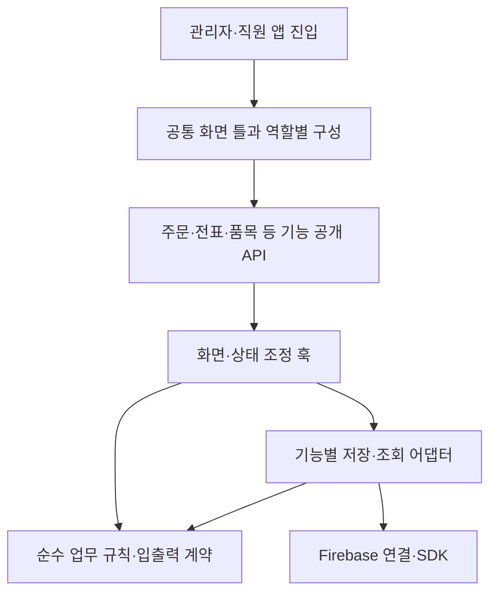

# 앱 전체 코드 모듈화 설계

기준 소스: `9565b05696a52022d3ac4a8f8018f11d7eadfd5c`, 2026-10-17. 사용자 요청에 따라 실제 코드 구조와 import를 조사한 설계다. 최초 산출물은 분리 경계·첫 적용 묶음·검증 계획이다. 이후 사용자 승인으로 첫 구현과 공통 UI 정리를 시작했다. 아래 최초 계획과 후속 적용 결과를 구분하며 앱 전체 모듈화 완료를 뜻하지 않는다. 운영자료는 변경하지 않는다.

## 현재 문제와 유지할 구조

Git 추적 중 `components/src/apps/functions/src`와 루트 타입 facade의 제품 TS/TSX를 집계했다. 시험·`src/test`·스크립트·설정 JS·생성물·의존 패키지를 제외한 기준은 509파일·99,110줄이다. 줄 수는 위험 우선순위의 단서이며 파일 크기만으로 결함을 판정하지 않는다.

| 현재 파일 | 줄 수 | 우선 분리할 책임 |
| --- | ---: | --- |
| `src/features/admin/AdminApp.tsx` | 5,441 | 메뉴/화면 틀과 기능별 업무 조정 |
| `components/HaccpChecklist.tsx` | 4,685 | 점검표 종류별 입력·출력과 저장 조정 |
| `components/OrdersList.tsx` | 4,538 | 목록/카드 표시·검색과 주문 처리 |
| `components/ItemList.tsx` | 4,122 | 재고/로트 표시·입고/실사 조정 |
| `components/TradeStatement.tsx` | 3,124 | 날짜/목록/상세/실패 작업과 작성 조정 |
| `components/ItemManager.tsx` | 2,075 | 품목 편집·거래처 연결·단위 표시 |
| `src/shared/types.ts` | 1,700 | 공통 계약과 기능 소유 타입 |
| `src/shared/services/firebaseService.ts` | 1,103 | 공통 조회와 기능별 저장 명령 |

동일 집합의 상대 import·타입 참조·재수출·문자열 dynamic import를 정적으로 연결한 파일 간 의존은 2,028개다(외부 패키지 제외). AdminApp의 직접 상대 의존151개, TradeStatement86개, firebaseService의 소비 파일40개, 공통 types 소비 파일235개가 확인됐다. 앱에서 서버 원본으로의 참조52개와 역방향0개는 현재 해석된 정적 경로의 수치이며 전체 순환 부재의 증명이 아니다. 계산된 동적 경로와 전체 SCC 순환 분석은 이번에 수행하지 않았다.

- 직원 `StaffApp`도 `AdminApp`을 `isAdmin=false`로 사용한다. 관리자·직원 코드를 복사하면 공통 동작과 수정이 다시 갈라진다. 공용 화면 틀에 역할별 구성을 주입하는 방향으로 분리한다.
- `AdminApp`에는 메뉴·권한별 화면 선택·알림·모달과 주문/전표 처리 조정이 함께 있다. 상태 전체를 큰 Context로 옮겨 파일 길이만 줄이지 않는다. 구독 수명과 회사·사용자 경계를 먼저 드러낸다.
- `firebaseService`에는 조회, 일반 CRUD, 기초잔액, OEM, 입고, 주문 원료 작업의 원자 처리까지 섞여 있다. 읽기와 도메인별 명령을 분리하되 원자 트랜잭션을 여러 호출로 쪼개지 않는다.
- `src/features/statements`에는 이미 `domain/hooks/infrastructure/ui`가 있다. 품목·생산서류·세금서류도 기존 기능 경계를 우선 재사용한다. 새 폴더 체계를 병렬로 하나 더 만들지 않는다.
- `types.ts`와 `src/services/firebaseService.ts`는 기존 경로 호환 재수출이다. 현재 호출자를 한 번에 바꾸지 않고 새 공개 경로를 점진 적용한다.
- 최근 챗봇의 화면·서버 지식 분리 누락처럼 같은 업무 규칙을 서로 다른 원본으로 관리하지 않는다. 단위·원료·금액 산식은 기존 공용 원함수를 그대로 사용한다.

대표 재사용 원본은 `statementLines`의 전표 행/합계, `purchaseUnit`의 단위 스냅샷, `day`의 날짜 정책, `orderProductionRecordPlan`의 생산 근거 계획, `inventoryWriterProtocol`의 원자 writer, `orderInventoryGeneration`의 작업 세대, `tradeStatementPending`와 복구 서비스, `financialOpeningCommands`의 기초 명령이다. 모듈화 중 동일 계산을 새로 구현하지 않는다. 복제 계산을 발견해도 원본 선택과 산식 변경은 별도 검증 작업으로 분리한다. 예를 들어 이름이 같은 stripUndefined도 JSON 왕복 방식과 재귀 제거 방식의 SDK 값 보존 의미가 다를 수 있으므로 이름만으로 통합하지 않는다.

## 목표 의존 방향

| 경계 | 소유 책임 | 금지하는 의존 |
| --- | --- | --- |
| `apps/admin`, `apps/staff` | 시작·인증·회사 선택·provider 조립 | 개별 전표/원료 산식 직접 구현 |
| 공통 화면 틀 | 메뉴·화면 선택·알림·챗봇·역할별 구성 | 기능 내부 저장 로직 직접 구현 |
| 기능 `ui` | 표시·입력·사용자 동작 전달 | 임의 SDK 쓰기, 다른 기능 내부 파일 접근 |
| 기능 `hooks` | 화면 수명·비동기 상태·취소·복구 조정 | 회사/UID 변경 뒤 이전 응답 재사용 |
| 기능 `domain` | 순수 계산·검증·DTO·상태 전이 | React, Firebase, 브라우저 API, 서비스 import |
| 기능 `infrastructure` | SDK/callable·원문 보관·조회·영수증 연결 | 화면 틀·AdminApp·상위 서비스 재수입 |
| `shared` | 실제 공용 기본 부품·순수 규칙·연결 기반 | 특정 기능의 모든 상태나 임의 업무 로직 수용 |

공통 화면 틀은 초기 추출에서는 기존 admin 경로를 유지하고, 역할별 조립과 테스트를 확보한 뒤 `src/features/app-shell`로 이동한다. 신규 기능은 필요한 층만 만든다. 기능 간 호출은 명시한 공개 파일의 컴포넌트·DTO·순수 함수만 사용한다. 모든 내부 파일을 재수출하는 큰 barrel은 만들지 않는다.

## 공개 API와 호환 방식

첫 추출은 함수 인자·반환형·콜백 순서·예외·구독 해지·기존 import 경로를 유지한다. 기존 파일은 새 원본을 명시 재수출하고, 새 원본이 호환 파일을 역수입하지 않도록 한다. 이후 소비자를 기능별 공개 경로로 옮긴 뒤 실제 참조가 없어졌을 때만 호환 파일을 제거한다.

거대한 공통 타입을 한 번에 분할하지 않는다. 새 모듈의 소유 DTO부터 `import type`으로 분리하고, 기존 타입 원본을 유지한 채 타입 순환과 런타임 순환을 구분한다. 함수명 변경·API 개편·오류 의미 변경을 파일 추출과 섞지 않는다.

앱은 ESM, 서버는 CommonJS이며 `functions/tsconfig.json`의 `rootDir=src`, 산출 진입점은 `lib/index.js`다. 서버·브라우저가 공유하는 원본은 현 빌드 경계에 맞게 `functions/src/shared`의 부작용 없는 순수 코드로 유지할 수 있다. 브라우저에서 `firebase-admin`, 서버 entry, Secret·trigger 모듈을 역수입하지 않는다. 공유 패키지나 monorepo 전환은 별도 필요성이 확인되기 전 도입하지 않는다. Node+tsx와 Vite의 모듈 해석 차이도 별도 확인한다.

## 첫 적용 묶음: 작은 추출 3개

세 작업의 고유 변경 파일은 8개(제품6·시험2, 기존3·신규5)다. 기존 시험 파일은 재사용하며 초기 구현 시 담당별 정확 소유를 먼저 등록한다. 업무 값·화면 배치·권한·writer·Functions·Rules는 바꾸지 않는다.

| 작업 | 정확 변경 파일 | 유지할 공개 계약과 검증 |
| --- | --- | --- |
| 사이드바 기본 부품 | `src/features/admin/AdminApp.tsx`, 신규 `src/features/admin/ui/NavigationPrimitives.tsx`, 신규 동일 경로 `.test.tsx` | `NavGroup`, `NavItem`을 원문 추출. props·`nav.*` 저장 키·접힘·hidden·99+ 배지·클릭 순서 유지. 메뉴 목록·역할·외부 동작·헤더/챗봇은 변경하지 않는다. 기존 메뉴 선호 시험과 숨김/접힘/저장 불가/배지 경계 시험으로 확인한다. |
| 전표 날짜 부품 | `components/TradeStatement.tsx`, 신규 `src/features/statements/ui/VoucherDateChip.tsx` | 기존 `VoucherDateChip` named export를 부모에서 호환 재수출한다. `value/onApply`, 명시 적용·취소·저장 중 잠금·실패 초안·최신 value ref를 유지한다. 기존 `components/TradeStatement.test.tsx`의 실제 날짜 회귀를 그대로 실행한다. 전표 발행/번호·저장 복구는 건드리지 않는다. |
| 읽기 서비스 | `src/shared/services/firebaseService.ts`, 신규 `src/shared/services/firestoreReads.ts`, 신규 동일 경로 `.test.ts` | `fetchWhere`, `fetchWhereIn`, `fetchByIds`, `subscribeWhere`를 동일명 재수출한다. 30개 분할·중복 처리·순서·없는 ID·회사 인자 필수/선택·구독 해지·오류 콜백을 유지한다. 기존 fetchByIds/fetchWhereIn 집중·실제 로컬 SDK 회사 경계 시험을 재사용한다. |

읽기 모듈은 SDK·`shared/firebase`·컬렉션/타입만 하향 참조하고 원래 `firebaseService`를 import하지 않는다. 현재 `fetchWhere/subscribeWhere`에는 회사 인자가 없고 `fetchByIds`는 선택, `fetchWhereIn`은 필수다. 이를 추출하면서 일괄 회사 필터를 추가하거나 `subscribeWhere`의 오류 시 `cb([])`를 바꾸지 않는다. 기존 의미를 기록하는 것이 보안 개선 완료를 뜻하지 않으며 정책 개선은 별도 변경으로 다룬다.

## 전체 적용 순서

| 단계 | 분리 대상과 완료 조건 |
| --- | --- |
| 1. 첫 3개 | 위 8파일 추출로 호환 재수출·의존 검사·행동 회귀 패턴을 확립한다. 큰 파일의 전체 분리를 완료했다고 세지 않는다. |
| 2. 화면 틀 | 메뉴의 역할별 구성·화면 registry·알림·모달 host를 각각 추출한다. 관리자/직원·회사·UID·마이페이지 고정·메뉴 선호·단축키·기존 작성창 보존을 통과한 뒤 직원 wrapper의 AdminApp 의존을 공통 화면 틀로 바꾼다. |
| 3. 주문 | `OrdersList`의 표시 모델·날짜/필터 부품→주문 카드→편집/복사주문/원료 복구 조정 훅 순서로 나눈다. 큰 OrderCard를 첫 작업으로 통째 옮기지 않는다. 조회 조건·구독 종료·이력 표시·원문·작업 ID·늦은 응답 차단을 유지한다. |
| 4. 전표·회계 | 기존 statements의 초안/명령/복구/이력 훅을 확장하고 전표 작성·목록·상세·실패 작업을 분리한다. admin 아래 `cashLedger/voucherMerge/financials` 등 공용 회계 책임은 실제 사용처에 따라 statements 또는 finance 경계로 정리한다. 실패·unknown·완료 구분과 영수증/요청 동일성은 그대로 둔다. |
| 5. 재고·입고·OEM | 기존 순수 단위/원가/로트 함수를 재사용하며 조회·화면과 명령 어댑터를 분리한다. 재고·로트·이력·금액을 함께 저장하는 원자 명령, actor/revision/release/receipt 경계를 통째 유지한다. |
| 6. 나머지 기능 | 품목·거래처·생산서류·세금서류·HACCP/위생점검·인사·대화/공지·보고서를 기존 기능 경계에 점진 합류한다. 큰 점검표 파일은 종류별 입력/출력부터 나누고 저장·revision은 하나의 조정 경계로 유지한다. 타입·계산·서비스의 실제 소유를 확정한 뒤 불필요한 호환 경로를 제거한다. |
| 7. 서버 조립 | 순수 규칙·명령·외부 어댑터와 trigger 조립을 분리한다. export명·region·secrets·schedule/timezone·timeout·retry 등 manifest와 Admin SDK 초기화 순서를 기존 배포와 대조한다. import만으로 새 Firestore 호출이 생기면 중단한다. |

단계별 구현은 관련 작업 약 3개를 묶되 의존이 없는 작업만 병렬 배정한다. 한 writer의 복구·원문·영수증 관련 파일을 담당별로 찢지 않는다. 설계 담당은 한 명, 구현과 검수는 별도로 유지한다. 상위 단계를 모두 끝내야만 독립 기능을 시작할 수 있다는 뜻은 아니다.

## 검증과 되돌리기

1. 추출 전 호출자·export·관련 시험·회사/계정/권한·비동기 수명·SDK 부작용을 기록한다. SDK mock만 있는지 실제 로컬 검증이 있는지도 구분한다.
2. 추출 후 기존 경로와 새 경로의 공개 계약을 확인한다. 관련 회귀와 핵심 행동을 깨뜨리는 변이를 실행하고 원문을 복원한다. 새 파일이 facade를 역수입하거나 domain이 SDK/UI를 import하면 실패하도록 경계를 확인한다. 기존 AST 시험은 실제 새 구현 위치를 검사하도록 최소 수정하며 보호 조건을 삭제해 통과시키지 않는다. writer 단계에서는 관련 실제 로컬 SDK의 회사 격리·중복/응답 유실·늦은 actor 검증이 필요하다.
3. 최종 후보에서 앱 타입·양 앱 빌드를 한 번 수행한다. 서버 변경 시 서버 타입/산출물과 실제 manifest를 추가 확인한다. 전체 수천 시험을 작은 추출마다 반복하지 않는다. 공유 기반의 영향이 넓거나 회귀 근거가 부족하면 그때 검증 범위를 넓힌다.
4. UI가 포함된 묶음은 관리자·직원, PC·모바일 폭, 작성/대기/오류/닫기·초점/원문 보존을 에이전트가 직접 확인한다. 실기기는 기존 사용자 지시에 따라 제외 사실을 기록한다.
5. 관련 코드·시험·문서를 한 묶음으로 main에 통합·배포하고 공개 산출물과 서버 상태를 확인한다. 노션은 묶음 마감에 한 번 갱신한다.
6. 회귀가 있으면 해당 추출 묶음만 revert하고 마지막 검증 빌드로 되돌린다. 이번 구조 추출에는 DB 이관이 없으며 실제 전표·재고를 되돌리거나 실패 사본을 임의 삭제하는 복구는 하지 않는다.

완료 기준은 줄 수 감소가 아니라 단일 업무 원본·하향 의존·명확한 공개 API·기존 동작 보존이다. 순환 import 제거 수나 전체 의존 그래프 완전성을 아직 확인하지 않은 상태에서 달성했다고 기록하지 않는다. 최초 설계 문서만 반영할 때에는 앱 빌드나 재배포를 하지 않았다. 후속 제품 변경은 아래 범위에서 따로 검증·배포한다.

## 첫 구현과 날짜 필터·헤더 공통화

사용자가 반복되는 날짜 필터와 헤더도 통일성 있게 모듈화하도록 요청했다. 기존 DateRangeFilter와 PageHeader를 재사용하며 날짜 선택 정책과 페이지 제목 표시 정책은 유지한다. 페이지 헤더와 앱 최상단 헤더를 구분하고, 조회 날짜와 전표 날짜의 명시적 적용도 구분한다. 모든 날짜 선택을 하나의 동작으로 강제하지 않는다.

첫 묶음은 NavGroup/NavItem 원문 추출, VoucherDateChip 원문 추출·기존 named export 호환, 공통 날짜 필터/페이지 헤더와 소비 화면2곳 정리다. 기존 조회 서비스4함수 추출은 다음 묶음으로 옮겼다. 제품·시험 고유 변경12개(제품8·시험4)이며 이 문서와 할일 기록2개를 별도로 관리한다. 현금출납장과 전표 주문 날짜 필터 부모는 줄바꿈·최소 너비·흰 바탕을 정리한다. OrderPicker는 소스를 바꾸지 않고 같은 원본을 사용한다. StatementHistoryFilters의 당년/ALL/이전·다음 기간과 월별 분석 등 다른 정책을 억지로 치환하지 않는다.

공통 조작 높이44px와 간격·날짜 입력 배치를 맞추고 우측 작업 버튼은 좁은 화면에서 줄바꿈한다. PageHeader는 기존처럼 모바일 제목을 숨기고 우측 조작이 없으면 빈 헤더 공간도 만들지 않는다. 메뉴 저장 키·숨김·접힘·배지와 조회 콜백·회사 조건·저장 흐름은 유지한다. 관련8파일136시험과 메뉴 숨김/날짜 저장 경합/수동 quick 해제 보호 변이3개를 통과하고 원문을 복원했다. 고정 날짜 전표 fixture를 현재 당일 필터로 찾던 기존6시험은 원본에서도 실패해 해당 수량 시험에 ALL 조회 선택1줄을 명시했다. 제품 날짜 정책이나 수량 검증을 바꾸지 않았다. 구현자와 별도의 제품12파일 검수도 완료했다.

총괄은 동결 SHA로 고정한 실제 Nav 부품·VoucherDateChip·공통 날짜 필터·PageHeader·StatementOrderDateFilter·CashLedger와 실제 전표 헤더 JSX의 우측 슬롯을 운영 연결 없는 합성 화면에서 검수했다. PC·390·320픽셀의 헤더 숨김/액션 표시·빠른 기간 선택·메뉴 접힘/배지·현금출납장 일반전표 창 열기/닫기를 확인했다. 날짜 수동 입력·전표 적용/취소/저장 경합은 관련 행동 시험으로 확인했으며 합성 화면 확인과 구분한다. 320픽셀에서 기존 전역 date 최소너비140px가 겹침을 만들던 문제를 발견해 이 컴포넌트에만 최소너비 우선순위를 지정하고359이하는 세로로 배치했다. 최종 재검에서320 세로·390 동일행, 입력 높이44px·겹침0·가로 넘침0이었다. 관련2파일5시험 재통과·해당 CSS 독립 검수 후 동결했다. 초기 빌드 도중 이 CSS 보완으로 소스 핀이 달라진 결과는 최종 성공으로 쓰지 않는다. 초기 앱 타입 오류0은 유지하고 최종 CSS 후보에서 양 앱 빌드를 다시 한 번 수행한다. 최종 CSS 보완본 양 빌드는 관리자17.32초·직원15.92초로 성공했다. 기존 FCM 원문 bytes와 소스12파일 SHA가 유지됐으며 관리자76·직원78파일을 생성했다. 배포 결과는 완료 후 기록한다. 구조 추출로 기존 작성 요청·전표·재고·금액·서버·Rules를 변경하지 않는다.
