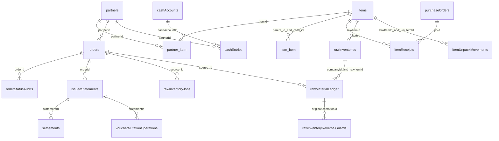
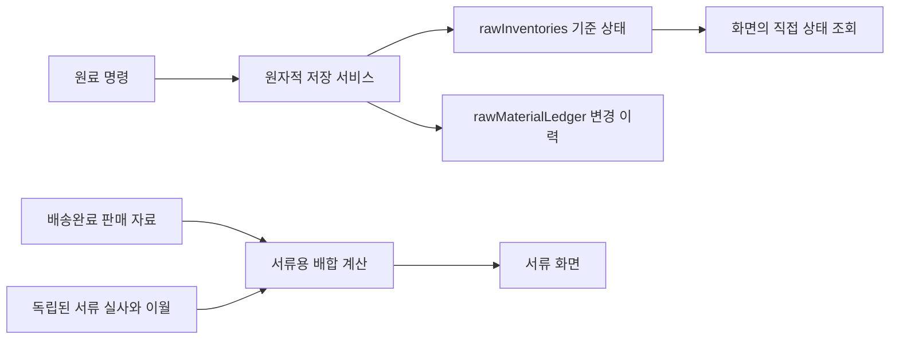

# 태백 ERP 현재 관계와 지향 설계 대조 — 2026-10-12

기준: 기존 통합 저장소 534b67fa 이후 문서 보완. 원료·주문 관계는 제품 변경 955e4ab8을 기준으로 확인했고, 이어 거래처 원장 조회 화면을 보완했다. 이 문서는 **코드에서 확인한 관계**이며 Firestore 전 문서 실측, 외래키 강제, 모든 읽기·쓰기 완전 추적을 주장하지 않는다. registry와 생성기 결과는 field-dictionary.generated.md/json에서 재생성한다.

## 2026-10-10 생산 근거 조회와 수동 0원 원가 후속

기존 주문 로그는 저장 생산 스냅샷의 계산 근거만 조회한다. 전체와 품목별 기록을 합산하거나 현재 배합으로 과거를 재계산하지 않는다. 공용 원가 계산은 유한한 수동0원을 보존한다. 결산 CLI의 단일회사 조건부 Admin 저장은 준비된 도구이며 운영 실행0이다. 공식 사전은 소스430·COL74·선언717·참조614·미해석 속성2036이다. SDK 경로644·미해석 경로327이며 scripts는 생성 범위 밖이다. 배포 경계는 todo-production-evidence-anchor-followup-20261010.md에 별도 기록한다.

## 2026-10-10 명시 원료 kg·고아 재고 경로 후속

IssuedStatementItem.purchaseQuantityKg는 사람이 확인한 신규 전체kg 입력이다. 거래qty/금액과 별도로 immutable 원문에 보존하고 서버는 같은 회사의 kgmirror 홀더와 해당 줄의 원가 분모를 확인한다. 과거 원문을 재해석하지 않는다. adjustItemStock 미사용 본문 제거 뒤 공식 사전은 소스429·COL74·선언717·참조603·미해석 속성2036, SDK644·동적 collection38·미해석 경로327이다. 사전은 코드 관계이며 실제 입고량 실측/DB필드 삭제 근거가 아니다. 배포 경계와 제한은 todo-purchase-kg-zero-cost-followup-20261010.md에 기록한다.
## 2026-10-10 생산 근거·미사용 경로 후속

생산 스냅샷에 optional rawCalculationEvidence가 추가됐다. 실제 생산 계산 입력만 저장하며 원료 취소는 기존 operation trace를 사용한다. 미사용 원료 writer와 입고 fallback 제거 후 공식 사전은 소스429·COL74·선언716·참조602·미해석 속성2023, SDK643·동적 collection39·미해석 경로327·별도 모델690이다. 이는 운영 문서 백필이나 필드 삭제 실측이 아니다. 현재 배포 확인은 todo-production-valuation-followup-20261010.md의 후속 결과와 구분한다.
## 2026-10-09 동결 소스 사전 갱신

정적 사전은 2026-10-10 현재 checkout에서 미사용 statementWrites 계획과 전용 시험을 제거한 뒤 공식 생성기로 재생성했다. tests/spec 제외 분석 소스429·COL74·직접 선언704·참조601·미해석 속성2023, SDK645·registry밖12·wrapper24·동적collection40·미해석경로329·별도모델691이다. 이전 배포8858eb21 사전의 소스430·별도모델694와 구분한다. 직접 선언3개 증가는 RawMaterialEntry.kind/reversalOf와 PurchaseOrder.duplicateReceiptCorrection에 대응하며 이번 미사용 경로 제거는 운영 DB 필드 삭제가 아니다. 생성8529/d4b9f9 self-check exit0, 실제 전표 명령·재시도19회귀 통과를 확인했다. 미해석은 별도 목록이며 DB실측/삭제 근거가 아니다.

이번 세금 선택5 Functions는 각각runtime72/compiled72 byte 일치, 전체34ACTIVE/Node22·나머지29 source 및 trigger 불변이다. 양Hosting27JS·양HTML과 Rules SHA a2b027748890f2a96ca93afc7a9fefb59cefe8a6a4ea8b0f8bebf75eb0ff93a4 일치를 확인했다. 현재022 재인수로 전체21완료22잔여·우선15 11완료4잔여, ERD 전체 미완료다. 이전042/015/LOAN 배포는 당시 기록으로 보존한다. 이후 앱8858eb21은 중복 입고 취소 표시/원복 연결을 반영했고 Hosting 원격33파일·양HTML 일치 확인을 마쳤다. 서버 제품 소스 변경은 없어 선택5 세금 Functions의 기존72runtime/72compiled 배포 증거를 유지한다. 승인된 중복 정정5문서 적용·1700보호 원문/버전 검증은 별도 운영 사실이며, private 실행기·백업은 생성기의 제품소스 범위에 포함하지 않는다. 새 gate·Notion·Figma·push0. 아래 수치·대기 문구는 제목별 과거 시점이다.

| 최신 코드 관계 | 근거와 제한 |
| --- | --- |
| 세금 발행 확인 → taxIssueOperations/taxIssueRecords | taxIssueCommand.ts는 선택 원전표·actor/hash를 확인하고 발행 기록과 taxIssuedAt/exemptIssuedAt·mutationRevision 및 voucherMutationOperations를 같은 TX에 저장한다. 새 금융 전표·외부 신고·번호 counter를 만들지 않는다. |
| 정기 대출 예약 → loanMovementOperations | functions/src/loanMovementCommand.ts의 recordScheduledLoanMovement가 templateId/yearMonth와 고정 scheduledRequest를 감사에 저장한다. 재시도는 저장된 입력·결과를 검증하며 새 계약 revision으로 과거 입력을 바꾸지 않는다. fixedCostTemplates·loanContracts·cashAccounts를 읽는 관계이며 독립 예약 collection을 추측하지 않는다. |
| 반품 접수 → returnSubmissionOperations / returnRequests | submitReturnRequestCommand.ts는 requestId·actorId·requestHash로 accepted/rejected terminal 감사를 보존한다. accepted와 접수 원문·submissionReceipt는 같은 TX에서 생성되며 처리 후 replay는 최초 receipt를 확인하고 최신 처리 상태를 덮지 않는다. |
| 금융 기초 → financialOpeningOperations | financialOpeningCommand.ts의 kind와 원문 hash·actor·결과를 보존하며 cashAccounts·loanContracts·거래처 기초 전표 저장을 해당 명령 TX에 합성한다. account-create는 현금 계좌 생성이다. |
| 회사 기초 계정표 → accountCodes | firebaseService.ts의 createOpeningAccountCodeWithDb는 adminOnly Rules 아래 Web TX로 동일 내용은 unchanged, 없는 계정만 생성한다. 금융 operation receipt가 아닌 회사 계정 metadata이며 기존 계정 덮어쓰기와 331 등록을 허용하지 않는다. |
| 생산 소비 추적 → 원 로트 복원 근거 | 주문 내 productConsumedLots의 optional lotSnapshot은 차감 전 원 로트 metadata다. orderProductLots.ts는 제거된 원 로트만 잔량0으로 재구성한 뒤 이번 소비 수량을 더한다. snapshot의 과거 잔량 전체를 복사하지 않고, snapshot 없는 구형 trace의 원 로트를 추정하지 않는다. 원료 lotChanges.lotSnapshot과 제품 소비 추적은 서로 다른 저장 구조다. |
| 원료 원복/입고 취소 표시 | RawMaterialEntry.kind/reversalOf는 원료 원장 분류·원 operation 참조이며, PurchaseOrder.duplicateReceiptCorrection은 정정 operation/원입고/commandHash/originalHash/proofHash/kg/reason/cancelledAt 증명이다. 새 collection이 아니고 기존 원료 원장·원입고 guard와 PO 표식을 읽어 취소 완료를 구분한다.1511.061kg 기준은 상태를 로트 잔량에 맞춘 전산 보정이며 실측 근거는 미확인이다. |

## 2026-10-08 이전 분석 기준과 당시 경로

이전 정적 사전은 소스 동결 commit c4a54ea9의 2026-10-08 05:26:55 UTC 소스를 분석했다. 공지 작성 모델·이미지 처리와 BOM 오탐 수정이 포함된 앱 소스이며 최종 타입40434·양앱빌드83389는 통과했다. Hosting 배포72231 및 원격16037 exit0, 실제25assets·양site HTML entry 모두 일치했다. GitHub는 사용자 보류로 푸시0이다. 생성 소스400·COL70·공용 직접 선언692·참조 있는 필드598·미해석 속성1321, SDK 경로568·registry 밖12·명명 동적 wrapper24·경로 미해석 위치300·별도 모델616다. 미해석 수는 정적 해석의 한계이며 오류 수 또는 운영 DB 필드 수가 아니다. Functions 시험 포함 소스와 최근 선택 배포 runtime54개를 구분하며 이번 앱 변경으로 Functions 재배포를 주장하지 않는다.

| 현재 관계/계산 | 코드 근거와 경계 |
| --- | --- |
| 원료 상태·원장·품목 미러 | functions/src/shared/rawInventoryCore.ts의 applyRawCommand와 rawInventoryPrepare.ts의 prepareRawCommand를 앱 서비스와 서버가 소비한다. rawLot·formula·stockUnitMeasure도 순수 본체를 공유한다. 각 실제 transaction writer가 최종 회사/원본 검증과 저장을 수행한다. |
| 반품 후 원전표 삭제 | returnApplications의 실제 배분과 보호된 returnOperations/journal proof를 returnClaimReader 및 shared/returnClaimProjection.ts가 읽는다. 살아있는 source는 해당 배분만 차감하고 존재하지 않는 source의 배분부분만 독립 음수 credit으로 남긴다. 재고/반품분개는 삭제와 함께 임의 취소하지 않는다. |
| 앱의 반품 연결 존재 증명 | useAppData 원문 returnOperations는 재고 이동에 유지한다. 별도 useReturnAllocationSources의 sourcePresence/returnAllocationOperations는 회사·UID·현재 source 재조회 및 refreshToken으로 금융 조회만 보완한다. 미로드/미확정은 잔액 추정 없이 확인 중으로 표시하며 이 파생 값은 DB 원문 필드가 아니다. |
| 생산 전용 재고 만들기 | 주문 purpose stock-production은 기존 생산/로트·취소 경로를 사용하되 판매 전표 발행에서 제외한다. 일반 판매 주문과 예약·출고 계약을 혼동하지 않는다. |
| OEM 입고·취소 | 기존 PO 회사/원본 상태를 읽고 품목별 로트 및 원료 복원 transaction 경계를 사용한다. 목록은 oemSent를 일반 items 누락과 구분한다. 품목 옵션 규격 표시 완료와 가공비의 로트 원가 반영 여부는 별도다. |
| 계좌 월말 확정 기준 | CashAccount.confirmedBalances는 실제 입출금 cashEntry와 구분하는 조회 기준이다. openingBalance 정정과 날짜별 기준을 각각 보존하며 번호·수익비용 전표를 추정해 만들지 않는다. |

운영 증거는 릴리즈별 선택 범위다. batch6 d2d8dc60은 선택16함수의 runtime53/compiled13 일치와 옛 mutate callable 삭제, batch7 d21eb7d0은 선택3함수 runtime54/compiled6 일치, 새 재고3ab3b758은 issueTradeStatementCommand1개 runtime54/compiled6, OEM76c855ca는 receiveOemFinishedGoodsCommand1개 runtime54/compiled7 일치를 확인했다. d2876860은 앱 품목 규격 표시1파일이다. 소스 사전 재생성이 모든 Functions 최신 재배포 또는 전체 운영 문서 존재를 뜻하지 않는다.

Figma 다른 보드 정리는 사용자 '일단냅둬'로 보류한다. Notion 의미 중복의 실제 편집은 기존 자동 거절 제한으로 수행하지 않는다. 현재/지향·사전 갱신의 부분 근거만 추가하며 전체 ERD 원본 완료로 확대하지 않는다. 최신 원본 인수 판정은 우선15개 중11완료·4보류이며 전체43개 중20완료·23잔여다.

## 이전 생성 시점·배포 경계 기록

2026-10-07 후속 기준: 관리자·직원 Hosting과 GitHub main의 `4b574cdd`에는 생산 수량·로트·주문 근거의 원자 저장과 취소 복원 보완이 반영됐다. 생성 사전은 병행 중인 타입 정리가 끝난 뒤 최신 `src/shared/types.ts` 선언과 참조 위치로 통합 재생성한다. 제거한 `Item.itemType`, `Item.partnerId`, `Item.partnerBoxConfigs`, `Item.용량`, `Item.wipStock`, `Item.finishedStock` 및 고립된 박스 설정 타입은 선언 목록에서 제외한다. 운영 DB 필드 삭제나 데이터 이관을 뜻하지 않는다.

서버 기준은 별도로 대조해야 한다. 처음 확인한 51파일 차이 상태는 후속 통합으로 바뀌었다. 현재 `functions/src`는 10월 6일 보존한 거래처 지급 배포본 53개 소스를 기준으로 기존 수정 함수와 export를 보존하고 자동전표 변경을 합친 코드다. 배포 전 읽은 daily/loan ZIP은 각각48개 소스이며 실행 경로의 공유 차이는 releaseGate/voucherIssue였다. 원본 파일 수에는 시험이 포함된다. 이번 생성 시 실제 `functions/src`의 TS56개 중 시험 제외30개를 분석했고 배포 전 ZIP48개 중 시험 제외27개와 구분한다. 후속 commit71d768f6의 선택 dailyAutoVoucher 배포는 완료됐고 총괄 검증에서 새 ZIP generation1791374813509146의56개 소스가 로컬56개와 모두 일치했다. 변경한 Function은 daily 하나뿐이며 loan 등 다른 Functions가 이 통합 소스로 배포됐다는 뜻은 아니다. 대출 안전 거절 후보와 금융 cutover도 별도다. 근거 `docs/todo15-batch2-validation-20261007.md`와 배포 전 `outputs/todo15-current-functions-20261007` ZIP. 이 사전만 근거로 Functions 전체를 배포하지 않는다.

## 사전 생성 당시의 배포 경계와 후속 배포

이번 코드 사전은 생성 당시 `3e2f4ca4` 배포 commit을 기반으로 **당시 checkout의 미배포 TODO022 금융 후보도 포함**하여 생성했다. 배포된 소스만의 사전이나 현재 운영 Functions 전체의 사전이 아니다. 총괄은 세 번째 023/036/039 정확17파일만 양앱 Hosting21171·실제 SHA 검증·GitHub main push 완료로 확인했다. 해당 범위는 수동 snapshot의 저장 cost 평가, 회사 이력·동일 ID 거래처, 안전한 4필드 정리다. 기존 원본 전체 완료로 확대하지 않는다.

사전 생성 당시 checkout의 AdminApp 공용 현금 callback, LoanManager/HRManager의 명령 연결, loanMovementCommand 안전 거절, payrollVoucher와 Rules 회사 gate 보호는 별도 미배포 금융 후보였다. 서비스·관계·필드가 사전에 나와도 실제 배포 또는 양사 cutover 활성화를 뜻하지 않는다. 그 시점에는 양사 급여 firstYearMonth가 사용자 입력 대기였고 대출·급여 운영 gate 쓰기도 없었다. 배포 때 보관한 후보를 총괄이 byte 복원한 사실과 이번 정적 분석 범위를 구분한다.

2026-10-07 13:06 생성 당시 최종 재생성은 COL69·직접 선언705·분석 소스366·참조 필드611·미해석 속성826, SDK 경로462·동적 경로254·별도 모델566을 기록했다. Functions 현재 TS57개 중 시험 제외30개를 포함한다. 앞의56개는71d768f6 당시 소스/ZIP 증거이며 생성 당시 추가된 미배포 대출 시험과 구분한다. 생성73397 exit0와 후속 self-check/check-only85631 exit0에서 같은 최종 집계를 확인했고 diff check도 통과했다. 미해석 항목은 남아 있으며 런타임 관계를 확정한 것으로 해석하지 않는다.

사전 재생성은 product source 변경이 아니다. 현재 관계 설명의 서버 원자 저장은 해당 구현 계약을 뜻하며, 미배포 후보의 실제 운영 호출 가능 여부는 배포된 Function 버전과 gate 상태를 별도 확인해야 한다. Figma·Notion 쓰기와 운영 데이터 이관은 하지 않았다.

### 2026-10-07 후속 금융 배포·활성화 확인

총괄은 `9c7872f7` 정확30파일 후보의 Hosting·Rules 배포62261과 `recordLoanMovementCommand`·`issuePayrollVoucherCommand` 두 Function 선택 배포35417을 모두 exit0로 확인했다. 두 운영 source ZIP은 각각57소스/로컬57소스 차이0이며 실제 변경 Function은 정확히2개다. Rules SHA `6d9c1937...`와 Hosting 파일 SHA도 일치했다. 다른 Functions 전체 배포나 코드 사전의 미해석 관계 전체 확인으로 확대하지 않는다.

사용자 원문 '둘 다 2026년 10월부터'와 '양사 모두 활성화'에 따라 양사의 대출·급여 cutover 문서4개를 각각1문서만 적용했다. 급여 firstYearMonth는 양사2026-10이며 금융 문서·카운터 쓰기0이다. 독립 검증 `work/todo022-cutover-independent-verification.json`의4개 확인은 모두true, 기존 금융·감사 문서 버전도 동일했다. 실제 급여 지급·대출 거래 테스트를 운영에 가짜로 발행한 결과가 아니다. 이번 사전의 생성 시각과 이 후속 활성화 시각을 구분한다. 해당 commit의 GitHub push 결과는 총괄 후속 확인 대상으로, 이 문단에서 먼저 완료 처리하지 않는다.

## 현재 관계 — 코드에서 확인

관계선은 문서 ID 참조·내장 배열·조회 조건을 나타낸다. Firestore가 SQL 외래키나 필수 cardinality를 강제한다는 뜻은 아니다. 저장된 옛 문서에는 선택값과 누락값이 있을 수 있다.

| 연결/값 | 현재 의미와 근거 |
| --- | --- |
| companyId | 회사 범위. 조회·쓰기 경계와 서버 claim 검사가 별개로 존재. 코드상 구형 기본값 처리도 있어 모든 DB 문서에 필수 저장됐다고 판단하지 않는다. src/shared/companyWriteBoundary.ts, src/shared/services/firebaseService.ts |
| partner_item | itemId/partnerId와 Direction in/out, 단가·과세·배송지 선택. 판매 연결은 여기서 조인한다. items.partnerIds 자동판매연결은 복구하지 않는다. src/shared/types.ts:108, src/features/admin/AdminApp.tsx:636 |
| orders.items/itemInventory/inventorySnapshots | 주문 품목·줄별 생산 적용 상태·생산/출고 원복 근거가 주문 안에 저장된다. 별도 collection으로 그리지 않는다. src/shared/types.ts:233, src/features/admin/orderStockEngine.ts:638 |
| item_bom | parent_id/child_id는 items ID, quantity는 구성 수량. src/shared/types.ts:1409 |
| item_formula | parent_key/child_name은 이름 기반 키, ratio/yield_rate. items ID 외래키라고 그리지 않는다. src/shared/types.ts:1400 |
| item_pack | PackRow 별도 모델과 정적 fetch 존재. shared/types 직접 인터페이스 사전에 없는 모델. src/shared/hooks/useAppData.ts:351, src/shared/packIndex.ts:26 |
| rawInventories | 회사·rawItemId별 상태, stockKg/activeLots/recentDepletedLots/revision/stocktakeAnchor. shared/types.ts가 아닌 rawInventoryCore.ts:49 선언. |
| rawMaterialLedger | 새 operationId/commandHash/sequence/lotChanges와 구형 date/material/received/used 등 호환 칸을 같은 collection에 저장. 별도 새 원장 collection으로 오인하지 않는다. src/shared/services/rawInventoryService.ts:52 |
| 구형 작업 문서 ID | 동일 operation의 새 operationDocId와 legacyOperationDocId를 모두 조회해 중복 적용을 막는다. 두 조회가 두 번의 차감을 뜻하지 않는다. src/shared/services/rawInventoryService.ts:162 |
| 원료 상태·원장·items 미러 | 적용 transaction에서 상태와 이력을 쓰고, mirrorToItem 기본 true일 때 items.stock/lots도 갱신한다. ledger 전용 명령 등은 예외. 코어의 ‘복제하지 않는다’ 주석은 현재 쓰기와 다르다. src/shared/services/rawInventoryService.ts:204, 278–285 |
| rawInventoryJobs | 여러 원료 명령의 완료 상태와 expectedOperationIds를 추적. 주문 전체 상태와 동치가 아니며 부분 실패 판단 때 개별 원장과 함께 대조. src/shared/rawInventoryCore.ts:160, src/shared/services/rawInventoryJob.ts |
| 완제품 stock/lots/예약 | items 안의 로트·inventoryReservations, 주문의 출고 snapshot/소진 추적 및 orderStatusAudits를 함께 사용한다. ‘숫자 stock만 있다’는 docOil 상단 주석은 현재 orderProductLots/orderItemStock 구현을 포괄하지 못한다. |

## 현재 생산·수량 로트·취소 관계

- 생산 계획은 회사 입력으로 기존 재고 사용량과 실제 생산량을 구분한다. kg 원료 사용은 원료별 공용 명령으로 처리하고, 수량 관리 구성품은 실제 구성 수량과 FIFO 로트를 함께 차감한다. 생산 로트 생성·증감과 소비 로트 근거는 `orderProductLots.ts`에서 계산한다.
- `orderItemStock.ts`의 `applyItemStockDeltas`는 최신 품목을 transaction에서 읽고 숫자 재고·로트·예약을 검증한다. 품목별 작업완료 경로의 `orderMutation`은 재고 업데이트와 주문 줄의 `itemInventory`/생산 스냅샷을 같은 transaction에 저장한다. 모든 화면의 임의 품목 수정이나 주문 업무 전체가 항상 이 transaction에 포함된다는 뜻은 아니다.
- 주문 내부 `inventorySnapshots.production` 및 `itemInventory`의 생산 근거에는 `stockDeltas`, `productProducedLots`, `productConsumedLots`, `rawConsumedLots`, `rawLedgerIds` 등이 남는다. 별도 생산 스냅샷 collection으로 그리지 않는다. `productionRecords`는 별도 생산 이력이고, 금액 마감용 `inventorySnapshots` collection과도 구분한다.
- 생산 취소는 실제 생산·소비 스냅샷의 수량 델타와 원래 로트를 복원한다. 현재 BOM이나 새 FIFO 분배를 과거 소비 근거 대신 적용하지 않는다. `SHIPPED → DISPATCHED` 전환은 `prepareOrderInventoryCancellation`/`executeOrderInventoryCancellation`의 기존 출고 취소 명령을 사용한다.
- 로트/수량 검증이 쓰기 전에 실패하고 `inventoryUnchanged`가 확인된 경우에만 작업 잠금을 null로 해제한다. 부분 반영 가능성이 있으면 실패 잠금을 남긴다. 원료별 transaction, 여러 원료 진행표, 후속 수량 저장의 경계는 서로 다르며 전체 업무의 단일 transaction을 보장하지 않는다.

근거: `src/features/admin/orderStockEngine.ts`, `orderItemStock.ts`, `orderProductLots.ts`, `orderInventoryCancellation.ts`. 사용자 승인 운영 복구는 별도 감사·백업 근거이며 이 구조 문서나 Hosting 배포가 기존 운영 자료를 자동 정정한 것으로 표현하지 않는다.

## 실제 배합과 서류 배합 — 현재 연결 구분

- 실제 원료 차감: src/features/admin/bom.ts buildFormula는 item_formula를 우선하고 없으면 PRODUCT_FORMULA를 사용한다. phantom 하위 반제품만 재귀 전개하며, 비 phantom 홀더는 종단으로 취급한다. 순환/깊이 제한은 빈 결과로 끊는다.
- 원가: 같은 파일 formulaRowsOf는 ratio와 yieldRate를 분리한다. 차감 계산의 ratio×yield_rate를 원가와 같다고 설명하지 않는다.
- 서류 판매·원료 배분: src/shared/docOil.ts addOilByRaw/mixLabel은 PRODUCT_FORMULA를 사용한다. 실제 원료 자동차감과 같은 날짜·수량이라고 가정하지 않는다.
- **현재 화면 연결 차이**: docOil.ts는 rawDocEntries 별도 서류 실사/이월 모델과 buildRawDocMonth를 정의하지만, 현재 AdminApp.tsx:4007 이후 buildRawDocSheet는 mergedRawMaterialLedger를 읽고 재고 실사 ID를 필터한다. 전월이월도 해당 화면 계산을 사용한다. 조사한 src/components/functions에서 rawDocEntries Firestore 호출·현재 화면의 buildRawDocMonth 연결을 확인하지 못했다. 따라서 rawDocEntries를 ‘운영에서 별도 저장 중’으로 그리지 않는다. 모델/순수 계산 존재와 실제 연결을 구분한다.

## registry 밖 경로 — 현재 소스 근거

자동 inventory는 SDK collection/doc 참조와 동적 표현식의 출처를 기록한다. 동적 wrapper의 실제 값과 문서 내부 필드를 모두 해석하지 못하므로 보완 범위를 따로 남긴다.

| 경로 | 소스에서 확인한 용도 | 주의 |
| --- | --- | --- |
| appMeta/releaseCutover | 활성 release 검사 | 회사 업무문서와 같은 일반 회사 컬렉션으로 단정하지 않는다. |
| appMeta/partnerPaymentState_* | 거래처 결제 상태 조회 | 동적 문서 ID. src/features/statements/infrastructure/issueTradeStatementCommand.ts:89 |
| appMeta/workOrderReset_* | 작업지시 초기화 회사별 잠금 | 동적 문서 ID. AdminApp.tsx:959 |
| itemUnpackMovements | 박스→낱개 개봉 중복 방지/출처 | items 두 문서와 같은 transaction. boxUnpackService.ts:22 |
| voucherMutationOperations | 서버 전표 수정 idempotency 영수증 | Functions에 실제 참조·쓰기 있음. Hosting 배포만으로 서버 배포 상태를 보증하지 않는다. editIssuedStatementCommand.ts:38 |
| authLoginAttempts | 로그인 실패 횟수/차단 시각/만료 | 서버 전용 보안 경로. employeeLogin.ts:32 |
| rawDocEntries | 모델/설계 주석·순수 계산에 등장 | 조사 범위에서 DB 접근 호출 확인 못함. 위 서류 연결 차이 참조. |

거래처 원장 조회 보완: components/PartnerLedger.tsx는 회사로 제한한 전표·자금 자료를 buildJournals로 해석해 전체 이력과 계정 필터·계정별 기초/당기/기말을 함께 표시한다. 108/251/253/133/254 잔액을 합치지 않으며, 비용전표 대체의 133/254 거래처 태그 누락은 원본 거래처로 읽기 중에만 보완한다. 분개 실패는 경고 이력으로 남기고 잔액에서 제외한다. 독립 수동분개 저장본의 UI 전달 경로는 없으며, helper의 수동분개 시험을 해당 저장본 조회 완료로 주장하지 않는다.

## 지향 관계 — 미구현/검토 제안

아래는 이번 작업으로 바뀐 운영 상태가 아니다. 승인·자료 대조 없이 이관 또는 삭제하지 않는다.

1. 원료 화면이 rawInventories 기준 상태를 직접 읽도록 전환한 뒤 items 미러 제거 가능성을 검증한다. 지금 mirror를 꺼서는 안 된다. 소진 로트 복원은 recentDepletedLots 꼬리가 아닌 이력 lotSnapshot 근거를 유지한다.
2. 서류용 실사/이월 모델과 실제 화면을 일치시킬지 결정한다. 현재 rawMaterialLedger 필터·이월 방식과 rawDocEntries 모델을 혼합해 ‘완료’ 처리하지 않는다.
3. registry 밖 저장 경로를 명시적 관리표 또는 COL에 포함할지 검토한다. 이번에는 이름/보안 규칙/저장 경로를 변경하지 않는다.
4. 이름 기반 item_formula를 ID 기반으로 바꾸려면 이름 동치·구형 fallback·원가/실제차감/서류차감 차이를 먼저 대조한다. 제안만으로 과거 배합을 이관하지 않는다.

## 2026-10-07 생산 작업일지·전표 유형 연결 — 당시 코드 기준

생산 작업일지는 `productionWorkDocuments/{id}` 헤더와 `productionWorkDocumentLines/{id}` 행을 분리한다. 행의 companyId/documentId/documentRevision은 부모 회사·ID·revision에 연결한다. `productionWorkDocumentService`는 회사·기록자·원본 revision을 확인하고 헤더 revision 증가 및 이전/새 행 교체를 transaction으로 처리한다. 이전 행 목록을 회사+documentId로 읽은 뒤 transaction에서 부모/행을 다시 검사하고 Rules도 부모 revision 증가를 요구한다. 이 관계는 생산 문서의 저장 계약이며 실제 재고 차감·법정 수율 확정을 뜻하지 않는다. AdminApp의 ProductionWorkDocumentHost 호출로 현재 UI에 연결돼 있다. 장문 인쇄 검수와 실제 Auth SDK 근거는 두 번째 묶음 검증 문서에 있으며 배포 완료 여부는 별도다.

016 전표 템플릿의 명시 유형 입력은 저장된 설정과 자동전표 draft/command에 전달된다. 71d768f6의 양앱/Rules 및 선택daily 배포·운영SHA 검증·GitHub push가 완료됐다. 생산 문서 저장 연결도 같은 묶음에 포함되며 퇴직금은 구조 설계 문서 범위다. 선택daily 배포만으로 대출·급여·수동 상계 명령이나 모든 Functions를 운영 활성화한 것으로 간주하지 않는다.

2026-10-07 검증 당시 COL 밖 정적 경로13개는 appMeta, authLoginAttempts, companyTransferGrants, companyTransferOperations, itemUnpackMovements, loanMovementOperations, manualSettlementBatchOperations, manualSettlementOperations, oemReceiptOperations, partnerPaymentOperations, returnApplications, returnOperations, voucherMutationOperations다. 인증 시도·감사 operation·권한 문서와 업무 원장을 같은 종류로 표시하지 않는다. 경로의 소스 존재는 운영 문서 실존이나 callable export/활성화 증거가 아니다.

## 필드 사전 범위와 남은 검수

- 이전 사전은 2026-10-07 12:09:37 UTC에 재생성했다. 아래 수치는 당시 검증 이력이며 현재 집계는 문서 앞의 2026-10-08 기준을 따른다. COL69·shared/types.ts 직접709필드·시험 제외 소스361개·참조 해석 필드612개·미해석 속성812개·SDK 경로458개·동적 경로252개·별도 모델563/직접2971필드다. 앞선716/329/609/371 수치를 현재 사실로 사용하지 않는다. 미해석 증가에는 통합 서버 소스의 별도 모델 접근이 포함되며 신규 DB 누락 건수로 간주하지 않는다. 정적 property access 수는 DB read/write 건수가 아니며 사용처0도 삭제 근거가 아니다.
- 생성기는 미해석 속성의 위치·표현식·receiver 타입과 any/unknown/선언 미해석 이유를 별도 목록으로 남긴다. 이는 DB 필드 목록이 아니며 실제 모델·UI/런타임 접근인지 조사할 근거다.
- 동적 문서 ID와 동적 컬렉션은 구분한다. 당시 동적252개 중 알려진 컬렉션의 동적 문서 경로216개, 동적 컬렉션36개다. 당시 명명 wrapper25개와 실제 연결된 소비자 위치를 별도로 기록한다. 동적 ID가 slash를 포함할 가능성은 남으므로 경로 깊이를 추정으로 확정하지 않는다.
- `dynamicWrappers`는 SDK를 포함한 명명 함수와 TypeScript가 실제 선언으로 연결한 소비자 위치·인수식을 기록한다. `firebaseService`의 collectionName wrapper, `pendingFlowQuantityService`의 입고/반품 조건 분기, `deleteIssuedStatementService`의 orders/purchaseOrders/settlements 목록, `applyTaxIssueWrites`의 StatementWrite DTO 등은 실제 원문 계약과 함께 대조한다. 익명 고차 함수·객체 DTO·동적 분기 및 240자를 넘는 인수식은 전체 실행값을 해석한 것으로 주장하지 않는다.
- 보완 사전의 별도 모델은 입력 DTO·계산 결과·UI 상태도 포함할 수 있다. 모두 DB 필드라고 표시하지 않는다. 중첩 타입·교차/유니언 타입·상속·any·동적 인덱스·객체 전개·구형 저장 문서는 완전 해석 대상이 아니다.
- scripts/로컬전용/운영 데이터·Firestore rules/Storage/Auth/FCM은 생성기 운영 TS/TSX 분석 범위와 다르다. 보안 rules상 허용 경로가 실제 사용/문서 존재 증거는 아니다.
- 사용자 지정 기존 Figma 전체 시스템 보드 `iHDrVvkALbp16Zkx0TOMY2`는 현재 원료 경로·생산/취소·미구현 목표로 갱신했다. 기존 노드 삭제0이며 나머지 두 보드의 URL/삭제 대상은 미확인이다. 원료 상세와 목표 영역은 스크린샷을 확인했고 새 생산 영역의 시각 검증은 도구 호출 한도로 미완료다. 변경 ID와 검증 한계는 `work/figjam-system-update-evidence-20261007.json`에 보존한다.
- 노션 관리키 중복0과 의미 중복 전수 통합은 별개다. 대표 업무·다른 인수조건·보존할 근거를 읽기 대조표로 준비한 뒤 승인된 범위만 통합한다. 기존 자동 거절된 Notion 쓰기는 재시도하거나 다른 도구로 우회하지 않으며, 원본 반영은 pending으로 구분한다.
- Notion 원본은 미완료/본부장 판단/완료 이력 뷰가 이미 분리돼 있고 관리키 중복은 0건으로 재조회됐다. 의미 중복 검토는 별도이며 DB 또는 전체 TODO 완료를 선언하지 않는다.
- 계정 500/505→501/502 및 상품매입451 기존 데이터 이관은 사용자 보류를 유지한다.

## 2026-10-08 TODO023 원본 인수 판정

총괄은 원본3e82cda7782b8143abc8c73e9c36b563과 독립 대조한 결과 날짜·전표번호·저장재고평가·BOM원가·자동전표 공용 순수 계산의 인수 충족을 확정했다. 새 기능이나 반복 시험으로 완료 건수를 만든 것이 아니라 기존 부분 구현·검증·배포 근거를 누적해 원본 조건과 대조한 판정이다. 전체 원본15개 완료는8/15이며 Notion 상태 쓰기는 하지 않았다.

실제 소비자는 day/shared calculation, voucherStamp와voucherIssue/shared voucherNumber, appautoVoucher와serverautoVoucherDraft/shared recurringVoucher, lineAmount와tradeStatementIssue/shared purchaseCost, ProfitAnalysis와index/shared inventoryValuation이다. BOM buildCostFn은 앱 단일본체이며 현재 서버 실제 소비가 없으므로 새 서버 소비자를 인수조건으로 만들지 않는다. 앱 invalid-date 번호 fallback과 매입원가의 기존 fallback 선택 차이는 명시 보존한 예외이며 모든 입력에서 앱/서버 결과가 같다고 주장하지 않는다. 과거 스냅샷 재계산·OEM가공원가 새 연결·전체 화면E2E는 이번 원본 판정 범위가 아니다. 근거 private work/todo023-acceptance-current-20261008.md와 실제 import/호출 독립 대조.

사용자 최신 GitHub 푸시 보류를 준수한다. 현재 문서·미배포 후보를 원격 반영 완료로 표현하지 않으며 배포 검증은 계속한다.

### 2026-10-10 원료 kg·입고 상세·구형 price 후속
신규 원료 벌크 매입은 kg 기준이 미확인일 때 품목 원가 갱신만 생략하며 거래 수량·금액·거래처 단가는 유지한다. 입고·반품의 일반 전표 상세는 기존 전표 모달을 재사용하고 읽기 전용 행·합계·인쇄는 저장 원문을 사용한다. kgml 보정은 표시 함수이며 전표 원문을 이관하지 않는다. 공통 모달 초점 유지와 조건부 구형 price=0 필드 정리 도구를 추가했지만 새 컬렉션·새 활성화 설정은 없으며 정리 도구의 운영 실행은 하지 않았다.

## 2026-10-10 동적 래퍼 컬렉션 해석 후속 — 배포 확정 소스 기준

소스4cc21755의 생성기는 실제 SDK 컬렉션 인수에 쓰인 함수 선언 파라미터만 실제 호출 인수로 대입해 literal/COL로 확인된 첫 컬렉션을 resolvedPaths에 기록한다. 다른 인수(회사 등)를 컬렉션으로 승격하지 않고 런타임 문자열·동적 문서 ID·조건 분기는 미해석으로 유지한다. self-check/변이 검출은 제한된 정적 해석 검증이며 운영 DB 전체 경로와 writer 완료를 뜻하지 않는다. 사전35350 exit0은 COL74/필드717/소스430/참조614/미해석2038이다. caller-SDK520은 해석 결과 수이며 컬렉션520개가 아니다.

Node22 집중5파일30PASS80077·타입19408·양앱91644 exit0, 양Hosting84430·원격29782 exit0으로 HTML2+JS115+CSS2 총119 SHA 일치를 확인했다. 새 Functions/Rules 배포는0이다. 전체 시험85077은 exit1로 종료했다. 파일459 중12실패·446통과·1skip, 시험3876 중24실패·3842통과·10skip(1297.41초)이며 전체 PASS가 아니다. PartnerLedger 기본환경5FAIL은 jsdom pragma 보완 후 기본config30PASS86586 exit0으로 해결했고, 새 accountCodeWiring 공통상수 후속은 기존 실패와 구분한다. 상세 근거는 docs/notice-partner-erd-followup-20261010.md에 보존한다. Figma 보드 정리·Notion 의미 통합은 보류/쓰기0, 원본ERD whole완료 추가0·전체21완료22잔여·우선15 중11완료4잔여를 유지한다.

## 2026-10-11 컬렉션 등록·구형 경로 후속 — 배포 전 소스 고정

source93376edb 정확36파일은 로컬 커밋으로 고정됐으며 GitHub push0이다. 실제11개 컬렉션 등록과 미등록 경로 감지 guard를 반영한 사전57496 exit0은 collections85/fields717/source429/refs614/unresolved2037/caller-SDK520이다. 마지막520은 컬렉션 수가 아니다. 회사 fallback·계정상수·원장 setters 명칭·대출 얇은 re-export 정리는039 국소 후속이며015는 기존 loanAutoReady 정책의 Manager 안내다. 새 Functions runtime 변경0, Hosting74768·원격56475 exit0이다.

최종 타입93073→57efa0 및 diff0226a1 exit0은 확인됐다. 전체51233은 CLI spawn30초 timeout과 두 파일 thread termination으로 중단 exit1(0ac6c2), 최종 시험 총계는 없다. 실패3파일 복구82016은 정확3파일23PASS exit0이며 기존195와 고유218시험·별도Node6 근거를 확인했다. 전체 중단 실행은 성공으로 세지 않는다. 통합 후 양앱56303·Hosting74768 exit0이며 기대값·제한시간·제품 소스 변경0이다. 집중 성공 근거를 전체 PASS로 확대하지 않는다. 사용자가 수정 마무리·브랜치 통합·배포·푸시를 명시 승인했으며 최종 소스 푸시13220 exit0을 확인했다. Figma/Notion/운영자료/gate 쓰기0, 원본 전체21완료22잔여를 유지한다. 상세는 docs/legacy-company-collection-loan-followup-20261010.md.

### 2026-10-11 이관·브랜치 검토 후속(최종 검증 대기)
이전용 세션·MEMORY·기록·설정은 별도 폴더 이관6파일 범위다. 브랜치 검토에서 필요한 코드가 이미 반영돼 새 merge0이며 관련6파일93PASS는 기존 시험과 겹쳐 합산하지 않는다. 배합(formula) 운영 변경은 별도 보류다. 최종 타입67257 exit0·통합 소스e6e5e49a 정확6파일67추가/10삭제 로컬 커밋, 최종 양앱56303·Hosting74768 exit0, 원격56475·실제push13220 exit0이다. 승인과 별도로 실제 빌드·Hosting·원격·푸시 성공 근거를 확인했다.

### 통합 후 빌드·Hosting 확정
양앱56303 exit0: 관리자3284/직원3286 module과 PWA 둘 다 완료했다. Hosting74768 exit0으로 양 사이트 release complete(admin71/staff72파일)를 확인했다. 원격56475 exit0에서 HTML2+JS115+CSS2 총119 SHA가 일치했다. 실제 소스 push13220 exit0, github/main은 d2876860→e6e5e49ad0dfdc0ffe24c8f4b002b6a058b551be이며 ls-remote와 HEAD가 일치했다. 결과 문서3개 커밋·푸시는 총괄 후속이다. 업로드 파일 수를 원격 SHA 대조 파일 수로 대신하지 않는다.

## 2026-10-11 저장 생산 계산·원료 일일 대조 후속

`auditSavedRawCalculation`은 저장된 rawCalculationEvidence와 같은 회사·주문·품목 줄·attempt·원료·문서에 연결된 생산 trace 및 원장의 reportedDeltaKg만 비교한다. appliedDeltaKg=0을 원래 사용량 0으로 해석하지 않는다. 현재 BOM으로 과거 계산을 보충하지 않으며, 취소된 생산 기록은 당시 기록으로 표시한다. 동일 operation이어도 계산·trace·원장 ID 원문이 다르면 정상 미러로 제외하지 않는다. 품목 생산을 모은 전체 스냅샷에는 계산 근거가 없는 기존 저장 방식이 있어 미기록 안내가 함께 나올 수 있다.

`rawInventoryAxes`의 기존 원료 네 축 계산을 관리자 감사와 일일 보고서가 공유한다. rawInventoryReport는 원료 상태·활성 로트·품목 저장 kg·실제 원장을 같은 행에 표시한다. L 표시 품목도 이미 저장된 kg를 다시 환산하지 않는다. 빠진 값은 미확인으로 표시하며 실측 증빙을 추정하지 않는다. CLI는 `npm run audit:daily -- --raw-input 입력.json --output 결과.json`으로 인증·DB 초기화 없이 전체 원료 파일을 대조한다. 입력은 companyId, snapshotDate, complete:true, rawInventories/items/rawMaterialLedger 전체 배열이 필요하며 기존 결과 파일을 덮어쓰지 않는다. 기존 제품 `--input` 분기를 유지한다.

새 컬렉션·활성화 설정·운영 자료 수정은 없다. 009의 과거 주문 출처 확인과 011의 전수 실측 기준, ERD의 Figma 보류 및 동적 경로 후속은 남아 있으므로 원본 TODO 완료 수를 늘리지 않는다.

## 2026-10-11 매입 단위와 해석된 모델 필드

매입 단위는 품목 배열이 아닌 item_purchase_unit 별도 컬렉션으로 관리한다. 매입 전표·발주 줄은 purchaseUnitId/purchaseUnit/purchaseQty/unitKg/inventoryQty 다섯 필드를 함께 저장하며 sourceLineIndex로 같은 품목의 다른 단위 줄을 구분한다. 과거 원가용 purchaseQuantityKg는 입고 확정 kg로 전환하지 않는다. 현재 표를 수정해도 이미 저장된 거래의 환산값은 바뀌지 않는다.

필드 사전은 기존 직접 선언 통계와 별도로 TypeScript가 해석한 모델 필드를 제공한다. 상속, Partial, intersection의 필드·선택 여부·원본 선언 위치를 표시한다. union/any는 임의의 데이터베이스 구조로 펼치지 않는다. 자체 검증과 독립 fixture 3개를 통과했으며 새 컬렉션 이외의 운영 자료나 Figma 보류 범위를 변경하지 않았다.

2026-10-11 OEM 신규 원가 근거: PurchaseOrder의 oemCostEvidence·oemCostEvidenceSource·oemBatchCost는 발주 또는 최초 입고 원문과 receiptOperation provenance를 고정한다. 실제 fee 전표 공급액으로 확정하고 해당 RawMaterialLot.oemBatchCost로 배분한다. 가공비 수정·삭제 시 blocked/previousConfirmed로 보존하며 로트 금액 표시만 해제한다. 과거 원가 자동 역산은 하지 않는다.

## 2026-10-11 원자 취소 잠금 복구 후속 · 배포 전

| 문서 | 연결 기준 | 저장 책임 |
| --- | --- | --- |
| orders.inventoryOperation | 회사·주문·실패 작업번호·실패 시작 시각 | 기존 취소 claim/실패 기록 및 관리자 복구 |
| orderStatusAudits | 취소 작업번호의 완료 영수증 | 원자 취소 transaction |
| orderLockRecoveryOperations | 회사·주문·작업번호·실패 시작 시각으로 정한 복구 ID | 관리자 서버 command만 생성 |

복구는 원자 취소 실패의 현재 주문 근거와 완료 영수증 부재를 같은 transaction에서 대조한다. 실패 시작 시각은 결정 작업번호가 재사용되는 새 실패를 이전 승인과 구분한다. 복구 영수증은 미반영 판정과 당시 실패 원문을 남기며 재고/로트/원료를 추가 반영하지 않는다. 기존 완료표가 있거나 일반 과거 상태 작업의 저장 근거가 부족하면 차단한다. 서버 감사 컬렉션 규칙으로 클라이언트 쓰기를 거절하고 새 활성화 설정은 만들지 않는다.

공용 컬렉션 등록과 실제 소스 필드 사전을 갱신한다. 정적 모델 해석이 과거 운영 문서의 전수 검증을 의미하지 않으며 Figma 정리는 사용자 보류대로 유지한다. 이번 후보는 배포 전이며 원본 ERD 전체 완료로 추가 계수하지 않는다.

위 후속은 source d388dd0으로 실제 배포·푸시를 완료했다. 선택복구함수 ACTIVE/nodejs22·양Hosting117SHA일치, 최종일반4056PASS/5skip·집중103PASS·SDK8PASS·타입/양빌드0. 운영/Figma/신규gate쓰기0이며 ERD전체완료추가0.

복구영수증 보호 추가: sourceee37463에서 serverAuditCollection 등록으로 포괄 client writer를 차단했다. Rules단독배포0·실제Rules4PASS/보호제거변이4FAIL·원복20PASS(SDK16포함). 운영자료쓰기0.

## 2026-10-12 반품 승인 원문·결과 재개 후속 배포

이전 fa484cf는 최초 UI 승인 원문과 비교하는 입력이 없었으며, 현재 소스06795ef는 그 경계를 보완했다. 새 shared business evidence/optional expectedBusinessHash와 local pending v2는 구현되었고 실제 서버 TX 28건·service/pure 17건을 검증했다. v1은 원명령 그대로 보존하고 결과 재개와 회사·UID·actor 확인을 보강한다. 서버 분개·수불 계획과 운영 gate는 유지한다. 반품함수2825·양Hosting56764 exit0 및 원격117SHA 일치로 배포를 확인했다. 실제 관계와 제한은 [반품 처리 근거 후속](return-processing-evidence-followup-20261012.md)에 정리한다.

## 2026-10-12 OEM 모달 응답 세대 후속 · 구현 중

기준09408ee의 저장 원입고 중량 대조는 source 구현·검증·GitHub 통합을 완료했으며 해당 화면 배포 확인은 별도로 대기한다. 다음 OEM UI의 모달 세대 보호는 records/todo-next-oem-lifecycle에서 구현 중이다. 모달 메모리 세대·회사·모드·배치가 다른 응답은 새 모달 닫기와 busy 변경에 사용하지 않는다. 이 UI 경계는 서버의 실제 회사·UID·operation 및 원문 증명을 대신하지 않는다.

| 경계 | 현재 역할과 구분 |
|---|---|
| OemManager 메모리 세대 | 해당 모달의 비동기 결과·후행 close/busy 처리만 제어한다. DB operation ID가 아니다. |
| sessionStorage OEM 발주·입고 pending | 최초 요청의 재개 근거이며 회사별 key로 읽는다. 다른 원문으로 바뀐 pending을 이전 응답으로 삭제하지 않는다. 실제 적용 증명은 서버 결과와 원문 계약에서 확인한다. |
| purchaseOrders OEM 원문 | 회사·송출·저장 입고 구성과 가공비/원가 연결을 보존한다. UI가 모달 닫기 보호를 이유로 금액·재고를 재계산하지 않는다. |
| 원자 입고·가공비 operation | 기존 서버 명령의 최신 문서·회사·요청 증명을 유지한다. UI 생명주기 수정에 새 컬렉션을 추가하지 않는다. |

현재 boxSize는 공용 환산 근거가 아니다. 현재 환산은 BOM·item_pack의 unitsPerBoxOf를 사용하며 옛 fix-boxsize-restore CLI의 고정값 부활/무조건 삭제 경로를 종료하는 후속을 구현했다. 기존 DB-CHANGELOG 역사와 백업·실제 포장 관계는 보존한다. 최종 검증·배포 여부는 [OEM 모달 세대 후속](oem-modal-generation-followup-20261012.md)에 별도로 기록한다.

## 2026-10-12 OEM 저장 원가 요약 후속 · 구현 중

6d61ca8의 모달 세대 후속은 일반4204PASS·타입양빌드 exit0·GitHub main 통합을 확인했고 Hosting 화면 확인은 대기한다. 다음 조회 판독은 PO·원가 근거·저장 preview/finalize 결과를 기존 공용 계산으로 대조하여 불일치한 원가 숫자의 확정 표시를 막는다. 실제 가공비 전표나 원입고 영수증을 새로 조회한 인증 증명과 구분한다. 양수 PO 수량과 저장 kg의 동시 변경은 PO-only 판독만으로 검출할 수 없다.

현재 포장 관계는 BOM·item_pack이며 옛 fix-pack-table의 고정값 이관과 전체 문서 복원/기존 pack 무조건 삭제 undo는 현재 관계의 수정 경로가 아니다. 해당 CLI를 안내로 종료하고 실제 포장 관계·백업·역사를 보존한다. 새로운 DB 관계·컬렉션·활성화 설정은 없다. 구현과 검증 결과는 [OEM 저장 원가 요약 근거 후속](oem-cost-summary-evidence-followup-20261012.md)에서 구분한다.

## 2026-10-12 품목 중복 가격 저장 경로 후속 · 구현 중

품목 원가 모델은 Item.cost이며 거래처·주문·전표의 price는 거래 단가다. 일반 품목 생성·수정·병합·배치 서비스에서 items의 옛 최상위 price를 payload에서 제외하는 경계를 구현한다. 다른 컬렉션의 거래 단가나 cost0·원가 부재는 변경하지 않는다. 생략은 이미 저장된 운영 필드의 삭제가 아니므로 데이터 이관과 구형 클라이언트/직접 SDK 통제는 별도다.

현재 수불·입고·OEM·반품 transaction은 필요한 stock/lots/cost patch를 저장하며 전체 품목 원문을 복원하지 않는다. 옛 fix-spec-loose-bulk의 전체 품목 규격 교정과 무조건 복원은 현재 규격 편집 경로가 아니므로 안내로 종료한다. 현재 BOM·item_pack·과거 백업과 기록은 보존한다. 새 관계·컬렉션·운영 쓰기는 없다. 검증과 제한은 [품목 중복 가격 저장 경로 후속](item-price-write-boundary-followup-20261012.md)에 기록한다.

## 2026-10-12 외주 송출 근거와 생산일지 후속 · 구현 중

6a1455c의 품목 가격 저장 경계와 옛 규격 CLI 종료는 일반4310PASS·타입/양빌드 exit0·GitHub main 일치를 확인했다. 다음 외주 현황은 기존 PO 배열과 rawInventoryJobs/rawMaterialLedger/rawInventoryReversalGuards의 결정적 작업 근거를 연결하는 읽기 전용 화면이다. 회사·요청 지문·출처·원료·업무 송출량을 대조하며 외주창고의 물리 실측·소유 잔량 모델로 확대하지 않는다. 기존 pending/failed 배치의 예정 전량을 실제 송출로 합산하지 않는다.

생산일지 문서 헤더/행 저장 모델은 유지한다. 날짜 전환에 현재 Editor의 dirty/busy 세대를 연결해 미저장 수동 내용 유실을 보완한다. 직원의 다른 회사 문서나 다른 사용자의 초안을 노출하지 않으며 저장 revision·생산/원료 계산은 바꾸지 않는다. 새 컬렉션·Rules·운영 재고 쓰기는 없다. 원양식 및 하남댁 실제 제출 자료 인수는 별도 미확인이다. [외주 송출·생산일지 후속](oem-warehouse-production-followup-20261012.md)에 실제 검증과 제한을 기록한다.
